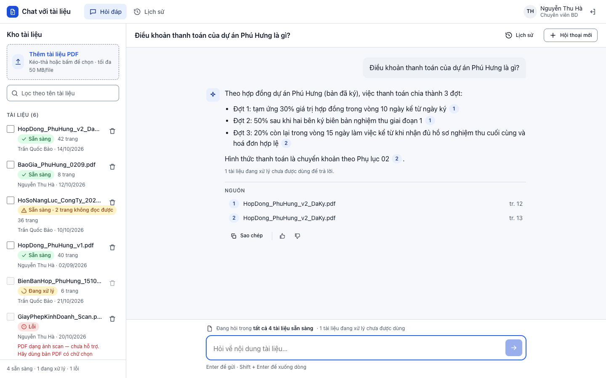
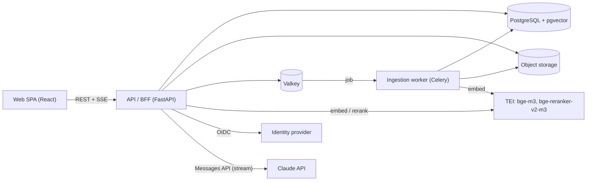
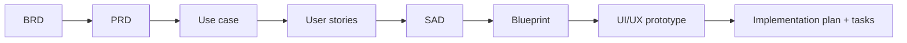

# sdlc-ai — "Chat với tài liệu" (CWD)

Dự án áp dụng AI vào toàn bộ vòng đời phát triển phần mềm (SDLC) để xây dựng MVP **"Chat với tài liệu"**: một ứng dụng web nội bộ giúp đội Phát triển kinh doanh (BD) hỏi đáp trên kho tài liệu PDF của dự án.

Mỗi giai đoạn SDLC gồm ba phần:

1. **Prompt** theo chuẩn IEEE, dùng để sinh tài liệu bằng AI.
2. **Tài liệu đầu ra** (BRD, PRD, SAD, Blueprint…), sinh từ prompt và tài liệu của giai đoạn trước.
3. **Checklist** (`.xlsx`) để review tài liệu đầu ra theo chuẩn tương ứng.

> **Trạng thái:** đã xong giai đoạn yêu cầu, thiết kế và lập kế hoạch triển khai (tất cả ở bản *Draft*). Repo chưa có mã nguồn; việc code bắt đầu từ Sprint 0 (26/10/2026) theo [kế hoạch triển khai](docs/implementation/IMPLEMENTATION_PLAN.md).

---

## Sản phẩm

**Vấn đề.** Thông tin dự án nằm rải rác trong nhiều file PDF. Mỗi lần cần một thông tin, nhân viên BD phải tự mở từng file, tìm và tổng hợp, rất tốn thời gian.

**Giải pháp.** Người dùng đưa PDF vào một kho tài liệu chung rồi đặt câu hỏi bằng tiếng Việt hoặc tiếng Anh. Hệ thống:

- chỉ trả lời từ nội dung có trong tài liệu, không tự thêm kiến thức bên ngoài;
- ghi trích dẫn **tên file + số trang** cho từng ý; bấm vào trích dẫn để mở đúng trang gốc;
- nói rõ **"không tìm thấy"** khi tài liệu không có thông tin;
- tổng hợp câu trả lời từ nhiều tài liệu, cho phép giới hạn phạm vi tài liệu và hỏi tiếp theo ngữ cảnh.

Ngoài ra còn có: đăng nhập bằng tài khoản công ty (OIDC), quản lý kho (tải lên, trạng thái xử lý, gỡ tài liệu, nhật ký), lịch sử hội thoại riêng tư, đánh giá câu trả lời và thống kê sử dụng theo tuần.

Backlog MVP gồm **22 user story + 8 enabler** (5 epic). Chi tiết ở [USER_STORIES.md](docs/requirements/USER_STORIES.md).



## Kiến trúc dự kiến

Modular monolith theo kiến trúc Clean/Hexagonal, có worker bất đồng bộ và pipeline RAG (chi tiết ở [SAD.md](docs/requirements/SAD.md)).



| Lớp | Công nghệ |
|---|---|
| Frontend | React 18, TypeScript, Vite, TanStack Query, Zustand, Radix UI, pdfjs-dist |
| Backend | Python 3.12, FastAPI, SQLAlchemy 2, Alembic, Celery 5, pypdfium2, Authlib, `anthropic` SDK |
| Dữ liệu & mô hình | PostgreSQL 16 + pgvector, Valkey 8, Text Embeddings Inference (embedding và rerank chạy nội bộ) |
| LLM | Claude (`claude-opus-5-5`), gọi qua adapter để có thể đổi nhà cung cấp (ADR-005) |
| Hạ tầng | Docker Compose, Nginx, OpenTelemetry, Grafana stack |

Truy xuất dùng tìm kiếm lai: vector kết hợp toàn văn (gộp bằng RRF), sau đó rerank. Chỉ các đoạn trích liên quan được gửi tới LLM, không gửi toàn bộ tài liệu.

## Cấu trúc repository

```text
docs/
├── requirements/                 # Giai đoạn yêu cầu (IEEE 29148, IEEE 1016)
│   ├── BRD_Elicitation_Prompt_IEEE_standard.md
│   ├── BRD_Prompt_IEEE_standard.md
│   ├── BRD.md                    # Tài liệu yêu cầu nghiệp vụ
│   ├── BRD_IEEE_29148_Checklist.xlsx
│   ├── PRD_Prompt_IEEE_standard.md
│   ├── PRD.md                    # Tài liệu yêu cầu sản phẩm
│   ├── useCase_prompt.md
│   ├── use_case_diagram.drawio   # Sơ đồ use case UML (mở bằng draw.io)
│   ├── USER_STORIES.md           # 22 user story + enabler, AC dạng Given/When/Then
│   ├── SAD_Prompt_IEEE_standard.md
│   ├── SAD.md                    # Thiết kế kiến trúc phần mềm + ADR
│   └── SAD_IEEE_1016_Checklist.xlsx
├── design/                       # Giai đoạn thiết kế (IEEE 1016)
│   ├── bluePrint_design_prompt.md
│   ├── Blueprint_Design.md       # Thiết kế chi tiết: persona, trạng thái UI, design token
│   ├── BluePrint_Design_IEEE_1016_2009_Checklist.xlsx
│   ├── UI-UX-Design_prompt.md
│   ├── UI_UX_Design_IEEE-1016-2009_Checklist.xlsx
│   └── UI_UX_design/             # Prototype HTML tĩnh + ảnh chụp màn hình theo user story
└── implementation/               # Giai đoạn lập kế hoạch triển khai
    ├── IMPLEMENTATION_PLAN.md    # 8 sprint + hardening, mốc, đường găng, rủi ro
    └── tasks/                    # 64 task chi tiết (T00-01 … T07-06) + OPEN_QUESTIONS.md
```

## Luồng tài liệu

Mỗi tài liệu lấy tài liệu của bước trước làm đầu vào, và các ID (`BR-`, `US-`, `UC-`, `NFR-`, `ADR-`, `OQ-`…) được giữ nguyên xuyên suốt để truy vết.



| Bước | Prompt | Đầu ra | Checklist |
|---|---|---|---|
| Thu thập & viết BRD | [BRD_Elicitation_Prompt](docs/requirements/BRD_Elicitation_Prompt_IEEE_standard.md), [BRD_Prompt](docs/requirements/BRD_Prompt_IEEE_standard.md) | [BRD.md](docs/requirements/BRD.md) | IEEE 29148 |
| PRD | [PRD_Prompt](docs/requirements/PRD_Prompt_IEEE_standard.md) | [PRD.md](docs/requirements/PRD.md) | — |
| Use case | [useCase_prompt](docs/requirements/useCase_prompt.md) | [use_case_diagram.drawio](docs/requirements/use_case_diagram.drawio) | — |
| User stories | — | [USER_STORIES.md](docs/requirements/USER_STORIES.md) | — |
| Kiến trúc | [SAD_Prompt](docs/requirements/SAD_Prompt_IEEE_standard.md) | [SAD.md](docs/requirements/SAD.md) | IEEE 1016 |
| Thiết kế chi tiết | [bluePrint_design_prompt](docs/design/bluePrint_design_prompt.md) | [Blueprint_Design.md](docs/design/Blueprint_Design.md) | IEEE 1016-2009 |
| UI/UX | [UI-UX-Design_prompt](docs/design/UI-UX-Design_prompt.md) | [UI_UX_design/](docs/design/UI_UX_design/) | IEEE 1016-2009 |
| Kế hoạch triển khai | — | [IMPLEMENTATION_PLAN.md](docs/implementation/IMPLEMENTATION_PLAN.md), [tasks/](docs/implementation/tasks/README.md) | — |

Các prompt được viết dạng template (`[SYSTEM NAME]`, `[Insert …]`), nên có thể dùng lại cho dự án khác.

## Xem prototype UI

Prototype là HTML/CSS/JS tĩnh, dùng dữ liệu giả trong [mock-data.js](docs/design/UI_UX_design/assets/mock-data.js):

```bash
cd docs/design/UI_UX_design
python3 -m http.server 8000
# mở http://localhost:8000
```

Gồm các màn hình: đăng nhập, workspace hỏi đáp, lịch sử, nhật ký tài liệu, thống kê và design system. Ảnh chụp theo từng user story nằm trong [screenshots/](docs/design/UI_UX_design/screenshots/).

## Lộ trình

| Mốc | Ngày | Nội dung |
|---|---|---|
| M1 | 06/11/2026 | Spike đo độ trễ LLM xong, staging chạy |
| M2 | 04/12/2026 | Walking skeleton: đăng nhập → tải PDF → hỏi → trả lời có trích dẫn |
| M3 | 18/12/2026 | Golden set ≥ 100 câu, lần đầu đạt mục tiêu chất lượng |
| M4 | 29/01/2027 | Đủ tính năng (feature complete) |
| M5 | 19/02/2027 | Gate review |
| Pilot | 22/02 → 19/03/2027 | Chạy thử 4 tuần với đội BD |

Mục tiêu chất lượng (đề xuất, chờ sponsor chốt): ≥ 85% câu trả lời đúng và trích dẫn đúng; ≥ 90% câu không có đáp án trả về "không tìm thấy"; ký tự đầu tiên p90 ≤ 3 giây, câu trả lời hoàn chỉnh p90 ≤ 15 giây.

## Câu hỏi mở quan trọng

Một số quyết định đang chặn hoặc ảnh hưởng tới thiết kế, ví dụ:

- **OQ-005:** Bảo mật thông tin có cho phép gửi đoạn trích tài liệu tới dịch vụ AI bên ngoài không? Nếu không, adapter LLM sẽ được đổi sang mô hình chạy nội bộ.
- **OQ-010, OQ-011:** chốt target chất lượng, ngân sách và mốc thời gian.

Danh sách đầy đủ ở [BRD.md](docs/requirements/BRD.md) và [tasks/OPEN_QUESTIONS.md](docs/implementation/tasks/OPEN_QUESTIONS.md).
