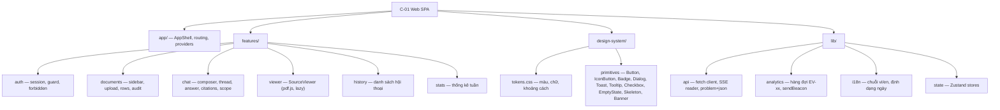
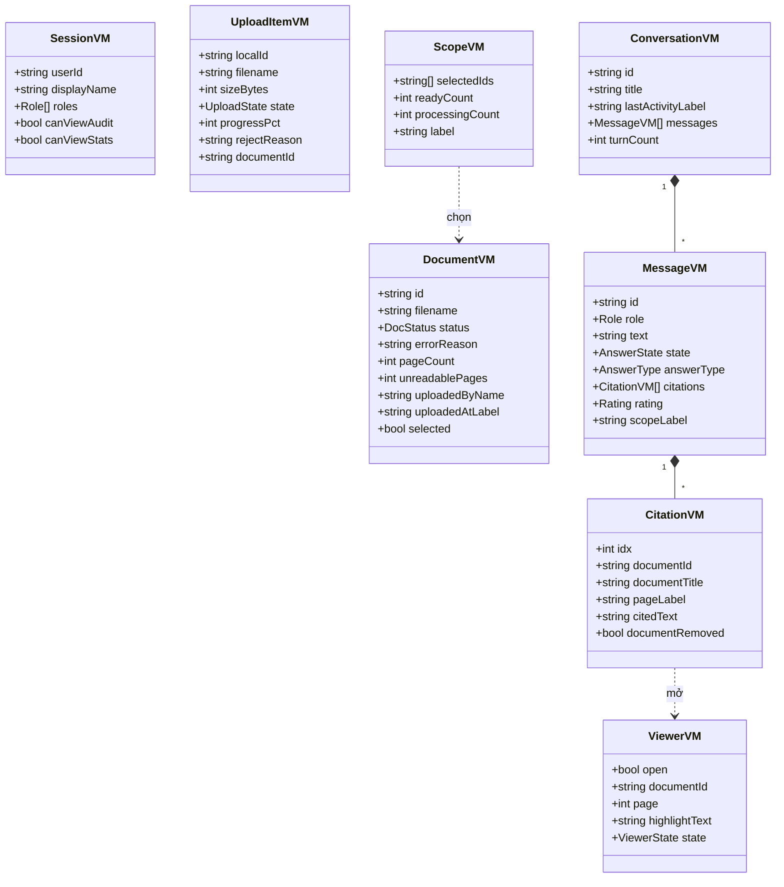
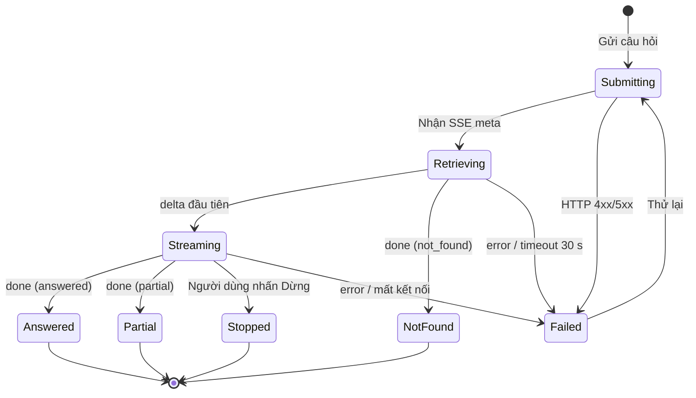
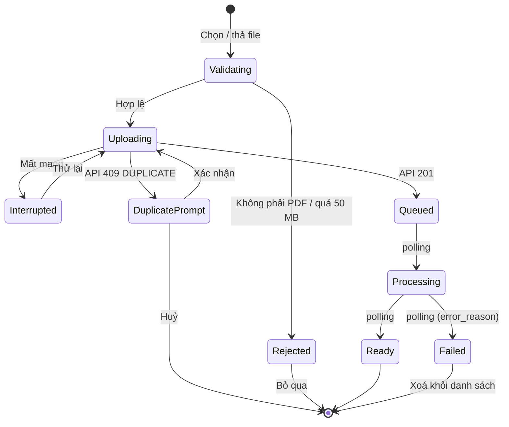

# Software Blueprint Design (SDD) — "Chat với tài liệu" (MVP)

> **Chuẩn áp dụng:** IEEE 1016-2009 (Software Design Descriptions)
> **Đầu vào:** [BRD](../requirements/BRD.md) v0.2 · [PRD](../requirements/PRD.md) v0.1 · [SAD](../requirements/SAD.md) v0.1 · [User Stories](../requirements/USER_STORIES.md) v0.1 · [Use case](../requirements/use_case_diagram.drawio)
> **Đầu ra kế tiếp:** UI/UX design ([UI_UX_design/](UI_UX_design/index.html)), SRS chi tiết, test plan
> **Quan hệ với SAD:** SAD mô tả kiến trúc (thành phần, hạ tầng, ADR). Blueprint này đi sâu vào **thiết kế chi tiết và lớp UI/UX**: persona, kịch bản chất lượng, mô hình trạng thái UI, interface component, design token. Phần backend chỉ tóm tắt và dẫn chiếu SAD để tránh trùng lặp.

---

## 1. Context & Subject

### 1.1 System Identification

| Attribute | Value |
|-----------|-------|
| **System Name** | Chat với tài liệu (CWD) — MVP |
| **SDD Version** | v0.1 |
| **Document Date** | 2026-10-21 |
| **Document Owner** | Lead Architect + Lead UX Designer |
| **Revision History** | v0.1 · 2026-10-21 · Lead Architect / Lead UX · Bản nháp đầu tiên từ BRD v0.2, PRD v0.1, SAD v0.1, User Stories v0.1 |

**Mô tả hệ thống.** CWD là ứng dụng web nội bộ cho đội Phát triển kinh doanh (BD). Người dùng đưa các file PDF của dự án vào một kho tài liệu chung và đặt câu hỏi bằng ngôn ngữ tự nhiên (tiếng Việt, tiếng Anh). Hệ thống:
1. tìm các đoạn liên quan trong kho bằng truy xuất lai (vector + toàn văn) và xếp hạng lại;
2. gửi các đoạn đó cho mô hình Claude (`claude-opus-5-5`) để tạo câu trả lời **chỉ từ nội dung tài liệu**;
3. hiển thị câu trả lời dạng streaming, **mỗi ý có trích dẫn tên file + số trang**, bấm vào để mở đúng trang gốc;
4. trả lời "không tìm thấy" khi tài liệu không có thông tin.

Ngoài ra có quản lý kho (tải lên, trạng thái, gỡ, nhật ký), lịch sử hội thoại riêng tư, đánh giá câu trả lời và thống kê sử dụng cho quản lý.

### 1.2 System Scope and External Boundaries

| Boundary Type | Description |
|---------------|-------------|
| **System Purpose** | Giảm thời gian đội BD tìm và tổng hợp thông tin từ nhiều PDF (BO-001), với câu trả lời kiểm chứng được (BO-002), vận hành an toàn với tài liệu kinh doanh (BO-004) |
| **External Systems** | (1) IdP của tổ chức qua OIDC (chờ OQ-016); (2) Claude API của Anthropic — Messages API, streaming, citations (chờ OQ-005, OQ-029); (3) Object storage S3 của IT; (4) Hạ tầng giám sát và kho backup của IT |
| **User Types** | Chuyên viên BD (PER-01), Trưởng nhóm BD (PER-02), Quản lý (PER-03); gián tiếp: Quản trị/vận hành IT, Bảo mật thông tin |
| **External Interfaces** | REST/JSON + SSE qua HTTPS (SPA ↔ API); OIDC (API ↔ IdP); HTTPS Messages API (API ↔ Claude); S3 API; HTTP nội bộ tới model server (TEI); SQL (PostgreSQL); OTLP (telemetry). Chi tiết: SAD §10 |
| **Trust Boundaries** | TB-1 Internet ↔ mạng nội bộ (chỉ egress tới Claude qua proxy allowlist); TB-2 trình duyệt ↔ Nginx (TLS, cookie phiên); TB-3 vùng ứng dụng (VLAN app) ↔ vùng dữ liệu (VLAN data); TB-4 hệ thống ↔ nhà cung cấp AI (chỉ ≤ 8 đoạn trích + câu hỏi + lịch sử đi qua); TB-5 nội dung PDF tải lên là **dữ liệu không tin cậy** (prompt injection, file độc hại) |
| **Deployment Environment** | On-premise hoặc private cloud của tổ chức (chờ OQ-034): 3–4 VM, Docker Compose, một site; trình duyệt Chrome/Edge (2 phiên bản mới nhất) trên desktop ≥ 1280px, dùng được ở ≥ 768px |

### 1.3 Assumptions and Constraints

| Type | Description |
|------|-------------|
| **Technical Constraints** | Ứng dụng web (CON-001); chỉ PDF có lớp văn bản (CON-002); trả lời qua AI chat (CON-004); không dùng CDN công cộng cho asset (TC-04); không ghi nội dung vào analytics (TC-10); stack đề xuất: React 18 + TypeScript SPA, FastAPI, PostgreSQL 16 + pgvector, Valkey, TEI (SAD §4) |
| **Business Constraints** | MVP, ngân sách và mốc thời gian chưa xác định (CON-003, OQ-011); tuân thủ chính sách bảo mật và NDA (CON-005); có thể có dữ liệu cá nhân (CON-006) |
| **Environmental Assumptions** | Mạng nội bộ ≥ 100 Mbps, độ trễ trình duyệt ↔ máy chủ < 30 ms; egress tới Claude API độ trễ < 300 ms; IT cung cấp DNS, TLS, backup; người dùng có trình duyệt hiện đại (ASM-006) |
| **Data Assumptions** | ≤ 500 tài liệu trong pilot, mỗi file ≤ 50 MB, ≤ 500 trang (OQ-004); ~9.000 câu hỏi/tháng; ngôn ngữ tài liệu: tiếng Việt và tiếng Anh (ASM-002); lưu giữ hội thoại 180 ngày, analytics 13 tháng (đề xuất, OQ-013) |

---

## 2. Stakeholders & Concerns

### 2.1 Stakeholder Identification

| Stakeholder | Role/Title | Primary Interest |
|-------------|------------|------------------|
| Chuyên viên BD (PER-01) | Người dùng cuối chính | Tìm câu trả lời đúng nhanh, kiểm chứng được nguồn, dễ dùng |
| Trưởng nhóm BD (PER-02) | Người dùng, phụ trách kho tài liệu | Kho đúng và đủ, truy vết thao tác, ít bước khi nạp hồ sơ |
| Quản lý / Executive sponsor (PER-03) | Người ra quyết định đầu tư | Số liệu sử dụng và mức hài lòng; chi phí |
| Product owner | Business | Đúng phạm vi MVP, đo được KR, ra pilot đúng hạn |
| Đội phát triển | Engineering | Dễ bảo trì, dễ test, ranh giới module rõ, thay được nhà cung cấp LLM |
| QA / SME | Chất lượng | Tiêu chí nghiệm thu kiểm chứng được, golden set, test tự động |
| Vận hành IT / SRE | Platform | Triển khai lặp lại được, giám sát, backup, khôi phục |
| Bảo mật thông tin / Pháp chế | Compliance | Bảo vệ dữ liệu, kiểm soát truy cập, nhật ký, dữ liệu gửi ra ngoài, giấy phép |
| UX/UI Designer | Thiết kế | Nhất quán, accessibility, trạng thái lỗi/rỗng đầy đủ |

**Persona chi tiết** (từ PRD §3.1; các chi tiết hành vi `[Unverified]` cho tới khi phỏng vấn — OQ-017)

| Persona | Role | Goals | Pain Points | Tech Proficiency | Usage Frequency | Key Tasks |
|---------|------|-------|-------------|------------------|-----------------|-----------|
| **PER-01** Chuyên viên BD | Chuẩn bị đề xuất, trả lời khách hàng, chuẩn bị họp | Có câu trả lời đúng trong vài giây; dẫn được nguồn | Mở nhiều PDF, Ctrl+F không ra khi diễn đạt khác; tự tổng hợp; nghi ngờ AI | Trung bình — dùng thành thạo Office, trình duyệt; mức quen AI đa dạng | Hằng ngày, 10–30 câu hỏi/ngày, cao điểm trước cuộc họp | Hỏi, đọc trích dẫn, mở trang gốc, hỏi tiếp, sao chép câu trả lời |
| **PER-02** Trưởng nhóm BD | Phụ trách tài liệu dự án, hướng dẫn nhóm | Kho luôn đúng và mới; biết ai làm gì | Nhiều phiên bản tài liệu gây câu trả lời mâu thuẫn; file lỗi không biết vì sao | Trung bình–khá | Hằng tuần nạp/dọn kho; hằng ngày hỏi như PER-01 | Tải bộ hồ sơ, xử lý file lỗi, gỡ bản cũ, xem nhật ký |
| **PER-03** Quản lý | Sponsor | Đánh giá mức chấp nhận, quyết định đầu tư | Không có số liệu | Trung bình | Hằng tuần trong pilot | Xem thống kê tuần |

### 2.2 Stakeholder Concerns (IEEE 1016-2009)

| ID | Stakeholder | Concern | Priority | Acceptance Criteria |
|----|-------------|---------|----------|---------------------|
| CN-01 | PER-01 | Câu trả lời đúng, chỉ từ tài liệu | High | ≥ 85% đúng + trích dẫn đúng trên golden set (NFR-002, đề xuất) |
| CN-02 | PER-01 | Kiểm chứng nhanh tại nguồn | High | 100% câu trả lời có nội dung có ≥ 1 trích dẫn; mở trang trích dẫn ≤ 2 s (US-016) |
| CN-03 | PER-01 | Phản hồi nhanh | High | Ký tự đầu p90 ≤ 3 s, hoàn chỉnh p90 ≤ 15 s (NFR-001) |
| CN-04 | PER-01 | Biết rõ khi không có thông tin | High | ≥ 90% câu không có đáp án trả "không tìm thấy" (KR2.2) |
| CN-05 | PER-01, PER-02 | Dễ dùng, ít thao tác | High | ≥ 4/5 người dùng UAT hoàn thành J1 không cần trợ giúp (LG-07) |
| CN-06 | PER-02 | Biết trạng thái và lỗi của tài liệu | High | 100% file lỗi hiển thị đúng lý do (US-004); trạng thái cập nhật ≤ 10 s |
| CN-07 | PER-02 | Truy vết thao tác trên kho | Med | 100% thao tác tải lên/gỡ có bản ghi nhật ký (US-007) |
| CN-08 | PER-03 | Số liệu sử dụng đáng tin | Med | Số liệu tuần khớp kiểm đếm mẫu từ sự kiện (US-019) |
| CN-09 | Bảo mật thông tin | Kiểm soát truy cập, riêng tư hội thoại | High | 100% truy cập trái phép bị chặn trong test (LG-04) |
| CN-10 | Bảo mật thông tin | Tối thiểu dữ liệu ra ngoài | High | Chỉ câu hỏi + lịch sử + ≤ 8 đoạn trích đi qua TB-4; kiểm tra bằng review code và log egress |
| CN-11 | Bảo mật thông tin | Không có nội dung trong telemetry | High | 0 nội dung câu hỏi/tài liệu trong log/analytics (kiểm tra mẫu) |
| CN-12 | Đội phát triển | Bảo trì, thay được nhà cung cấp LLM | Med | Đổi LLM chỉ thay một adapter; `domain` không import framework (import-linter) |
| CN-13 | QA | Kiểm thử được | Med | Mọi AC có test; E2E chạy < 15 phút |
| CN-14 | Vận hành | Khôi phục được | Med | RTO ≤ 4 giờ, RPO ≤ 15 phút (diễn tập EN-05) |
| CN-15 | Product owner | Đo được KR | Med | 100% sự kiện P0 ghi được trên staging (LG-08) |
| CN-16 | UX Designer | Accessibility | High | WCAG 2.1 AA; 0 lỗi axe-core mức serious/critical |

### 2.3 Quality Attribute Scenarios (six-part)

| Quality Attribute | Source | Stimulus | Artifact | Environment | Response | Response Measure |
|-------------------|--------|----------|----------|-------------|----------|------------------|
| **Performance** | Chuyên viên BD | Gửi câu hỏi | API + pipeline RAG + Claude | 20 người đồng thời, kho 500 tài liệu, giờ làm việc | Câu trả lời stream về trình duyệt | Ký tự đầu p90 ≤ 3 s; hoàn chỉnh p90 ≤ 15 s |
| **Performance (ingest)** | Trưởng nhóm BD | Tải PDF 50 trang | Worker + model server | Hàng đợi bình thường | Tài liệu chuyển "Sẵn sàng" | p90 ≤ 3 phút |
| **Scalability** | Product owner | Số người dùng tăng từ 20 lên 60 | API, Worker | Cùng phần cứng + thêm replica | Thêm replica API/Worker, GPU cho model server | NFR-001 vẫn đạt sau khi thêm ≤ 1 VM; không thay đổi code |
| **Availability** | Lỗi phần cứng/tiến trình | Một replica API chết | API cluster | Giờ làm việc | Nginx chuyển sang replica còn lại, container tự khởi động lại | Không có request lỗi quá 10 s; sẵn sàng ≥ 99% giờ làm việc; RTO VM ≤ 4 giờ |
| **Availability (phụ thuộc)** | Claude API | Lỗi 5xx liên tục | ClaudeLLMAdapter | Bất kỳ | Retry 2 lần, circuit mở sau 5 lỗi, UI hiển thị EC-07 | Người dùng nhận thông báo ≤ 30 s; không mất câu hỏi |
| **Security** | Người dùng B | Mở URL hội thoại của A | API `conversations` | Đã đăng nhập | Trả 404, không lộ nội dung | 100% trường hợp trong test phân quyền |
| **Security (dữ liệu)** | Bất kỳ | Dữ liệu lưu/truyền | PostgreSQL, object storage, mọi kết nối | Production | Mã hoá | TLS 1.3 (tối thiểu 1.2) khi truyền; ổ đĩa và backup mã hoá AES-256 |
| **Maintainability** | Đội phát triển | Đổi nhà cung cấp LLM | `LLMPort` + adapter | Phát triển | Chỉ thêm adapter mới, cấu hình | ≤ 1 module thay đổi; golden set không giảm > 3 điểm % |
| **Testability** | QA | Chạy bộ test | CI | Mỗi merge request | Unit + integration + E2E | Unit coverage ≥ 70% phần nghiệp vụ; integration + E2E < 15 phút |
| **Deployability** | Đội phát triển | Phát hành phiên bản mới | Docker Compose, Ansible | Ngoài giờ cao điểm | Rolling restart từng replica, migration expand/contract | 0 phút gián đoạn với người dùng; rollback ≤ 10 phút |
| **Observability** | Vận hành | Độ trễ tăng đột biến | OTel, Prometheus, Grafana | Production | Cảnh báo, trace chỉ ra công đoạn chậm | Cảnh báo ≤ 15 phút; trace có span cho embed/search/rerank/LLM |

### 2.4 UX/UI Quality Attribute Scenarios

| Quality Attribute | UX/UI Scenario |
|-------------------|----------------|
| **Usability** | Người dùng lần đầu (PER-01) đăng nhập, tải 1 PDF, hỏi 1 câu và mở 1 trích dẫn (hành trình J1) trong ≤ 3 phút **không tính thời gian xử lý tài liệu**, không cần trợ giúp; ≥ 4/5 người UAT đạt |
| **Accessibility** | Mọi chức năng dùng được chỉ bằng bàn phím (Tab, Enter, Esc, phím mũi tên trong danh sách); câu trả lời streaming được công bố cho screen reader qua `aria-live="polite"` theo từng câu hoàn chỉnh; WCAG 2.1 AA |
| **Performance** | Trên mạng nội bộ: LCP < 2,0 s, INP < 200 ms, CLS < 0,1; phản hồi thị giác sau khi gửi câu hỏi ≤ 100 ms (câu hỏi hiện ngay, trạng thái "Đang tìm trong tài liệu…") |
| **Responsiveness** | Bố cục 3 vùng ở ≥ 1280px; 768–1279px: kho tài liệu thu thành drawer, vùng xem tài liệu thành lớp phủ; < 768px: dùng được ở mức đọc và hỏi (không hỗ trợ chính thức, OQ-022); không có thanh cuộn ngang ở 768–2560px |
| **Visual Consistency** | 100% màu, chữ, khoảng cách, bo góc lấy từ design token (§3.6.3); không có giá trị hard-code trong CSS component (kiểm tra bằng stylelint) |
| **Error Recovery** | Mọi lỗi hiển thị tại chỗ (inline) với nguyên nhân và hành động tiếp theo; câu hỏi đang soạn không bao giờ bị mất khi lỗi mạng hoặc hết phiên; thử lại không cần tải lại trang |
| **Feedback & Affordance** | Mọi phần tử bấm được có trạng thái hover/focus/active/disabled; thao tác bất đồng bộ hiện chỉ báo trong ≤ 300 ms (skeleton, spinner, tiến trình); trạng thái tài liệu dùng cả biểu tượng và chữ |
| **Information Architecture** | Mọi chức năng chính cách màn hình chính ≤ 2 thao tác: hỏi (0), tải lên (1), xem trích dẫn (1), lịch sử (1), nhật ký (1), thống kê (1) |
| **Internationalization** | Giao diện tiếng Việt; chuỗi tách ra file ngôn ngữ (sẵn cho tiếng Anh); ngày giờ theo `vi-VN` (dd/MM/yyyy HH:mm) và múi giờ người dùng; bố cục chịu được chuỗi dài hơn 30%; không cần RTL |
| **Mobile Experience** | Không trong phạm vi MVP; vùng chạm tối thiểu 32×32 px trên desktop, 44×44 px ở breakpoint < 768px |

### 2.5 UX/UI Constraints Matrix

| UX/UI Constraint | Requirement | Tool/Standard | Verification Method |
|------------------|-------------|---------------|---------------------|
| **Color Contrast** | Chữ thường ≥ 4,5:1; chữ lớn và thành phần UI ≥ 3:1; không truyền thông tin chỉ bằng màu | WCAG 2.1 AA (1.4.3, 1.4.11, 1.4.1) | axe-core trong CI + kiểm tra thủ công bằng công cụ contrast |
| **Typography** | Chữ nội dung hỏi đáp 16 px; nhãn UI 14 px; không nhỏ hơn 12 px; line-height ≥ 1,5 cho đoạn văn; phóng to 200% không vỡ bố cục | Design system §3.6.3, WCAG 1.4.4 | Design audit, test zoom |
| **Touch Targets** | ≥ 32×32 px desktop; ≥ 44×44 px dưới 768px | WCAG 2.5.8 (AA), Apple HIG | Kiểm tra UI |
| **Loading States** | Skeleton/spinner ≤ 300 ms cho mọi thao tác bất đồng bộ; trạng thái "Đang tìm trong tài liệu…" ngay khi gửi câu hỏi | UX best practice | E2E đo thời gian xuất hiện chỉ báo |
| **Error Messaging** | Tiếng Việt, rõ nguyên nhân, có hành động; không hiển thị mã lỗi kỹ thuật thô (mã chỉ ở dạng "Mã tham chiếu" để báo hỗ trợ) | UX writing guideline §3.6.4 | Content review |
| **Empty States** | Mọi danh sách rỗng có tiêu đề, giải thích, hành động tiếp theo | UX best practice | UI inventory (trang design system) |
| **Notifications** | Toast cho kết quả thao tác (tự ẩn 5 s, có thể đóng, không che ô hỏi); banner cố định cho mất kết nối; không dùng hộp thoại cho thông báo không cần quyết định | UX best practice | User testing |
| **Help & Onboarding** | Empty state lần đầu hướng dẫn 3 bước (thêm tài liệu → hỏi → bấm trích dẫn); gợi ý câu hỏi mẫu; tooltip cho biểu tượng | UX best practice | Đo tỷ lệ hoàn thành phễu kích hoạt (PRD §6.2) |
| **Motion** | Chuyển động ≤ 300 ms; tắt khi `prefers-reduced-motion` | WCAG 2.3.3 | Kiểm tra thủ công |
| **Trust cues** | Trích dẫn luôn hiển thị cạnh ý; câu trả lời không có trích dẫn phải có cảnh báo; "không tìm thấy" có kiểu hiển thị riêng | PRD trụ cột P1 | Design review, E2E |

---

## 3. Design Views (IEEE 1016-2009 Core)

### 3.1 Composition View

**Concerns:** CN-12 (bảo trì), CN-13 (kiểm thử), CN-05 (dễ dùng — cấu trúc UI).

**3.1.1 Phân rã hệ thống** (chi tiết thành phần backend: SAD §4)

| Element | Type | Parent | Responsibility | Dependencies |
|---------|------|--------|----------------|--------------|
| CWD | System | — | Hỏi đáp có trích dẫn trên kho PDF | IdP, Claude API, hạ tầng IT |
| C-01 Web SPA | Subsystem | CWD | Giao diện người dùng | C-08, C-02 |
| C-02 API/BFF | Subsystem | CWD | Phiên, phân quyền, REST + SSE, điều phối RAG | C-05, C-06, C-07, C-04, IdP, Claude |
| C-03 Ingestion worker | Subsystem | CWD | Xử lý PDF, embedding, purge | C-05, C-06, C-07, C-04 |
| C-04 Model server | Subsystem | CWD | Embedding, rerank | — |
| C-05..C-07 | Data stores | CWD | PostgreSQL + pgvector, object storage, Valkey | — |
| C-08 Nginx | Edge | CWD | TLS, SPA tĩnh, proxy SSE | C-02 |
| C-09 Observability | Ops | CWD | Metric, log, trace, cảnh báo | — |

**3.1.2 Phân rã lớp UI (C-01)**

| Element | Type | Parent | Responsibility | Dependencies |
|---------|------|--------|----------------|--------------|
| `app/` | Package | C-01 | AppShell, router, QueryClient, error boundary, guard vai trò | `features/*`, `lib/*` |
| `features/auth` | Feature module | C-01 | Lấy `/me`, chuyển hướng đăng nhập, trang Forbidden | `lib/api` |
| `features/documents` | Feature module | C-01 | DocumentSidebar, UploadDropzone, DocumentRow, AuditLogPage | `lib/api`, `design-system` |
| `features/chat` | Feature module | C-01 | ChatThread, QuestionComposer, AnswerMessage, CitationChip, ScopeBar, FeedbackControl | `lib/api` (SSE), `lib/state`, `features/viewer` (qua store) |
| `features/viewer` | Feature module | C-01 | SourceViewer; nạp lười `pdfjs-dist` | `lib/api` |
| `features/history` | Feature module | C-01 | HistoryList | `lib/api` |
| `features/stats` | Feature module | C-01 | StatsPage | `lib/api` |
| `design-system/` | Package | C-01 | Token và primitive dùng chung; không phụ thuộc feature | — |
| `lib/` | Package | C-01 | Hạ tầng client: API, SSE, analytics, i18n, store | — |

**Quy tắc phụ thuộc UI:** `features/*` → `design-system`, `lib`; feature không import trực tiếp feature khác (giao tiếp qua store hoặc router); `design-system` không import gì từ `features`. Kiểm tra bằng `eslint-plugin-boundaries`.

### 3.2 Logical View

**Concerns:** CN-01, CN-02, CN-12.

**3.2.1 Thực thể miền** — giữ nguyên SAD §5 (User, Document, Page, Chunk, Conversation, Message, Citation, Feedback, AuditEntry, AnalyticsEvent) và invariant INV-01..INV-06.

**3.2.2 Thực thể UX (view model phía client)**

Quy tắc ánh xạ: view model được tạo từ DTO của API (SAD §10.2) trong `lib/api/mappers`. Nhãn hiển thị (`uploadedAtLabel`, `pageLabel` "tr. 12–13", `scopeLabel`) được tính một lần trong mapper, không định dạng rải rác trong component.

### 3.3 Dependency View

**Concerns:** CN-12, CN-14.

- **Backend:** SAD §6 (phụ thuộc cứng/mềm, thư viện, giấy phép).
- **Frontend:**

| Thư viện | Dùng cho | Nạp | Ghi chú |
|---|---|---|---|
| React 18, React Router | UI, định tuyến | Bundle chính | — |
| TanStack Query 5 | Server state, polling | Bundle chính | — |
| Zustand | UI state | Bundle chính | — |
| Radix UI primitives | Dialog, Tooltip, Checkbox, DropdownMenu (accessibility) | Bundle chính | Chỉ import primitive cần dùng |
| react-markdown + DOMPurify | Hiển thị câu trả lời an toàn | Bundle chính | Không cho HTML thô |
| pdfjs-dist | Xem PDF | **Nạp lười** khi mở trích dẫn đầu tiên | Worker chạy `blob:` (CSP `worker-src 'self' blob:`) |
| Biểu tượng | Bộ SVG nội tuyến (Lucide, ISC) | Tree-shaken | — |

### 3.4 Interaction View

**Concerns:** CN-02, CN-03, CN-04, CN-05, CN-06.

**3.4.1 Tương tác hệ thống:** SAD §8.1 (hỏi đáp), §8.2 (tải lên), §8.3 (gỡ), §8.4 (đăng nhập).

**3.4.2 Luồng tương tác người dùng**

| Flow | User Journey Steps | Decision Points | Error Paths | Success Criteria |
|------|-------------------|-----------------|-------------|------------------|
| **UF-01 Lần đầu sử dụng (J1)** | Đăng nhập SSO → màn hình chính (empty state 3 bước) → kéo-thả PDF → thấy "Đang xử lý" → "Sẵn sàng" → gõ câu hỏi → đọc câu trả lời có `[n]` → bấm `[n]` → trang gốc mở, tô sáng | Có quyền? File hợp lệ? Có thông tin trong tài liệu? | Không quyền → Forbidden; file lỗi → lý do + xoá; không tìm thấy → gợi ý diễn đạt lại; mất mạng → giữ câu hỏi, thử lại | Hoàn thành ≤ 3 phút (không tính xử lý); EV-01 → EV-05 → EV-08 → EV-09 → EV-12 |
| **UF-02 Hỏi đáp hằng ngày** | Mở ứng dụng → (tuỳ chọn) tick tài liệu để giới hạn phạm vi → hỏi → đọc → hỏi tiếp → sao chép/đánh giá | Phạm vi: tất cả hay đã chọn? Cần kiểm chứng? | Rate limit → thông báo thời gian chờ; AI bận → thử lại; hội thoại > 20 lượt → đề nghị hội thoại mới | Ký tự đầu ≤ 3 s; ≥ 1 trích dẫn mỗi câu trả lời |
| **UF-03 Kiểm chứng trích dẫn** | Bấm chip `[n]` → SourceViewer mở tại trang → xem đoạn tô sáng → chuyển trang/đóng | Màn hình rộng hay hẹp (panel hay overlay)? | Tài liệu đã gỡ → nhãn "đã bị gỡ"; tải lỗi → thử lại | Mở ≤ 2 s; hội thoại không bị mất |
| **UF-04 Nạp bộ hồ sơ** | Kéo-thả nhiều PDF → từng file có tiến trình → cảnh báo trùng (nếu có) → xác nhận → theo dõi trạng thái | File trùng? Vượt giới hạn? | File không phải PDF / quá lớn → từ chối trước khi tải; mật khẩu/hỏng/scan → "Lỗi" + lý do; mất mạng → "Tải lên bị gián đoạn" + thử lại | Mọi file có trạng thái cuối rõ ràng; file lỗi không chặn file khác |
| **UF-05 Dọn kho** | Lọc danh sách theo tên → chọn "Gỡ" trên bản cũ → hộp thoại xác nhận (tên tài liệu) → toast "Đã gỡ" | Xác nhận hay huỷ? | Đã bị người khác gỡ → thông báo; lỗi mạng → toast lỗi + thử lại | Tài liệu biến mất ngay; câu hỏi sau đó không dùng tài liệu này |
| **UF-06 Xem nhật ký (PER-02)** | Menu → "Nhật ký tài liệu" → lọc khoảng ngày → đọc | — | Không phải lead → 403 | Thấy đủ thao tác, mới nhất trước |
| **UF-07 Xem thống kê (PER-03)** | Menu → "Thống kê" → chọn khoảng tuần → đọc bảng + biểu đồ | — | Không phải manager → 403; chưa có dữ liệu → empty state | Số liệu tuần hiển thị ≤ 2 s |
| **UF-08 Mở lại hội thoại** | Mục "Hội thoại gần đây" → chọn → đọc → hỏi tiếp | — | Hội thoại hết hạn/không thuộc mình → "Không tìm thấy hội thoại" | Đầy đủ nội dung và trích dẫn |

### 3.5 Information View

**Concerns:** CN-10, CN-11, CN-15.

**3.5.1 Dữ liệu bền vững:** SAD §7 (schema, chỉ mục, pipeline, lưu giữ).

**3.5.2 UI State Model**

| UI State Name | Type | Description | Persistence | Scope |
|---------------|------|-------------|-------------|-------|
| `session` | Global | Người dùng, vai trò (từ `GET /me`) | Bộ nhớ (TanStack Query, `staleTime` 5 phút) | App |
| `connectivity` | Global | Online/offline (`navigator.onLine` + lỗi fetch) | Bộ nhớ | App |
| `toasts` | Global | Hàng đợi thông báo | Bộ nhớ (Zustand) | App |
| `documents` | Server cache | Danh sách tài liệu; polling 5 s khi có `QUEUED`/`PROCESSING` | Bộ nhớ (TanStack Query) | App |
| `uploadQueue` | Global | Các file đang tải lên/bị từ chối (`UploadItemVM[]`) | Bộ nhớ (Zustand); mất khi tải lại trang — file đã tải xong vẫn ở server | App |
| `scopeSelection` | Page | ID tài liệu đã tick | Bộ nhớ (Zustand); xoá khi tài liệu bị gỡ | Route `/`, `/c/:id` |
| `conversation` | Server cache | Hội thoại hiện tại và các message | Bộ nhớ (TanStack Query) | Route `/c/:id` |
| `streamingAnswer` | Component | Message đang stream (text tích luỹ, citations, state) | Bộ nhớ (state của ChatThread); ghi vào cache khi `done` | AnswerMessage |
| `composerDraft` | Component | Nội dung ô hỏi chưa gửi | `sessionStorage` khoá `cwd.draft.<conversationId|new>` (giữ khi mất mạng/hết phiên) | QuestionComposer |
| `viewer` | Global | `ViewerVM` (mở, tài liệu, trang, highlight) | Bộ nhớ (Zustand) | App |
| `sidebarCollapsed` | Global | Thu gọn cột kho tài liệu | `localStorage` khoá `cwd.ui.sidebar` (try/catch) | App |
| `analyticsQueue` | Global | Sự kiện EV-xx chờ gửi | Bộ nhớ; flush 10 s hoặc `visibilitychange` | App |

**Quy tắc riêng tư phía client:** không lưu câu hỏi đã gửi, câu trả lời hay nội dung tài liệu vào `localStorage`/IndexedDB; `sessionStorage` chỉ giữ bản nháp chưa gửi và bị xoá khi gửi thành công hoặc đăng xuất.

**3.5.3 Form schemas**

| Form | Trường | Kiểu / ràng buộc | Validation hiển thị |
|---|---|---|---|
| Câu hỏi | `question` | string, trim, 1..2.000 ký tự | Bộ đếm hiện từ 1.800 ký tự; > 2.000 → viền lỗi + "Câu hỏi tối đa 2.000 ký tự"; rỗng → nút Gửi disabled |
| Câu hỏi | `scope_document_ids` | uuid[], 0..200, chỉ tài liệu `READY` | Chọn tài liệu chưa sẵn sàng → checkbox disabled + tooltip |
| Tải lên | `file` | `.pdf`, MIME `application/pdf`, ≤ 50 MB | Từ chối ngay, inline trong danh sách tải lên |
| Tải lên | `confirm_duplicate` | bool | Hộp thoại khi API trả 409 `DUPLICATE_DOCUMENT` |
| Phản hồi | `rating` | `up` \| `down` | — |
| Phản hồi | `reason` | `wrong_info` \| `wrong_citation` \| `missing_info` \| `other` (khi `down`) | Không bắt buộc |
| Phản hồi | `note` | string ≤ 500 | Bộ đếm ký tự |
| Lọc nhật ký | `from`, `to` | date, `from ≤ to`, khoảng ≤ 90 ngày | Inline dưới trường ngày |
| Thống kê | `from`, `to` | ISO week, ≤ 26 tuần | Inline |

### 3.6 Interface View

**Concerns:** CN-05, CN-12, CN-16.

**3.6.1 Giao diện API:** SAD §10 (REST, SSE, mã lỗi, giao diện ngoài).

**3.6.2 UI Component Interface Definition**

| Component | Purpose | Props/Inputs | Events | States | Used In Pages |
|-----------|---------|--------------|--------|--------|---------------|
| `AppShell` | Khung: header, điều hướng, vùng nội dung, banner | `session: SessionVM`, `children` | `onLogout` | default, offline (banner) | Mọi trang sau đăng nhập |
| `DocumentSidebar` | Cột kho tài liệu | `documents: DocumentVM[]`, `selectedIds`, `filter`, `collapsed` | `onToggleSelect(id)`, `onFilter(q)`, `onRemove(id)`, `onCollapse()` | loading (skeleton), empty, list, filtered-empty | Workspace |
| `UploadDropzone` | Vùng tải lên + lớp phủ kéo-thả | `accept="application/pdf"`, `maxSizeMb=50`, `disabled` | `onFiles(File[])` | idle, dragover, disabled, rate-limited | Workspace |
| `DocumentRow` | Một tài liệu/file tải lên | `item: DocumentVM \| UploadItemVM`, `selectable` | `onToggle`, `onRemove`, `onRetry`, `onDismiss` | uploading, interrupted, rejected, queued, processing, ready, ready-warning, failed | Workspace |
| `StatusBadge` | Trạng thái bằng biểu tượng + chữ | `status`, `label?` | — | ready, processing, failed, warning, removed | Workspace, Audit |
| `ScopeBar` | Cho biết đang hỏi trong bao nhiêu tài liệu | `scope: ScopeVM` | `onClearScope` | all, selected, none-ready, processing-note | Workspace |
| `QuestionComposer` | Ô hỏi | `value`, `maxLength=2000`, `disabled`, `disabledReason`, `isStreaming` | `onChange`, `onSubmit`, `onStop` | empty, typing, near-limit, over-limit, disabled, streaming, rate-limited, offline | Workspace |
| `ChatThread` | Danh sách lượt hỏi/đáp, tự cuộn | `messages: MessageVM[]`, `streaming?: MessageVM` | `onCitationClick`, `onRetry` | empty (gợi ý câu hỏi), populated, long-conversation | Workspace |
| `AnswerMessage` | Một câu trả lời | `message: MessageVM` | `onCitationClick(c)`, `onRate`, `onCopy`, `onRetry` | retrieving, streaming, answered, partial, not-found, stopped, failed | Workspace |
| `CitationChip` | Chip `[n]` cạnh ý | `citation: CitationVM`, `active` | `onClick` | default, hover, focus, active, removed | AnswerMessage |
| `SourceList` | Danh sách nguồn cuối câu trả lời | `citations` | `onCitationClick` | — | AnswerMessage |
| `SourceViewer` | Xem trang PDF được trích dẫn | `viewer: ViewerVM`, `mode: "panel" \| "overlay"` | `onClose`, `onPageChange(n)` | closed, loading, loaded, error, removed | Workspace |
| `FeedbackControl` | 👍/👎 + lý do | `rating`, `disabled` | `onRate(rating, reason?, note?)` | none, up, down, down-with-reason | AnswerMessage |
| `ConfirmDialog` | Xác nhận thao tác phá huỷ | `title`, `body`, `confirmLabel`, `tone: "danger" \| "default"` | `onConfirm`, `onCancel` | open, submitting | Workspace |
| `Toast` | Thông báo kết quả | `tone`, `message`, `action?` | `onAction`, `onDismiss` | info, success, warning, danger | Mọi trang |
| `Banner` | Thông báo cố định đầu trang | `tone`, `message` | — | offline, degraded | AppShell |
| `EmptyState` | Hướng dẫn khi rỗng | `icon`, `title`, `body`, `action?` | `onAction` | — | Workspace, History, Audit, Stats |
| `HistoryList` | Hội thoại gần đây | `conversations` | `onOpen(id)`, `onNew()` | loading, empty, list | Workspace (drawer), History |
| `AuditTable` | Bảng nhật ký | `entries`, `range` | `onRangeChange`, `onLoadMore` | loading, empty, list, forbidden | Audit |
| `WeeklyStats` | Bảng + biểu đồ tuần | `rows`, `range` | `onRangeChange` | loading, empty, data, forbidden | Stats |

**3.6.3 Design System Token Interface**

| Token Category | Token Name | Value (light / dark) | Usage |
|----------------|------------|----------------------|-------|
| **Color** | `--color-bg` | `#F6F8FB` / `#0F141B` | Nền ứng dụng |
| | `--color-surface` | `#FFFFFF` / `#161D27` | Thẻ, cột, hộp thoại |
| | `--color-surface-muted` | `#EEF2F7` / `#1D2633` | Nền câu hỏi người dùng, hàng hover |
| | `--color-border` | `#D5DCE6` / `#2A3546` | Đường chia, viền thẻ (trang trí, ~1,4:1) |
| | `--color-border-strong` | `#7A8699` / `#6B7A90` | Viền ô nhập, checkbox, nút phụ — thành phần UI cần ≥ 3:1 (3,7:1 / 3,9:1, WCAG 1.4.11) |
| | `--chart-series-1` | `#1D4ED8` / `#5E8BF0` | Cột biểu đồ một chuỗi (đã chạy validator dataviz: PASS cả hai chế độ) |
| | `--color-text` | `#111827` / `#E6EAF0` | Chữ chính (16,9:1 / 14:1) |
| | `--color-text-muted` | `#4B5563` / `#A3AEBD` | Chữ phụ (7,6:1 / 7,9:1) |
| | `--color-primary` | `#1D4ED8` / `#7AA2FF` | Nút chính, liên kết, focus |
| | `--color-on-primary` | `#FFFFFF` / `#0B1220` | Chữ trên nút chính (6,7:1 / 7,6:1) |
| | `--color-primary-soft` | `#E8EFFE` / `#1C2B4D` | Nền chip trích dẫn, hàng được chọn |
| | `--color-primary-strong` | `#1E3A8A` / `#B9CCFF` | Chữ chip trích dẫn |
| | `--color-success` / `-soft` | `#166534` / `#DCFCE7` (dark `#6FD39B` / `#123524`) | Trạng thái Sẵn sàng |
| | `--color-warning` / `-soft` | `#92400E` / `#FEF3C7` (dark `#F5C36B` / `#3A2A0B`) | Đang xử lý, cảnh báo trang không đọc được |
| | `--color-danger` / `-soft` | `#B91C1C` / `#FEE2E2` (dark `#FF8A8A` / `#3D1414`) | Lỗi, gỡ tài liệu |
| | `--color-info` / `-soft` | `#075985` / `#E0F2FE` (dark `#7CC8F2` / `#0D2A3D`) | Không tìm thấy, thông tin |
| | `--color-highlight` | `#FDE68A` / `#6B5A12` | Tô sáng đoạn được trích dẫn |
| | `--color-focus-ring` | `#2563EB` / `#93B4FF` | Viền focus 2 px, offset 2 px |
| **Typography** | `--font-sans` | `"Segoe UI", system-ui, -apple-system, "Helvetica Neue", Arial, sans-serif` | Toàn bộ (hỗ trợ đầy đủ dấu tiếng Việt, không cần font ngoài) |
| | `--font-mono` | `ui-monospace, "Cascadia Code", Consolas, monospace` | Mã tham chiếu lỗi |
| | `--text-xs` / `-sm` / `-md` / `-lg` / `-xl` / `-2xl` | 12 / 14 / 16 / 18 / 20 / 24 px | Chú thích / nhãn UI / nội dung hỏi đáp / tiêu đề vùng / tiêu đề trang / số liệu lớn |
| | `--leading-tight` / `-normal` | 1,3 / 1,55 | Tiêu đề / đoạn văn |
| | `--weight-regular` / `-medium` / `-semibold` | 400 / 500 / 600 | — |
| **Spacing** | `--space-1..8` | 4 / 8 / 12 / 16 / 20 / 24 / 32 / 48 px | Lưới 4 px |
| **Border Radius** | `--radius-sm` / `-md` / `-lg` / `-pill` | 4 / 8 / 12 / 999 px | Badge / nút, input / thẻ, hộp thoại / chip |
| **Shadow** | `--shadow-sm` | `0 1px 2px rgb(15 23 42 / .06)` | Thẻ |
| | `--shadow-md` | `0 4px 12px rgb(15 23 42 / .10)` | Dropdown, toast |
| | `--shadow-lg` | `0 12px 32px rgb(15 23 42 / .18)` | Hộp thoại, overlay |
| **Animation** | `--duration-fast` / `-base` / `-slow` | 120 / 200 / 300 ms | Hover / mở panel / overlay |
| | `--ease-standard` | `cubic-bezier(.2,0,0,1)` | Mọi chuyển động; tắt khi `prefers-reduced-motion` |
| **Layout** | `--sidebar-width` / `--viewer-width` / `--content-max` | 300 / 520 / 760 px | Cột kho / vùng xem / độ rộng đọc câu trả lời |

**3.6.4 Quy ước nội dung (UX writing)**

| Tình huống | Mẫu câu |
|---|---|
| Không tìm thấy | "Không tìm thấy thông tin này trong các tài liệu hiện có." + "Đã tìm trong {n} tài liệu." + gợi ý |
| AI bận | "Hệ thống đang bận, vui lòng thử lại sau ít phút." + [Thử lại] |
| Mất mạng | Banner: "Mất kết nối. Câu hỏi của bạn vẫn được giữ lại." |
| Rate limit | "Bạn đang hỏi quá nhanh. Vui lòng thử lại sau {s} giây." |
| File lỗi | "{Lý do}. {Hành động}." Ví dụ: "PDF dạng ảnh scan — chưa hỗ trợ. Hãy dùng bản PDF có chữ chọn được." |
| Xác nhận gỡ | Tiêu đề "Gỡ tài liệu?" · thân "“{tên}” sẽ không còn được dùng để trả lời. Thao tác này không hoàn tác được." · nút "Gỡ tài liệu" / "Huỷ" |
| Câu trả lời không có nguồn | "Câu trả lời không có nguồn trích dẫn — hãy kiểm chứng trước khi sử dụng." |

### 3.7 State Dynamics View

**Concerns:** CN-03, CN-04, CN-06, CN-02.

**Backend:** SAD §9 (vòng đời tài liệu, câu trả lời, phiên, circuit breaker).

**3.7.1 AnswerMessage (UI)**

| State | Hiển thị | Hành động khả dụng |
|---|---|---|
| Submitting / Retrieving | Câu hỏi đã hiện; skeleton 3 dòng + "Đang tìm trong {n} tài liệu…" | Dừng |
| Streaming | Văn bản hiện dần, chip `[n]` xuất hiện khi khối có trích dẫn kết thúc | Dừng |
| Answered | Câu trả lời + chip + danh sách nguồn | Sao chép, 👍/👎, bấm chip |
| Partial | Như Answered + cảnh báo vàng "không có nguồn trích dẫn"/"chỉ tìm được một phần" | Như Answered |
| NotFound | Khối thông tin màu info, biểu tượng ℹ️, không chip | Gợi ý diễn đạt lại, 👍/👎 |
| Stopped | Phần đã nhận + nhãn "Đã dừng" | Hỏi lại |
| Failed | Phần đã nhận (nếu có) + thông báo lỗi + mã tham chiếu | Thử lại |

**3.7.2 UploadItem (UI)**

**3.7.3 SourceViewer:** `Closed` → (bấm chip) → `Loading` → `Loaded` (tô sáng nếu tìm thấy `citedText`) | `Error` (thử lại) | `Removed` (410) → (Esc / nút đóng) → `Closed`. Bấm chip khác khi đang mở → `Loading` tài liệu/trang mới, giữ panel mở.

**3.7.4 QuestionComposer:** `Disabled` (không có tài liệu sẵn sàng / offline / phạm vi không sẵn sàng) ↔ `Empty` → `Typing` → `NearLimit` (≥ 1.800) → `OverLimit` (> 2.000) · `Typing` → (Enter) → `Streaming` (nút thành "Dừng") → `Empty` · `RateLimited` (đếm ngược) → `Typing`.

### 3.8 Resource & Deployment View

**Concerns:** CN-03, CN-14.

- **Backend:** SAD §12 (CPU/RAM/lưu trữ/mạng/chi phí), §13 (triển khai).
- **Frontend:**

| Tài nguyên | Ngân sách | Cách đạt |
|---|---|---|
| JS bundle ban đầu | ≤ 250 KB gzip | Tách route; pdf.js nạp lười (~350 KB gzip) |
| CSS | ≤ 40 KB gzip | Token + CSS modules, không framework CSS lớn |
| Bộ nhớ tab | ≤ 300 MB khi mở PDF 500 trang | Chỉ render trang đang xem ± 1; cache tối đa 10 trang |
| Kết nối mạng | 1 SSE / câu hỏi; polling 5 s chỉ khi có tài liệu đang xử lý | TanStack Query `refetchInterval` có điều kiện |
| Render streaming | ≤ 1 lần cập nhật DOM / 50 ms | Gộp `delta` theo `requestAnimationFrame` |

---

## 4. Design Elements & Resources

| Element | Trách nhiệm chính | Tài nguyên | View |
|---|---|---|---|
| Workspace page (C-01) | Không gian làm việc 3 vùng; hỏi đáp, kho, xem nguồn | Bundle chính + pdf.js lười | 3.1, 3.6, 3.7 |
| Audit page | Nhật ký tài liệu (lead) | Route riêng | 3.4 UF-06 |
| Stats page | Thống kê tuần (manager) | Route riêng, biểu đồ SVG nhẹ | 3.4 UF-07 |
| Login / Forbidden | Điểm vào, xử lý không có quyền | Trang tĩnh | 3.4 UF-01 |
| API/BFF, Worker, Model server, data stores | Theo SAD §4 | Theo SAD §12 | SAD |

---

## 5. Design Rationale (UI/UX)

| ID | Quyết định | Phương án đã cân nhắc | Lý do chọn / trade-off | Concern |
|---|---|---|---|---|
| UXD-01 | **Bố cục 3 vùng** (kho · hội thoại · xem nguồn) trên một màn hình | Tab riêng cho kho và chat; mở PDF ở tab mới | Kiểm chứng không rời ngữ cảnh hội thoại (P1 trust-first); giảm thao tác (CN-05). Trade-off: cần ≥ 1280px — chấp nhận theo NFR-007, có chế độ overlay | CN-02, CN-05 |
| UXD-02 | **Chip trích dẫn `[n]` ngay cạnh ý** + danh sách nguồn cuối | Chỉ footnote cuối; tooltip hover | Liên kết trực tiếp ý ↔ nguồn; bấm được bằng bàn phím; tooltip không dùng được trên cảm ứng | CN-02 |
| UXD-03 | **"Không tìm thấy" có kiểu hiển thị riêng** (khối info, không chip) | Hiển thị như câu trả lời thường | Người dùng không nhầm "không có" với "có câu trả lời"; tăng tin cậy | CN-04 |
| UXD-04 | **Streaming + trạng thái "Đang tìm trong N tài liệu…"** ngay khi gửi | Spinner đến khi xong | Giảm độ trễ cảm nhận (CN-03); cho biết phạm vi đang tìm | CN-03 |
| UXD-05 | **Giới hạn phạm vi bằng checkbox trong cột kho + thanh phạm vi** | Khái niệm "Dự án/Không gian" riêng | Không thêm thực thể mới ngoài BRD; đủ cho MVP; có thể nâng thành "dự án" sau | CN-05 |
| UXD-06 | **Xác nhận chỉ cho thao tác phá huỷ** (gỡ), không cho tải lên | Xác nhận mọi thao tác | Giữ ít thao tác; gỡ không hoàn tác được nên cần xác nhận | CN-05, CN-06 |
| UXD-07 | **Trạng thái tài liệu = biểu tượng + chữ + màu** | Chỉ màu | WCAG 1.4.1; dễ đọc cho người mù màu | CN-16 |
| UXD-08 | **Theo chế độ sáng/tối của hệ điều hành** | Chỉ sáng | Chi phí thấp nhờ token; dễ chịu khi dùng lâu | CN-16 |
| UXD-09 | **Font hệ thống** thay vì web font | Web font (Be Vietnam Pro…) | Không tải tài nguyên ngoài (TC-04); Segoe UI/hệ thống hỗ trợ đầy đủ dấu tiếng Việt; LCP tốt hơn | CN-03, CN-10 |
| UXD-10 | **Đánh giá 👍/👎 + lý do tuỳ chọn** | Thang 5 sao; bắt buộc lý do | Ít ma sát → tỷ lệ phản hồi cao hơn; lý do giúp phân loại lỗi | CN-15 |
| UXD-11 | **Desktop-first, overlay ở 768–1279px** | Mobile-first | Bối cảnh dùng tại bàn làm việc (PRD P3); chờ OQ-022 | CN-05 |
| UXD-12 | **Gợi ý câu hỏi mẫu trong empty state hội thoại** | Ô trống | Giảm "màn hình trắng", dạy cách hỏi; câu mẫu chung, không lộ nội dung tài liệu | CN-05 |

---

## 6. Traceability

### 6.1 Concern → View → Design element

| Concern | Views | Design elements |
|---|---|---|
| CN-01 Câu trả lời đúng | 3.2, 3.4, SAD §4.2 | Pipeline RAG, `AnswerMessage` (Partial cảnh báo) |
| CN-02 Kiểm chứng nhanh | 3.6, 3.7.3 | `CitationChip`, `SourceList`, `SourceViewer`, UXD-01, UXD-02 |
| CN-03 Phản hồi nhanh | 3.7.1, 3.8 | SSE streaming, trạng thái Retrieving, ngân sách bundle, UXD-04 |
| CN-04 Không tìm thấy | 3.7.1 | Trạng thái NotFound, UXD-03 |
| CN-05 Dễ dùng | 3.4, 3.6 | 3 vùng, EmptyState hướng dẫn, UXD-05, UXD-06, UXD-12 |
| CN-06 Trạng thái tài liệu | 3.7.2 | `DocumentRow`, `StatusBadge`, polling |
| CN-07 Truy vết | 3.4 UF-06 | `AuditTable` |
| CN-08 Số liệu | 3.4 UF-07 | `WeeklyStats` |
| CN-09 Truy cập | 3.4, SAD §11.1 | Guard vai trò, Forbidden, 404 hội thoại |
| CN-10, CN-11 Dữ liệu | 3.5.2 | Quy tắc riêng tư phía client, analytics không nội dung, UXD-09 |
| CN-12 Bảo trì | 3.1, 3.3 | Ranh giới feature, `eslint-plugin-boundaries`, LLMPort |
| CN-16 Accessibility | 2.5, 3.6.3 | Token contrast, focus ring, `aria-live`, UXD-07 |

### 6.2 User story → màn hình / component

| User story | Màn hình | Component |
|---|---|---|
| US-001 | Login, Forbidden, AppShell | `AppShell`, guard |
| US-002, US-004, US-006 | Workspace | `UploadDropzone`, `DocumentRow`, `ConfirmDialog` (trùng) |
| US-003 | Workspace | `DocumentSidebar`, `StatusBadge`, `EmptyState` |
| US-005 | Workspace | `DocumentRow` (menu Gỡ), `ConfirmDialog`, `Toast` |
| US-007 | Audit | `AuditTable` |
| US-008, US-014, US-015 | Workspace | `QuestionComposer`, `ChatThread`, `AnswerMessage` |
| US-009..US-012 | Workspace | `AnswerMessage` (Answered/Partial/NotFound), `CitationChip`, `SourceList` |
| US-013 | Workspace | `DocumentSidebar` (checkbox), `ScopeBar` |
| US-016 | Workspace | `SourceViewer` |
| US-017, US-018 | Workspace (drawer), History | `HistoryList` |
| US-019, US-020 | Stats | `WeeklyStats` |
| US-021 | Workspace | `FeedbackControl` |
| US-022 | Workspace | Nút "Sao chép" trong `AnswerMessage` |

### 6.3 Câu hỏi mở ảnh hưởng thiết kế

OQ-017 (xác nhận persona qua phỏng vấn), OQ-022 (nhu cầu dùng trên điện thoại), OQ-023 (US-016 lên P0), OQ-024 (WCAG 2.1 AA cho MVP — Blueprint giả định **có**), OQ-026 (vai trò), OQ-027 (ngưỡng), OQ-035 (US-022).
