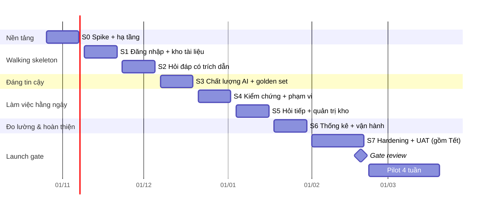

# Kế hoạch triển khai (Implementation Plan) — "Chat với tài liệu" (MVP)

> **Đầu vào:** [BRD.md](../requirements/BRD.md) v0.2, [PRD.md](../requirements/PRD.md) v0.1, [SAD.md](../requirements/SAD.md) v0.1, [USER_STORIES.md](../requirements/USER_STORIES.md) v0.1, [Blueprint_Design.md](../design/Blueprint_Design.md), prototype [UI_UX_design/](../design/UI_UX_design/)
> **Mục đích:** biến backlog (22 user story + 8 enabler, 147 điểm sơ bộ) thành lộ trình sprint, công việc kỹ thuật cụ thể, tiêu chí ra khỏi từng giai đoạn và các quyết định phải có đúng hạn để đạt launch gate LG-01..LG-10.
> **Phiên bản:** 0.2 · 2026-10-21 · Draft

---

## 0. Tóm tắt

| Mục | Nội dung |
|---|---|
| **Khung thời gian** | 8 sprint × 2 tuần + 1 giai đoạn hardening, **26/10/2026 → 19/02/2027** (Gate review). Pilot 4 tuần **22/02 → 19/03/2027**, báo cáo sponsor 26/03/2027 |
| **Cách tiếp cận** | Spike + hạ tầng trước (S0) → walking skeleton end-to-end (S1–S2) → chất lượng AI (S3) → tính năng dùng hằng ngày (S4–S5) → đo lường & hoàn thiện (S6) → hardening, bảo mật, UAT (S7) |
| **Mốc quan trọng** | M1 06/11: spike OQ-028 xong, staging chạy · M2 04/12: walking skeleton (đăng nhập → tải PDF → hỏi → trả lời có trích dẫn) · M3 18/12: golden set ≥ 100 câu, đạt NFR-002 lần đầu · M4 29/01: feature complete · M5 19/02: Gate review |
| **Đội giả định** | 2 Backend, 1 Frontend, 0,5 DevOps, 1 QA, 0,5 Architect/Tech lead, Product owner, SME BD (chấm golden set). Velocity giả định **~20 điểm/sprint** — xác nhận sau S1 |
| **Đường găng** | OQ-005/OQ-029 (được gửi dữ liệu tới Claude API?) → EN-01 spike → pipeline RAG (US-008, US-010) → golden set + hiệu chỉnh τ (EN-02) → LG-02, LG-03 |
| **Rủi ro lịch lớn nhất** | Quyết định của Bảo mật thông tin (OQ-005) trễ; IT cấp VM/IdP trễ (OQ-016, OQ-034); kỳ nghỉ Tết 2027 rơi vào giai đoạn hardening |

---

## 1. Kiểm soát tài liệu

| Thuộc tính | Giá trị |
|---|---|
| Mã tài liệu | IMP-CWD-001 |
| Phiên bản | 0.2 |
| Trạng thái | **Draft** |
| Review | Trưởng nhóm Dev, Product owner, QA lead, IT vận hành |
| Phê duyệt | Product owner, Trưởng nhóm Dev |

| Phiên bản | Ngày | Thay đổi |
|---|---|---|
| 0.1 | 2026-10-21 | Bản nháp đầu tiên từ BRD v0.2, PRD v0.1, SAD v0.1, User Stories v0.1 |
| 0.2 | 2026-10-21 | Chia thành 64 task trong [tasks/](tasks/README.md); thêm WP-55, WP-66, WP-67 |

**Quy ước ID:** `S0..S7` sprint · `M1..M5` mốc · `WP-xx` gói công việc kỹ thuật · `IR-xx` rủi ro triển khai. Các ID `US-`, `EN-`, `LG-`, `OQ-`, `ADR-`, `C-` giữ nguyên theo tài liệu nguồn.

---

## 2. Giả định và nguyên tắc lập kế hoạch

### 2.1 Giả định

| ID | Giả định | Nếu sai thì |
|---|---|---|
| PA-01 | Sprint 2 tuần, bắt đầu thứ Hai; refinement giữa sprint, review + retro cuối sprint | Lịch dịch tương ứng |
| PA-02 | Velocity ~20 điểm/sprint với đội ở §0 | Sau S1 tính lại; cắt story P2 ở S6 trước (§5.3) |
| PA-03 | IT cấp **VM staging** trước 02/11/2026 và **VM prod** trước 04/01/2027 | S0 dùng Docker Compose trên máy dev/VM tạm; prod trễ → dời Gate |
| PA-04 | Có client OIDC trên IdP (hoặc Keycloak tạm cho dev/staging) trước S1 | US-001 làm với Keycloak cục bộ, đổi cấu hình khi có IdP thật |
| PA-05 | Có API key Claude cho dev/staging trước S0 (dùng dữ liệu giả, không dùng tài liệu thật cho tới khi OQ-005 được quyết) | Spike EN-01 không chạy được → đường găng trễ |
| PA-06 | SME BD dành ~4 giờ/tuần từ S0 để soạn và chấm golden set (DEP-002, DEP-003) | LG-02 không đạt đúng hạn |
| PA-07 | Ngày nghỉ: 01/01/2027; Tết Nguyên đán dự kiến ~04–10/02/2027 (chờ lịch chính thức) | Điều chỉnh S7 |

### 2.2 Nguyên tắc

1. **End-to-end sớm.** Có một luồng mỏng chạy thật trên staging trước khi làm rộng (walking skeleton ở M2). Mọi rủi ro tích hợp (OIDC, TEI, Claude, SSE qua Nginx) phải lộ ra trước 04/12.
2. **Chất lượng AI đo được từ sớm.** Golden set nháp có từ S0, chạy tự động trên staging từ S2. Không tinh chỉnh prompt hay ngưỡng mà không có số đo.
3. **Bảo mật và riêng tư là mặc định, không phải giai đoạn cuối.** Lọc `owner_id` (INV-02), CSRF, không log nội dung (PR-06) có từ sprint đầu tiên chạm tới chúng. EN-08 ở S7 chỉ là xác nhận.
4. **Analytics đi cùng story.** Server-side event có từ S1 (EN-07 kéo sớm hơn story map) vì DoD của mọi story yêu cầu phát sự kiện.
5. **Không chờ quyết định để code.** Mọi phụ thuộc chưa chốt đi qua port/adapter (PR-03) hoặc cấu hình; quyết định đến thì đổi adapter/cấu hình, không viết lại.

### 2.3 Khác biệt so với story map (USER_STORIES §9)

| Thay đổi | Lý do |
|---|---|
| EN-07 (thu sự kiện) từ lát cắt 4 lên S1 | DoD yêu cầu mọi story phát sự kiện; làm muộn sẽ phải sửa lại từng story |
| US-018 (hội thoại riêng tư) từ lát cắt 3 lên S2, cùng US-008 | Lọc `owner_id` phải có ngay khi tạo bảng hội thoại; thêm sau là rủi ro bảo mật |
| US-004 (báo lỗi file) từ lát cắt 2 lên S2 | Worker xử lý lỗi PDF đã viết ở US-002; hoàn thiện cùng lúc rẻ hơn |
| EN-04 tách đôi: log/trace cơ bản ở S0, dashboard + cảnh báo đầy đủ ở S6 | Cần trace để đo độ trễ từ spike; dashboard đầy đủ chỉ cần trước Gate |

---

## 3. Cấu trúc repository và công cụ

Monorepo, một pipeline CI:

```text
sdlc-ai/
├── backend/                  # Python 3.12, uv
│   ├── cwd/                  # domain / application / ports / adapters / entrypoints (SAD §4.2)
│   ├── migrations/           # Alembic; schema docs, conv, access, ops
│   ├── prompts/              # system prompt có phiên bản (prompt_version)
│   └── tests/                # unit, integration (Testcontainers PostgreSQL + pgvector)
├── frontend/                 # React 18 + TS, Vite
│   └── src/{app,features,design-system,lib}/   # Blueprint §3.1.2
├── eval/                     # golden set (YAML/JSON), runner, báo cáo so sánh
├── deploy/
│   ├── compose/              # dev.yml, staging.yml, prod-app.yml, prod-model.yml
│   ├── nginx/                # TLS, CSP, proxy SSE
│   ├── ansible/              # dựng VM, deploy rolling
│   └── observability/        # OTel Collector, dashboard Grafana, rule cảnh báo
├── e2e/                      # Playwright + axe-core
├── perf/                     # k6 / Locust kịch bản tải
└── docs/
```

| Lớp | Công cụ (theo SAD §6.2, §13.2) |
|---|---|
| Backend | FastAPI, SQLAlchemy 2, Alembic, psycopg 3, pgvector-python, Authlib, Celery 5, pypdfium2, `anthropic` SDK, pybreaker, structlog, OpenTelemetry |
| Chất lượng code backend | ruff, mypy (strict cho `domain`, `application`), import-linter, pytest + Testcontainers, coverage ≥ 70% cho `domain` + `application` (LG-05) |
| Frontend | TanStack Query 5, Zustand, React Router, Radix UI, react-markdown + DOMPurify, pdfjs-dist 4 |
| Chất lượng code frontend | eslint + `eslint-plugin-boundaries`, tsc, Vitest + Testing Library, Playwright, axe-core |
| CI/CD | GitHub Actions hoặc GitLab CI (theo tổ chức); Syft (SBOM), Trivy, Semgrep, OWASP ZAP baseline |
| Hạ tầng | Docker Compose, Nginx 1.26, PostgreSQL 16 + pgvector ≥ 0.8, Valkey 8, TEI (bge-m3, bge-reranker-v2-m3), SeaweedFS (dev/staging) |

**Tái sử dụng prototype:** [tokens.css](../design/UI_UX_design/assets/tokens.css) và [components.css](../design/UI_UX_design/assets/components.css) chuyển thành `frontend/src/design-system/`; [mock-data.js](../design/UI_UX_design/assets/mock-data.js) làm fixture cho MSW (mock API) để Frontend làm song song khi API chưa xong.

---

## 4. Lộ trình theo giai đoạn

### Tổng quan



| Sprint | Thời gian | Stories | Điểm | Mốc |
|---|---|---|---|---|
| S0 | 26/10 – 06/11/2026 | EN-01, EN-03, EN-02 (phần 1) | 13 (+ EN-02 tính ở S3) | **M1** |
| S1 | 09/11 – 20/11 | US-001, US-002, US-003, EN-07 | 21 | — |
| S2 | 23/11 – 04/12 | US-008, US-010, US-018, US-004 | 23 | **M2** walking skeleton |
| S3 | 07/12 – 18/12 | US-009, US-011, US-012, EN-02 | 23 | **M3** NFR-002 lần đầu |
| S4 | 21/12 – 01/01/2027 | US-016, US-013, US-015 | 16 (dung lượng giảm do nghỉ lễ) | — |
| S5 | 04/01 – 15/01 | US-014, US-005, US-007, EN-06 | 21 | Prod VM sẵn sàng |
| S6 | 18/01 – 29/01 | US-019, US-020, US-021, EN-04, US-006, US-017, US-022 | 22 | **M4** feature complete |
| S7 | 01/02 – 19/02 (nghỉ Tết ~04–10/02) | EN-05, EN-08, test tải, UAT, sửa lỗi | 8 + buffer | **M5** Gate review |
| **Cộng** | | 22 US + 8 EN | **147** | |

---

### S0 — Nền tảng (26/10 – 06/11/2026)

**Mục tiêu:** chứng minh pipeline LLM đáp ứng được NFR-001 và có môi trường để deploy lặp lại.

| WP | Công việc | Owner | Kết quả |
|---|---|---|---|
| WP-01 | Khởi tạo monorepo theo §3; skeleton hexagonal `cwd/`; cấu hình import-linter, ruff, mypy, eslint-boundaries | Tech lead | CI xanh trên repo rỗng có cấu trúc |
| WP-02 | Docker Compose dev: PostgreSQL + pgvector, Valkey, SeaweedFS, TEI (CPU), Keycloak tạm | DevOps | `make up` chạy toàn bộ cục bộ |
| WP-03 | Migration nền: schema `access`, `docs`, `conv`, `ops`; extension `vector`, `unaccent`, `pg_trgm`; hàm `f_unaccent` IMMUTABLE (SAD §7.2) | Backend | `alembic upgrade head` chạy trên Testcontainers |
| WP-04 | **EN-01 spike:** script độc lập: 20–30 câu nháp + 10 PDF mẫu → chunk → embed → hybrid search → rerank → Claude `claude-opus-5-5` stream với document blocks + citations, đo `first_token_ms`, `total_ms`, `usage` ở effort `low` và `medium` | Backend + Tech lead | Báo cáo p50/p90, chi phí/câu hỏi, khuyến nghị effort; xác nhận ánh xạ `content_block_location` → trang hoạt động |
| WP-05 | **EN-03:** CI (lint, type, test, build image `cwd-app:<git-sha>`, SBOM, Trivy); deploy staging bằng một lệnh (Ansible/Compose qua SSH); Nginx TLS + `proxy_buffering off` cho SSE | DevOps | Staging deploy tự động sau merge vào `main` |
| WP-06 | Log JSON (structlog) với `request_id`, `trace_id`; OTel tracing cơ bản (FastAPI, SQLAlchemy, httpx) — phần đầu EN-04 | Backend | Trace của spike xem được trên Tempo/Jaeger cục bộ |
| WP-07 | **EN-02 phần 1:** SME + QA soạn golden set nháp ≥ 30 câu theo 6 nhóm LG-02; chọn bộ PDF mẫu không nhạy cảm (DEP-002) | QA + SME | `eval/golden_set.v0.yaml` |
| WP-08 | Frontend: Vite + design-system từ prototype; AppShell 3 vùng; MSW mock theo hợp đồng SAD §10 | Frontend | Storybook/route hiển thị layout với dữ liệu mock |

**Quyết định cần có trong S0:** OQ-028 (kết quả spike), OQ-029 (đường egress), OQ-016 (IdP), OQ-034 (VM, GPU), OQ-032 (secret store).

**Exit criteria S0 (M1):**
- [ ] Báo cáo spike: ký tự đầu p90 ≤ 3 s ở effort đã chọn, **hoặc** phương án giảm thiểu RSK-008 được Tech lead + PO chấp thuận.
- [ ] Staging deploy được bằng một lệnh; CI chạy đủ lint, type, test, SBOM, Trivy.
- [ ] Golden set nháp ≥ 30 câu có đáp án.

---

### S1 — Đăng nhập và kho tài liệu (09/11 – 20/11)

**Mục tiêu:** người dùng đăng nhập SSO, tải PDF và thấy tài liệu chuyển sang "Sẵn sàng".

| WP | Story | Backend | Frontend |
|---|---|---|---|
| WP-10 | US-001 | `OIDCIdentity` adapter (Authlib, PKCE); `/auth/login`, `/auth/callback`, `/auth/logout`; phiên trong Valkey (TTL 30 phút trượt / 8 giờ tuyệt đối, xoay ID); cookie `__Host-cwd_session`; CSRF double-submit; middleware RBAC (`cwd-users/leads/managers`); `GET /api/v1/me` | `features/auth`: guard route, trang Forbidden, chuyển hướng login giữ URL đích; lưu nháp câu hỏi `sessionStorage` (AC-US001-4) |
| WP-11 | US-002 | `POST /api/v1/documents`: kiểm tra magic bytes, sha256, cảnh báo trùng (409 + `confirm_duplicate`); `S3ObjectStore`; `CeleryJobQueue`; task `process_document`: pypdfium2 trích theo trang → chunking ~450 token/60 overlap/≤ 2 trang → `TEIEmbeddingAdapter` lô 32 → ghi pages + chunks trong một giao dịch; khoá `lock:doc:{id}`; audit `DOCUMENT_UPLOADED` | `UploadDropzone` (XHR có tiến trình, kiểm tra client đuôi/MIME/50 MB), trạng thái "Tải lên bị gián đoạn" + Thử lại |
| WP-12 | US-003 | `GET /api/v1/documents` (cursor, lọc `q` bằng trigram trên `f_unaccent(lower(filename))`, `status`); `GET /documents/{id}` có `unreadable_pages` | `DocumentSidebar`, `DocumentRow`, `StatusBadge` (biểu tượng + chữ), empty state, polling 5 s khi còn `QUEUED/PROCESSING` |
| WP-13 | EN-07 | Bảng `ops.analytics_events` phân vùng tháng; `POST /api/v1/events` kiểm schema từng sự kiện, từ chối khoá lạ; ghi server-side EV-05, EV-06 | `lib/analytics`: hàng đợi, gửi lô 10 s, `sendBeacon`; phát EV-01, EV-02, EV-03, EV-04 |

**Kiểm thử:** integration test OIDC với Keycloak; test worker với PDF mẫu (thường, 500 trang, có mật khẩu, hỏng, scan); E2E Playwright: đăng nhập → tải lên → "Sẵn sàng".

**Exit criteria S1:** AC của US-001, US-002, US-003 đạt trên staging; PDF 50 trang sẵn sàng p90 ≤ 3 phút trên staging (đo sơ bộ NFR-005).

---

### S2 — Hỏi đáp có trích dẫn (23/11 – 04/12) → **M2 walking skeleton**

**Mục tiêu:** luồng J1 chạy hết: hỏi tiếng Việt, nhận câu trả lời streaming có chip `[n]` đúng file + trang.

| WP | Story | Backend | Frontend |
|---|---|---|---|
| WP-20 | US-018 | Bảng `conv.conversations/messages/citations`; repository **luôn** lọc `owner_id`, không khớp → 404; `POST/GET /api/v1/conversations`, `GET /conversations/{id}` | — |
| WP-21 | US-008 | Use case `AskQuestion` bước 1, 3–11 (SAD §4.2): rate limit token bucket (10/phút, 60/giờ); truy vấn lai một câu SQL (HNSW + GIN + RRF k=60); `TEIRerankAdapter` → top 8; `ClaudeLLMAdapter` streaming; semaphore 15 lời gọi đồng thời; `POST /conversations/{id}/messages` trả SSE (`meta`, `delta`, `citation`, `done`, `error`, `: ping` 15 s); timeout ký tự đầu 30 s; ghi EV-08, EV-09, EV-10 | `lib/api` SSE reader (`fetch` + `ReadableStream`); `QuestionComposer` (Enter, đếm ký tự 2.000, vô hiệu khi trống / chưa có tài liệu sẵn sàng); `ChatThread`; nút Dừng (`AbortController`, EV-11); trạng thái "Đang tìm trong N tài liệu…"; lỗi + Thử lại không mất câu hỏi |
| WP-22 | US-010 | Mỗi chunk → `document` block `source.type="content"`, một block con/trang, `citations.enabled`; ánh xạ `content_block_location` → (chunk, trang); lưu `cited_text`, `document_title_snapshot`; INV-04: không có citation → `partial` | `AnswerMessage` (react-markdown hạn chế + DOMPurify), `CitationChip` dựng từ sự kiện `citation`, `SourceList` "[n] Tên — trang X" / "trang 12–13", cảnh báo partial |
| WP-23 | US-004 | Phân loại `error_reason` (`password_protected`, `corrupted`, `scanned` khi ≥ 90% trang không có chữ, `too_many_pages`, `other`); lỗi xác định không retry; lỗi tạm 3 retry 30 s / 2 phút / 10 phút; audit `DOCUMENT_FAILED`; Nginx `client_max_body_size 51m`, API 413/415 | Thông báo từ chối trước khi tải, lý do lỗi trên `DocumentRow`, "Xoá khỏi danh sách" |
| WP-24 | — | System prompt v1 trong `backend/prompts/` (6 quy tắc SAD §4.2), `prompt_version` | — |
| WP-25 | EN-02 | Runner golden set: gọi API staging, xuất báo cáo; chạy trong CI sau deploy staging (chưa chặn release) | — |

**Kiểm thử:** test tự động IDOR cho mọi endpoint `conversations`, `messages` (AC-US018-2); test hợp đồng SSE; Playwright J1 với `FakeLLMAdapter` (trên CI) và Claude thật (trên staging).

**Exit criteria S2 (M2):**
- [ ] Demo J1 trên staging với người dùng SSO thật/Keycloak, PDF mẫu, Claude thật.
- [ ] Golden set nháp chạy tự động; có số đo đầu tiên cho NFR-001, NFR-002.
- [ ] Người dùng B nhận 404 trên mọi endpoint hội thoại của người dùng A.

---

### S3 — Đáng tin cậy (07/12 – 18/12) → **M3**

**Mục tiêu:** đạt NFR-002 lần đầu trên golden set ≥ 100 câu.

| WP | Story | Công việc |
|---|---|---|
| WP-30 | EN-02 | Hoàn thiện golden set ≥ 100 câu đúng tỷ lệ LG-02 (40% một tài liệu, 20% đa tài liệu, 15% không có đáp án, 10% diễn đạt khác, 10% tiếng Anh, 5% khuyến nghị) + nhóm câu về bảng (RSK-010) + câu prompt injection; chấm tự động (citation đúng trang, `answer_type`) + phiếu chấm SME; so sánh với lần chạy trước, giảm > 3 điểm % → chặn release |
| WP-31 | US-011 | Cổng τ_nf sau rerank (trả `not_found` không gọi LLM); nhận diện câu cố định của system prompt; hiển thị khối ℹ️ riêng, phạm vi đã tìm, gợi ý; **hiệu chỉnh τ_keep, τ_nf** trên golden set để đạt KR2.2 mà không giảm KR2.1 |
| WP-32 | US-009 | Kiểm thử câu kiến thức chung, câu xin khuyến nghị, tài liệu chứa prompt injection (AC-US009-4); tinh chỉnh system prompt v2 qua golden set |
| WP-33 | US-012 | Câu đa tài liệu và mâu thuẫn; kiểm tra top 8 trải nhiều tài liệu; EV-09 `distinct_docs_cited` |
| WP-34 | — | Ghi chú "N tài liệu đang xử lý chưa được dùng" (AC-US008-8) qua `meta.docs_processing` |

**Exit criteria S3 (M3):** NFR-002 đạt trên golden set ≥ 100 câu (≥ 85% đúng + trích dẫn đúng, ≥ 90% not_found đúng, 0 câu dùng kiến thức ngoài), **hoặc** danh sách lỗi theo nhóm và kế hoạch cải thiện cho S4–S5. Tất cả story P0 đã code xong.

---

### S4 — Kiểm chứng và phạm vi (21/12/2026 – 01/01/2027)

Dung lượng giảm (nghỉ lễ cuối năm). **US-016 được ưu tiên trước** vì có thể bị nâng lên P0 (OQ-023).

| WP | Story | Công việc |
|---|---|---|
| WP-40 | US-016 | `GET /documents/{id}/file` hỗ trợ Range (206) từ object storage, `Cache-Control: private, no-store`, 410 khi đã gỡ; `features/viewer` nạp lười pdfjs-dist, mở đúng trang ≤ 2 s, tô sáng `cited_text` trên text layer, overlay ở 768–1279px; EV-12, EV-13; CSP `worker-src 'self' blob:` |
| WP-41 | US-013 | `scope_document_ids` (≤ 200), lọc `document_id = ANY(scope)` với `hnsw.iterative_scan = relaxed_order`; checkbox trong sidebar + `ScopeBar`; vô hiệu khi phạm vi chưa sẵn sàng (EC-18); EV-14 |
| WP-42 | US-015 | Phát hiện ngôn ngữ cho EV-08 `language`; câu not_found tiếng Anh; nhóm câu tiếng Anh và chéo ngôn ngữ trong golden set |

**Exit criteria S4:** AC US-016, US-013, US-015 đạt; golden set không hồi quy.

---

### S5 — Hỏi tiếp và quản trị kho (04/01 – 15/01/2027)

| WP | Story | Công việc |
|---|---|---|
| WP-50 | US-014 | Bước 2 pipeline: viết lại câu hỏi độc lập khi `turn_index > 0` (Claude effort `low`, `max_tokens` 256); lịch sử tái tạo nguyên văn từ `messages.llm_content` (append-only, PR-07), prompt caching, kiểm tra `cache_read_input_tokens`; giới hạn 20 lượt → 409 `CONVERSATION_TOO_LONG`; nút "Hội thoại mới" (EV-15); đo lại độ trễ ký tự đầu cho lượt ≥ 2 (RSK-008) |
| WP-51 | US-005 | `DELETE /documents/{id}`: `SELECT … FOR UPDATE`, đặt `REMOVED`, xoá pages/chunks, audit — một giao dịch; 409 `ALREADY_REMOVED`; task `purge_document` xoá object ≤ 1 giờ; citation cũ hiển thị "Tài liệu đã bị gỡ"; `ConfirmDialog` có tên tài liệu; EV-07 |
| WP-52 | US-007 | `GET /audit/documents?from&to` (vai trò lead); quyền PostgreSQL chỉ `INSERT/SELECT` trên `ops.audit_log`; `AuditTable` |
| WP-53 | EN-06 | Circuit breaker (pybreaker) quanh Claude và TEI (mở sau 5 lỗi / 30 s); chế độ `degraded` chỉ toàn văn khi TEI lỗi; test chaos trên staging |
| WP-54 | — | **Dựng prod** (VM-APP, VM-MODEL, VM-DATA) bằng Ansible; PgBouncer; LUKS; TLS nội bộ `verify-full`; secret store; deploy bản S4 lên prod (chưa mở cho người dùng) |
| WP-55 | — | Time study MET-001 baseline (trước khi người dùng BD tiếp xúc công cụ); vòng 2 đo trong tuần cuối pilot |

**Exit criteria S5:** AC US-014, US-005, US-007 đạt; test chaos EN-06 đạt; prod chạy được smoke test.

---

### S6 — Đo lường, vận hành và hoàn thiện (18/01 – 29/01/2027) → **M4 feature complete**

| WP | Story | Công việc |
|---|---|---|
| WP-60 | US-019, US-020 | Materialized view `ops.weekly_stats` refresh mỗi giờ (`refresh_weekly_stats`); `GET /stats/weekly` (vai trò manager); `features/stats`; ẩn menu với người không có vai trò; EV-19; đối chiếu số liệu với đếm EV-08 |
| WP-61 | US-021 | `PUT /messages/{id}/feedback` idempotent, chỉ chủ hội thoại; `FeedbackControl` 👍/👎 + lý do + ghi chú ≤ 500; EV-17 (**P0 dù story là P2**) |
| WP-62 | EN-04 | Metric Prometheus (SAD §11.3: `cwd_llm_first_token_seconds`, token, chi phí, `cwd_queue_depth`, `cwd_circuit_state`…); dashboard Grafana; 7 cảnh báo, bắn thử; kiểm tra mẫu log không có nội dung |
| WP-63 | US-006 | Thả nhiều file, tối đa 3 request song song, lớp phủ "Thả để thêm vào kho", xử lý 429 |
| WP-64 | US-017 | `HistoryList`, mở lại hội thoại (EV-16); task `retention_sweep` (180 ngày, chờ OQ-013; cũng xếp lại job kẹt `QUEUED` > 30 phút) |
| WP-65 | US-022 | Nút Sao chép (Clipboard API, văn bản thuần + danh sách nguồn), EV-18 — **chỉ làm nếu PO chấp thuận OQ-035** |
| WP-66 | — | Bảo vệ ngân sách: chạm 100% ngân sách tháng → giảm hạn mức câu hỏi/người (SAD §11.2) |
| WP-67 | — | Lưu giữ dữ liệu: tạo/xoá phân vùng `ops.analytics_events` (13 tháng), xoá `ops.audit_log` > 2 năm (SAD §7.4) |

**Ứng viên cắt khi thiếu dung lượng (theo thứ tự):** US-022 → US-006 → US-017. Nếu cắt US-021 thì vẫn phải giữ EV-17 hoặc lên kế hoạch khảo sát cuối pilot.

**Exit criteria S6 (M4):** mọi story P0 và P1 xong (hoặc được sponsor chấp thuận hoãn); dashboard + cảnh báo hoạt động; code freeze tính năng.

---

### S7 — Hardening, bảo mật, UAT (01/02 – 19/02/2027) → **M5 Gate review**

Kéo dài 3 tuần vì có kỳ nghỉ Tết (~04–10/02). Không nhận tính năng mới.

| Tuần | Công việc | Launch gate |
|---|---|---|
| 01/02 – 03/02 | **Test tải** (k6/Locust) với 20 người đồng thời, kho ≥ 500 tài liệu: đo NFR-001, NFR-005, NFR-006; quyết định bật GPU cho rerank nếu p90 > 0,8 s (RSK-009). **EN-05:** diễn tập khôi phục pgBackRest + object trên môi trường riêng ≤ 4 giờ. Đặt lịch pentest | LG-03, LG-09 |
| (Tết) | Pentest bên ngoài có thể chạy nếu đối tác làm việc; đội trực theo lịch | — |
| 11/02 – 15/02 | **EN-08:** Semgrep, ZAP baseline, kiểm thử phân quyền 100% (US-001, US-007, US-018, US-019); sửa lỗi Critical/High. Chạy golden set bản cuối có SME chấm. Chạy toàn bộ test case EC-01..EC-23 | LG-02, LG-04, LG-05 |
| 15/02 – 18/02 | **UAT:** ≥ 5 người BD làm J1 với tài liệu thật (chỉ khi OQ-005 đã cho phép); hướng dẫn sử dụng 1 trang + buổi giới thiệu (nêu BRU-006); runbook sự cố; ngưỡng chi phí tháng | LG-07, LG-10, LG-09 |
| 19/02 | **Gate review** với QA lead, Trưởng nhóm BD, Trưởng nhóm Dev, Bảo mật thông tin, Pháp chế, PO | LG-01..LG-10 |

**Exit criteria S7 (M5):** mọi LG-01..LG-10 đạt và có người ký; 0 lỗi Sev-1/Sev-2 mở (LG-06).

---

### Pilot (22/02 – 19/03/2027)

- Mở cho nhóm BD pilot; PO xem số liệu hằng tuần (WAU, tỷ lệ not_found, hữu ích, độ trễ, chi phí).
- Golden set chạy hằng tuần trên staging; mọi thay đổi prompt/tham số phải qua golden set.
- Đội dev ở chế độ hỗ trợ: sửa lỗi, tinh chỉnh τ, không thêm tính năng lớn.
- Time study cuối pilot cho MET-001; báo cáo sponsor **26/03/2027** (J4).

---

## 5. Quản lý phạm vi và phụ thuộc

### 5.1 Quyết định chặn và hạn chót

| OQ | Quyết định | Cần trước | Chặn | Phương án nếu trễ |
|---|---|---|---|---|
| OQ-005, OQ-029 | Được gửi đoạn trích tới Claude API? Qua đường nào? | **06/11/2026** (cuối S0) | US-008..US-015, UAT với tài liệu thật | Tiếp tục với dữ liệu giả; nếu bị cấm → đổi `LLMPort` sang mô hình nội bộ (RSK-002a), dự kiến +2–3 sprint, dời Gate |
| OQ-028 | Kết quả spike độ trễ | 06/11/2026 | Cấu hình effort, kiến trúc bước viết lại | — (thuộc S0) |
| OQ-016, OQ-026 | IdP và tên nhóm vai trò | 09/11/2026 (đầu S1) | US-001, US-007, US-019 | Keycloak tạm; cấu hình tên nhóm qua biến môi trường |
| OQ-034, OQ-032 | VM, GPU, secret store | 02/11 (staging), 04/01/2027 (prod) | EN-03, WP-54 | Staging trên VM tạm; Docker secrets 0400 |
| OQ-023 | US-016 lên P0? | 27/10/2026 | Thứ tự S4 | Đã xếp US-016 đầu S4 nên không đổi lịch |
| OQ-004 | Giới hạn file (50 MB, 500 trang) | 20/11/2026 | US-002, US-004 | Dùng giá trị đề xuất, cấu hình được |
| OQ-009, OQ-010, OQ-027 | Ngưỡng NFR-001, NFR-002 và các target "(đề xuất)" | 18/12/2026 (M3) | LG-02, LG-03 | Nghiệm thu theo ngưỡng đề xuất |
| OQ-013 | Thời hạn lưu hội thoại | 18/01/2027 | US-017 `retention_sweep` | 180 ngày, cấu hình được |
| OQ-031 | Tier / giới hạn tốc độ Claude API | 01/02/2027 (test tải) | LG-03 | Semaphore + thông báo bận |
| OQ-019, OQ-030 | Pháp chế: dữ liệu cá nhân, giấy phép | 12/02/2027 | LG-04 | Không qua Gate |
| OQ-033 | Bắt buộc quét virus tệp tải lên? | 04/12/2026 | US-002 | Nếu có: thêm bước ClamAV trong Worker (+3 điểm, S5) |
| OQ-035 | Đưa US-022 vào MVP? | 18/01/2027 | S6 | Cắt US-022 |

### 5.2 Phụ thuộc bên ngoài đội

| Phụ thuộc | Bên cung cấp | Cần khi |
|---|---|---|
| Client OIDC (redirect URI dev/staging/prod) | IT / IdP | S1 |
| VM staging, VM prod, DNS + chứng chỉ CA nội bộ, bucket S3, egress proxy | IT | S0, S5 |
| API key Claude riêng cho từng môi trường | Product owner | S0 |
| Bộ PDF mẫu + bộ file lỗi cho QA (DEP-002) | Trưởng nhóm BD | S0 – S2 |
| SME chấm golden set (DEP-003) | Trưởng nhóm BD | S0, S3, S7, hằng tuần trong pilot |
| Đối tác pentest | Bảo mật thông tin | Đặt lịch trước 15/01/2027 |

### 5.3 Quy tắc điều chỉnh phạm vi

1. Story P0 và EV-17 không bị cắt. Thiếu dung lượng → cắt P2 ở S6 theo thứ tự §S6.
2. Velocity S1 < 16 điểm → PO và Tech lead xếp lại S4–S6 ngay trong review S1; không dời M2.
3. M3 không đạt NFR-002 → S4 dành ≥ 30% dung lượng cho cải thiện chất lượng (chunking bảng, prompt, τ, effort `medium`) trước tính năng P1.
4. Mọi thay đổi phạm vi ghi vào mục lịch sử của tài liệu này.

---

## 6. Chiến lược kiểm thử

| Tầng | Phạm vi | Công cụ | Khi chạy |
|---|---|---|---|
| Unit | `domain`, `application` (chunking, phân loại lỗi PDF, RRF, ánh xạ citation, INV-01..INV-06) | pytest, Vitest | Mỗi commit; coverage ≥ 70% (LG-05) |
| Integration | Repository + SQL lai trên PostgreSQL thật, worker với PDF mẫu, OIDC với Keycloak, adapter TEI | pytest + Testcontainers | Mỗi PR |
| Hợp đồng | Schema REST + SSE theo SAD §10; event schema EV-01..EV-19 | pytest, schema test phía FE | Mỗi PR |
| Phân quyền | Ma trận vai trò × endpoint; IDOR hội thoại/message/feedback | pytest (tự sinh từ danh sách route) | Mỗi PR |
| E2E | J1 và mọi story P0; EC-01..EC-23 | Playwright (`FakeLLMAdapter` trên CI, Claude thật trên staging) | Sau deploy staging |
| Accessibility | Màn hình chính, audit, stats | axe-core trong Playwright | Sau deploy staging |
| Chất lượng AI | Golden set ≥ 100 câu, chấm tự động + SME | `eval/` runner | Sau deploy staging khi đổi prompt/model/tham số; hằng tuần trong pilot |
| Hiệu năng | NFR-001, NFR-005, NFR-006 | k6 / Locust | Đo sơ bộ S2, S5; chính thức S7 |
| Bảo mật | SAST, dependency, DAST, pentest | Semgrep, Trivy, ZAP, đối tác | CI liên tục; ZAP từ S5; pentest S7 |
| Chaos | TEI tắt, Claude lỗi, Valkey restart | Script trên staging | S5 (EN-06), S7 |

**Golden set là tài sản quản lý phiên bản** (`eval/golden_set.vN.yaml`); không chứa tài liệu mật trong repo cho tới khi OQ-005/OQ-025 cho phép — tài liệu thật lưu ở bucket staging có kiểm soát truy cập.

---

## 7. Môi trường và phát hành

| Môi trường | Mục đích | Dữ liệu | Deploy |
|---|---|---|---|
| Dev | Máy lập trình viên, Docker Compose | PDF mẫu, `FakeLLMAdapter` hoặc key dev | Thủ công |
| Staging | Tích hợp, E2E, golden set, test tải, UAT | PDF mẫu; tài liệu thật chỉ sau OQ-005 | Tự động sau merge `main` |
| Prod | Pilot | Tài liệu thật | Duyệt thủ công, rolling từng replica API; migration expand/contract |

- Nhánh: trunk-based, PR ngắn vào `main`, feature flag cho tính năng chưa xong (ví dụ `FEATURE_SCOPE`, `FEATURE_FEEDBACK`).
- Image gắn tag `git-sha`, không dùng `latest`. Release prod gắn tag `vYYYY.MM.DD-N`.
- Từ S5 deploy prod mỗi cuối sprint (chưa mở người dùng) để tập dượt quy trình trước Gate.

---

## 8. Rủi ro triển khai

| ID | Rủi ro | Mức | Giảm thiểu | Owner |
|---|---|---|---|---|
| IR-01 | OQ-005 trễ hoặc bị từ chối → không dùng Claude với tài liệu thật | High | Hạn chót 06/11; `LLMPort` sẵn sàng đổi adapter; ước lượng trước phương án mô hình nội bộ trong S0 | PO |
| IR-02 | IT cấp VM/IdP trễ | Medium | Keycloak + VM tạm; yêu cầu gửi IT ngay tuần đầu S0 | DevOps |
| IR-03 | Ký tự đầu > 3 s ở lượt hỏi tiếp (RSK-008) | Medium | Đo ở S0 và S5; hiển thị "Đang tìm…" ngay khi có `meta`; chỉ viết lại khi cần | Tech lead |
| IR-04 | Golden set/SME không kịp → không đo được NFR-002 | Medium | Bắt đầu từ S0; lịch SME cố định 4 giờ/tuần | QA lead |
| IR-05 | Chất lượng trích xuất bảng thấp (RSK-010) | Medium | Nhóm câu bảng trong golden set từ S3; phương án pdfplumber sau MVP | Backend |
| IR-06 | Velocity thực tế thấp hơn 20 điểm | Medium | Đo sau S1; cắt P2 theo §5.3 | PO |
| IR-07 | Nghỉ lễ cuối năm và Tết làm giảm dung lượng S4, S7 | Medium | S4 đã giảm tải; S7 kéo dài 3 tuần; không bắt đầu pilot trước Tết để số liệu sử dụng không bị méo | PO |
| IR-08 | Rerank CPU chậm khi tải cao (RSK-009) | Low | Đo sơ bộ S2, S5; chuẩn bị yêu cầu GPU L4 với IT từ S0 (OQ-034) | DevOps |

---

## 9. Truy vết

### 9.1 Story → sprint → launch gate

| Story | Ưu tiên | Sprint | Launch gate |
|---|---|---|---|
| US-001 | P0 | S1 | LG-01, LG-04 |
| US-002 | P0 | S1 | LG-01, LG-03 (NFR-005) |
| US-003 | P0 | S1 | LG-01 |
| US-004 | P0 | S2 | LG-01 |
| US-008 | P0 | S2 | LG-01, LG-03 (NFR-001) |
| US-010 | P0 | S2 | LG-01, LG-02 |
| US-009 | P0 | S3 | LG-01, LG-02 |
| US-011 | P0 | S3 | LG-01, LG-02 |
| US-012 | P0 | S3 | LG-01, LG-02 |
| US-018 | P1 | S2 | LG-04 |
| US-016 | P1 (đề xuất P0) | S4 | LG-01 |
| US-013 | P1 | S4 | LG-01 |
| US-015 | P1 | S4 | LG-02 |
| US-014 | P1 | S5 | LG-01, LG-02 |
| US-005 | P1 | S5 | LG-01 |
| US-007 | P1 | S5 | LG-01, LG-04 |
| US-019, US-020 | P1 | S6 | LG-08 |
| US-021 | P2 (EV-17 P0) | S6 | LG-08 |
| US-006, US-017, US-022 | P2 | S6 | — |
| EN-01 | P0 | S0 | LG-03 |
| EN-02 | P0 | S0 → S3 | LG-02 |
| EN-03 | P0 | S0 | LG-05 |
| EN-04 | P0 | S0 (cơ bản), S6 | LG-09 |
| EN-05 | P0 | S7 | LG-09 |
| EN-06 | P1 | S5 | LG-09 |
| EN-07 | P0 | S1 | LG-08 |
| EN-08 | P0 | S7 | LG-04 |

### 9.2 Launch gate → bằng chứng → sprint tạo ra

| LG | Bằng chứng | Sprint |
|---|---|---|
| LG-01 Chức năng | Báo cáo kiểm thử AC | S1–S6, tổng hợp S7 |
| LG-02 Chất lượng AI | Báo cáo golden set + phiếu SME | S3, chốt S7 |
| LG-03 Hiệu năng | Báo cáo test tải | S7 (sơ bộ S2, S5) |
| LG-04 Bảo mật | Biên bản review, pentest, test phân quyền | S7 (liên tục từ S1) |
| LG-05 Độ phủ QA | Báo cáo coverage, E2E, EC-01..EC-23 | S7 |
| LG-06 Lỗi tồn đọng | Bug tracker | S7 |
| LG-07 UAT | Biên bản UAT | S7 |
| LG-08 Analytics | Kiểm tra sự kiện trên staging, trang Thống kê | S6 |
| LG-09 Vận hành | Dashboard, cảnh báo, runbook, diễn tập khôi phục | S6, S7 |
| LG-10 Sẵn sàng người dùng | Hướng dẫn 1 trang, buổi giới thiệu | S7 |

---

## 10. Definition of Ready / Done

Áp dụng nguyên văn [USER_STORIES.md §10](../requirements/USER_STORIES.md). Bổ sung cho kế hoạch này:

- **DoR:** phụ thuộc trong bảng §5.1 của story đã được quyết, hoặc có phương án tạm được PO chấp thuận.
- **DoD:** story chạm pipeline hỏi đáp phải kèm báo cáo golden set trong PR; story chạm endpoint mới phải có dòng trong ma trận test phân quyền.

---

## 11. Việc cần làm ngay (tuần 26/10/2026)

1. PO gửi Bảo mật thông tin yêu cầu quyết định OQ-005, OQ-029, hạn **06/11**.
2. DevOps gửi IT yêu cầu VM staging, client OIDC, bucket S3, egress proxy, GPU (OQ-016, OQ-032, OQ-034).
3. PO cung cấp API key Claude cho dev/staging; Trưởng nhóm BD chỉ định SME và bộ PDF mẫu.
4. Tech lead khởi tạo monorepo (WP-01), bắt đầu spike EN-01 (WP-04).
5. Sponsor quyết định OQ-023 (US-016 lên P0) trước **27/10**.
