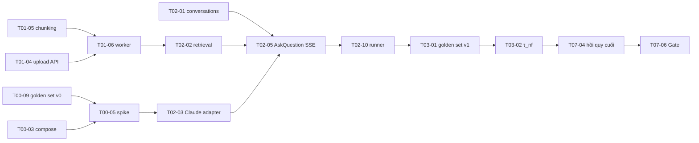

# Danh mục task triển khai — "Chat với tài liệu" (MVP)

> **Nguồn:** [IMPLEMENTATION_PLAN.md](../IMPLEMENTATION_PLAN.md) v0.1 (sprint, WP), [USER_STORIES.md](../../requirements/USER_STORIES.md) (AC), [SAD.md](../../requirements/SAD.md) (thiết kế), [Blueprint_Design.md](../../design/Blueprint_Design.md) (UI)
> **Phiên bản:** 0.1 · 2026-10-21 · Draft

## 1. Quy ước

| Mục | Quy ước |
|---|---|
| **ID** | `Tss-nn`: `ss` = sprint (00..07), `nn` = thứ tự trong sprint |
| **Tên file** | `Tss-nn-<slug>.md` |
| **Ước lượng** | Ngày công lý tưởng (1 người). Story point vẫn tính ở cấp story (USER_STORIES.md); task là đơn vị giao việc |
| **Loại** | BE (Backend) · FE (Frontend) · DevOps · QA · SME · PO |
| **Trạng thái** | `Todo` → `In progress` → `In review` → `Done` (cập nhật trong file task và bảng dưới) |
| **Sẵn sàng phát triển** | Task đạt DoR khi mọi task trong cột "Phụ thuộc" đã `Done` hoặc có hợp đồng (API/schema) được chốt để làm song song bằng mock |

### Cấu trúc mỗi file task

1. Bảng thuộc tính (sprint, story, WP, loại, ước lượng, phụ thuộc, chặn, trạng thái)
2. Mục tiêu
3. Bối cảnh
4. Phạm vi: trong phạm vi / ngoài phạm vi
5. Thiết kế chi tiết: file/module, schema, API, logic, cấu hình
6. Các bước thực hiện (checklist)
7. Tiêu chí hoàn thành (ánh xạ AC-USxxx-n / tiêu chí EN)
8. Kiểm thử
9. Analytics / observability
10. Tham chiếu
11. Giả định và câu hỏi mở

## 2. Danh sách task

### S0 — Nền tảng (26/10 – 06/11/2026)

| ID | Task | Story / WP | Loại | Ước lượng | Phụ thuộc |
|---|---|---|---|---|---|
| [T00-01](T00-01-backend-scaffold.md) | Khởi tạo monorepo và khung backend hexagonal | WP-01 | BE | 1,5 | — |
| [T00-02](T00-02-frontend-scaffold.md) | Khởi tạo khung frontend (Vite, TS, lint ranh giới) | WP-01, WP-08 | FE | 1 | — |
| [T00-03](T00-03-dev-docker-compose.md) | Docker Compose môi trường dev | WP-02 | DevOps | 2 | T00-01 |
| [T00-04](T00-04-db-baseline-migration.md) | Migration nền: schema, extension, `f_unaccent`, `access.users` | WP-03 | BE | 1 | T00-01, T00-03 |
| [T00-05](T00-05-spike-llm-latency.md) | Spike đo độ trễ và chất lượng Claude | EN-01, WP-04 | BE | 4 | T00-03, T00-04, T00-09 (≥ 20 câu đầu) |
| [T00-06](T00-06-ci-pipeline.md) | Pipeline CI: lint, type, test, image, SBOM, Trivy | EN-03, WP-05 | DevOps | 2 | T00-01, T00-02 |
| [T00-07](T00-07-staging-deploy-nginx.md) | Deploy staging một lệnh + Nginx (TLS, SSE, CSP) | EN-03, WP-05 | DevOps | 3 | T00-03, T00-04, T00-06 |
| [T00-08](T00-08-logging-tracing-errors.md) | Log có cấu trúc, tracing OTel, lỗi RFC 9457 | EN-04, WP-06 | BE | 1,5 | T00-01, T00-03 (xem trace cục bộ) |
| [T00-09](T00-09-golden-set-v0.md) | Golden set nháp v0 + bộ PDF mẫu | EN-02, WP-07 | QA, SME | 4 (rải sprint) | — |
| [T00-10](T00-10-design-system-appshell.md) | Design system từ prototype + AppShell 3 vùng + MSW | WP-08 | FE | 4 | T00-02 |

### S1 — Đăng nhập và kho tài liệu (09/11 – 20/11)

| ID | Task | Story / WP | Loại | Ước lượng | Phụ thuộc |
|---|---|---|---|---|---|
| [T01-01](T01-01-oidc-session.md) | Đăng nhập OIDC + phiên trong Valkey | US-001, WP-10 | BE | 3 | T00-04, T00-08 |
| [T01-02](T01-02-csrf-rbac-ratelimit-me.md) | CSRF, RBAC, rate limit, chuỗi middleware, `GET /me` | US-001, WP-10 | BE | 2 | T01-01 |
| [T01-03](T01-03-fe-auth-api-client.md) | FE: API client, guard, Forbidden, giữ bản nháp khi hết phiên | US-001, WP-10 | FE | 2,5 | T00-10, T01-02 (hợp đồng) |
| [T01-04](T01-04-document-upload-api.md) | API tải PDF lên: kiểm tra, sha256, trùng lặp, object store, enqueue | US-002, WP-11 | BE | 3 | T00-04, T01-02 |
| [T01-05](T01-05-pdf-extraction-chunking.md) | Trích xuất văn bản PDF và cắt đoạn (domain) | US-002, WP-11 | BE | 3 | T00-01 |
| [T01-06](T01-06-ingestion-worker-embedding.md) | Worker `process_document`: embedding, ghi chunks, trạng thái | US-002, WP-11 | BE | 3 | T01-04, T01-05 |
| [T01-07](T01-07-document-list-api.md) | API danh sách / chi tiết tài liệu, lọc bỏ dấu | US-003, WP-12 | BE | 1,5 | T01-04 |
| [T01-08](T01-08-fe-upload-dropzone.md) | FE: vùng tải lên một file có tiến trình | US-002, WP-11 | FE | 2 | T01-03, T01-04 (hợp đồng) |
| [T01-09](T01-09-fe-document-sidebar.md) | FE: danh sách tài liệu, trạng thái, polling, empty state | US-003, WP-12 | FE | 2,5 | T01-03, T01-07 (hợp đồng) |
| [T01-10](T01-10-analytics-events.md) | Thu sự kiện analytics (server + client) | EN-07, WP-13 | BE, FE | 2,5 | T00-04, T01-02 |

### S2 — Hỏi đáp có trích dẫn (23/11 – 04/12)

| ID | Task | Story / WP | Loại | Ước lượng | Phụ thuộc |
|---|---|---|---|---|---|
| [T02-01](T02-01-conversations-ownership.md) | Schema hội thoại + repository lọc chủ sở hữu + endpoint | US-018, WP-20 | BE | 2 | T01-02 |
| [T02-02](T02-02-hybrid-retrieval-rerank.md) | Truy xuất lai (vector + toàn văn + RRF) và rerank | US-008, WP-21 | BE | 3 | T01-06 |
| [T02-03](T02-03-claude-llm-adapter.md) | `ClaudeLLMAdapter` streaming + citations + `FakeLLMAdapter` | US-008, US-010, WP-21/22 | BE | 3 | T00-05 |
| [T02-04](T02-04-system-prompt-v1.md) | System prompt v1 có phiên bản | US-009, WP-24 | BE | 1 | T00-05 |
| [T02-05](T02-05-ask-question-sse.md) | Use case `AskQuestion` + endpoint SSE | US-008, US-010, WP-21/22 | BE | 4 | T02-01, T02-02, T02-03, T02-04, T01-10 |
| [T02-06](T02-06-fe-chat-composer-stream.md) | FE: ô hỏi, đọc SSE, khung hội thoại, Dừng, lỗi | US-008, WP-21 | FE | 3 | T01-03 |
| [T02-07](T02-07-fe-answer-citations.md) | FE: hiển thị câu trả lời, chip trích dẫn, danh sách nguồn | US-010, WP-22 | FE | 2,5 | T02-06 |
| [T02-08](T02-08-ingestion-error-handling.md) | Phân loại lỗi PDF, chính sách retry, 413/415 | US-004, WP-23 | BE | 2 | T01-06 |
| [T02-09](T02-09-fe-document-errors.md) | FE: từ chối file phía client, lý do lỗi, xoá khỏi danh sách | US-004, WP-23 | FE | 1,5 | T01-08, T01-09, T02-08 |
| [T02-10](T02-10-golden-set-runner.md) | Runner golden set + job CI trên staging | EN-02, WP-25 | QA, BE | 2,5 | T00-09, T02-05 |

### S3 — Đáng tin cậy (07/12 – 18/12)

| ID | Task | Story / WP | Loại | Ước lượng | Phụ thuộc |
|---|---|---|---|---|---|
| [T03-01](T03-01-golden-set-v1-scoring.md) | Golden set v1 ≥ 100 câu + chấm tự động + phiếu SME + cổng hồi quy | EN-02, WP-30 | QA, SME | 5 | T02-10 |
| [T03-02](T03-02-not-found-gate-calibration.md) | Cổng "không tìm thấy" τ_nf + hiệu chỉnh τ_keep, τ_nf | US-011, WP-31 | BE | 3 | T02-05, T03-01 |
| [T03-03](T03-03-fe-not-found-processing-note.md) | FE: khối "Không tìm thấy", ghi chú tài liệu đang xử lý | US-011, WP-31/34 | FE | 1,5 | T02-07, T02-05, T03-02 |
| [T03-04](T03-04-grounding-hardening.md) | Chỉ trả lời từ tài liệu: prompt v2, chống prompt injection | US-009, WP-32 | BE, QA | 2,5 | T02-04, T03-01 |
| [T03-05](T03-05-multi-document-synthesis.md) | Tổng hợp đa tài liệu và mâu thuẫn | US-012, WP-33 | BE, QA | 2 | T03-01 |

### S4 — Kiểm chứng và phạm vi (21/12/2026 – 01/01/2027)

| ID | Task | Story / WP | Loại | Ước lượng | Phụ thuộc |
|---|---|---|---|---|---|
| [T04-01](T04-01-document-file-range-api.md) | API phục vụ file PDF có HTTP Range | US-016 (có thể lên P0 — OQ-023), WP-40 | BE | 1,5 | T01-04 |
| [T04-02](T04-02-fe-source-viewer.md) | FE: SourceViewer pdf.js, nhảy trang, tô sáng | US-016, WP-40 | FE | 4 | T04-01, T02-07 |
| [T04-03](T04-03-scope-filter-api.md) | Giới hạn phạm vi tài liệu phía API | US-013, WP-41 | BE | 1,5 | T02-05 |
| [T04-04](T04-04-fe-scope-selection.md) | FE: chọn tài liệu, thanh phạm vi | US-013, WP-41 | FE | 2 | T01-09, T04-03 |
| [T04-05](T04-05-english-language-support.md) | Hỗ trợ tiếng Anh và truy xuất chéo ngôn ngữ | US-015, WP-42 | BE, FE, QA | 2 | T02-05, T03-01 |

### S5 — Hỏi tiếp và quản trị kho (04/01 – 15/01/2027)

| ID | Task | Story / WP | Loại | Ước lượng | Phụ thuộc |
|---|---|---|---|---|---|
| [T05-01](T05-01-follow-up-rewrite-history.md) | Hỏi tiếp: viết lại câu hỏi, lịch sử append-only, prompt caching | US-014, WP-50 | BE | 4 | T02-05 |
| [T05-02](T05-02-fe-new-conversation.md) | FE: hội thoại mới, cảnh báo hội thoại dài | US-014, WP-50 | FE | 1,5 | T02-06, T05-01 |
| [T05-03](T05-03-document-removal-api.md) | API gỡ tài liệu + task purge | US-005, WP-51 | BE | 2,5 | T01-06, T02-05, T02-08 |
| [T05-04](T05-04-fe-document-removal.md) | FE: gỡ tài liệu, xác nhận, trích dẫn tài liệu đã gỡ | US-005, WP-51 | FE | 1,5 | T05-03, T02-09, T04-02, T04-04 |
| [T05-05](T05-05-audit-log-api.md) | API nhật ký tài liệu + quyền CSDL chỉ thêm | US-007, WP-52 | BE | 1,5 | T01-02, T01-04 |
| [T05-06](T05-06-fe-audit-page.md) | FE: trang nhật ký tài liệu | US-007, WP-52 | FE | 1,5 | T05-05 |
| [T05-07](T05-07-circuit-breaker-degraded.md) | Circuit breaker và chế độ suy giảm | EN-06, WP-53 | BE, FE | 2,5 | T02-02, T02-03, T05-01 |
| [T05-08](T05-08-prod-provisioning.md) | Dựng môi trường prod | WP-54 | DevOps | 5 | T00-07; VM prod, secret store, chứng chỉ, egress (OQ-029, OQ-032, OQ-034) |
| [T05-09](T05-09-met001-time-study.md) | Time study MET-001: baseline trước pilot, đo cuối pilot | MET-001, OQ-001 | PO, SME | 2 + 1,5 | T03-01 |

### S6 — Đo lường và hoàn thiện (18/01 – 29/01/2027)

| ID | Task | Story / WP | Loại | Ước lượng | Phụ thuộc |
|---|---|---|---|---|---|
| [T06-01](T06-01-weekly-stats-api.md) | Thống kê tuần: materialized view, refresh, API | US-019, US-020, WP-60 | BE | 2 | T01-10 |
| [T06-02](T06-02-fe-stats-page.md) | FE: trang Thống kê | US-019, US-020, WP-60 | FE | 1,5 | T06-01 |
| [T06-03](T06-03-answer-feedback.md) | Đánh giá câu trả lời (API + UI) | US-021, WP-61 | BE, FE | 2 | T02-05, T02-07 |
| [T06-04](T06-04-metrics-dashboards-alerts.md) | Metric, dashboard, cảnh báo | EN-04, WP-62 | DevOps, BE | 3 | T00-08, T05-08 |
| [T06-05](T06-05-fe-multi-upload.md) | FE: tải nhiều file, lớp phủ thả file | US-006, WP-63 | FE | 1,5 | T01-08, T02-09 |
| [T06-06](T06-06-conversation-history-retention.md) | Lịch sử hội thoại + `retention_sweep` | US-017, WP-64 | BE, FE | 2,5 | T02-01, T02-07, T05-01, T05-04 |
| [T06-07](T06-07-copy-answer.md) | Sao chép câu trả lời kèm nguồn | US-022, WP-65 | FE | 1 | T02-07 |
| [T06-08](T06-08-llm-budget-guard.md) | Bảo vệ ngân sách LLM: giảm hạn mức khi chạm 100% | SAD §11.2, RSK-006 | BE | 1,5 | T01-02, T02-05, T06-04 |
| [T06-09](T06-09-data-retention-partitions.md) | Lưu giữ dữ liệu: phân vùng analytics, nhật ký kiểm toán | SAD §7.4 | BE | 1,5 | T01-10, T05-05, T06-06 |

### S7 — Hardening, bảo mật, UAT (01/02 – 19/02/2027)

| ID | Task | Story / WP | Loại | Ước lượng | Phụ thuộc |
|---|---|---|---|---|---|
| [T07-01](T07-01-load-test.md) | Test tải và báo cáo hiệu năng | LG-03 | QA, DevOps | 3 | T05-08, T06-04, T03-01 |
| [T07-02](T07-02-backup-restore-drill.md) | Diễn tập sao lưu và khôi phục + runbook | EN-05, LG-09 | DevOps | 2 | T05-08, T06-04 |
| [T07-03](T07-03-security-testing.md) | Kiểm thử bảo mật và phân quyền, phối hợp pentest | EN-08, LG-04 | QA, Bảo mật | 4 | Mọi task tính năng |
| [T07-04](T07-04-final-regression.md) | Hồi quy cuối: golden set có SME, EC-01..EC-23, E2E | LG-01, LG-02, LG-05, LG-08 | QA, SME | 3 | T03-01, T03-02, M4 (code freeze) |
| [T07-05](T07-05-uat-user-guide.md) | UAT, hướng dẫn sử dụng, buổi giới thiệu | LG-07, LG-10 | PO, QA | 3 | T07-04 |
| [T07-06](T07-06-gate-review.md) | Hồ sơ và buổi Gate review | LG-01..LG-10 | PO | 1 | T07-01..T07-05 |

## 3. Tài liệu đi kèm

- [OPEN_QUESTIONS.md](OPEN_QUESTIONS.md) — sổ câu hỏi mở phát sinh từ task (125 mục). Product owner phân công owner và hạn chót trong buổi refinement đầu S1.
- Ba task T05-09, T06-08, T06-09 được bổ sung sau khi rà soát: chúng là các yêu cầu trong SAD/BRD mà kế hoạch ban đầu chưa giao cho ai. Cần cập nhật IMPLEMENTATION_PLAN tương ứng.

## 4. Mâu thuẫn trong tài liệu nguồn cần Architect xử lý

Phát hiện khi viết task. Mỗi mục đã có đề xuất trong file task; SAD/PRD cần sửa cho khớp trước khi baseline.

| # | Mâu thuẫn | Nơi đề xuất |
|---|---|---|
| 1 | Truy vấn lai SQL §7.2: `row_number()` cùng cấp `ORDER BY … LIMIT` có thể làm planner bỏ HNSW; `websearch_to_tsquery` nối AND nên nhánh toàn văn gần như không khớp câu hỏi tự nhiên | [T02-02](T02-02-hybrid-retrieval-rerank.md) |
| 2 | Ngưỡng circuit breaker: §9.4 "5 lỗi liên tiếp / 60 s" so với §11.2 "5 lỗi / 30 s" | [T05-07](T05-07-circuit-breaker-degraded.md) |
| 3 | `/readyz` kiểm tra model server, mà Nginx dùng `/readyz` chọn upstream → TEI lỗi sẽ loại hết API thay vì chạy `degraded` | [T05-07](T05-07-circuit-breaker-degraded.md) |
| 4 | Bước viết lại câu hỏi `max_tokens` 256 có thể bị cắt vì thinking của Opus 5.5 tính vào `max_tokens` | [T05-01](T05-01-follow-up-rewrite-history.md) |
| 5 | Lịch sử gửi nguyên văn kèm đoạn trích mọi lượt → lượt 20 có thể > 100k token, khác ước tính chi phí §12.4 | [T05-01](T05-01-follow-up-rewrite-history.md) |
| 6 | Polling 5 s giữ phiên sống mãi → AC-US001-5 (hết hạn sau 30 phút không hoạt động) không đạt | [T01-01](T01-01-oidc-session.md), [T01-09](T01-09-fe-document-sidebar.md) |
| 7 | `sendBeacon` (§4.1) không gửi được header CSRF | [T01-10](T01-10-analytics-events.md) |
| 8 | Nguồn phát sự kiện: EV-01, EV-02, EV-07, EV-10, EV-17 — client hay server; EV-06 `reason` khác giá trị `error_reason` | [T01-10](T01-10-analytics-events.md), [OPEN_QUESTIONS.md](OPEN_QUESTIONS.md) |
| 9 | `ops.audit_log`: INV-05 "INSERT only" so với US-007 "INSERT/SELECT"; §7.4 "xoá phân vùng" nhưng bảng không phân vùng | [T05-05](T05-05-audit-log-api.md), [T06-09](T06-09-data-retention-partitions.md) |
| 10 | Semaphore 15 lời gọi Claude "toàn hệ thống" với 2 replica API cần semaphore phân tán (Valkey), SAD chưa mô tả | [T02-05](T02-05-ask-question-sse.md) |
| 11 | `fallbacks: "default"` gửi dữ liệu sang model Claude khác — Bảo mật thông tin cần xác nhận trong phạm vi OQ-005 | [T02-03](T02-03-claude-llm-adapter.md) |
| 12 | Không có nguồn dữ liệu cho "tổng người được cấp quyền" (AC-US019-1) | [T06-01](T06-01-weekly-stats-api.md) |
| 13 | CSP §11.1 thiếu `style-src` cho style Radix chèn lúc chạy; `add_header X-Accel-Buffering` ở Nginx không có tác dụng | [T00-07](T00-07-staging-deploy-nginx.md) |
| 14 | Rate limit 10/phút chặn runner golden set (100 câu ≥ 1 giờ 40 phút) → cần miễn trừ cho tài khoản eval trên staging, và loại tài khoản eval khỏi thống kê | [T02-10](T02-10-golden-set-runner.md), [T06-01](T06-01-weekly-stats-api.md) |
| 15 | Route `/history`, `/login` có trong Blueprint/prototype nhưng không có trong SAD §4.1 | [T00-10](T00-10-design-system-appshell.md) |
| 16 | Quyền gỡ tài liệu: US-005 viết cho trưởng nhóm, BR-003 cho mọi người dùng; vai trò lead/manager có bao gồm `user` không | [T05-03](T05-03-document-removal-api.md), [T01-01](T01-01-oidc-session.md) |

## 5. Đường găng

