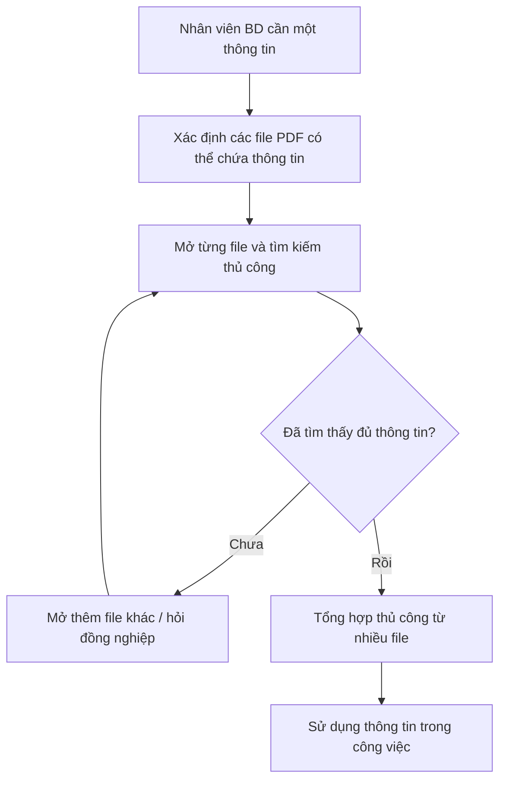
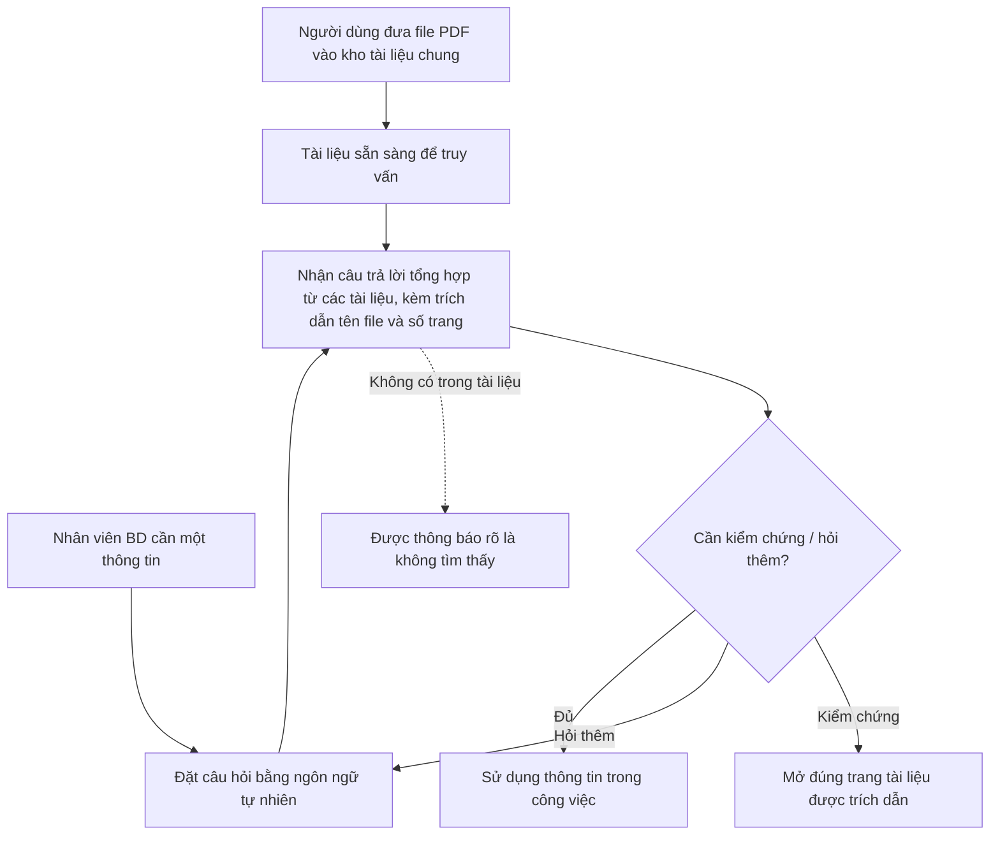

# Tài liệu Yêu cầu Nghiệp vụ (BRD) — Công cụ "Chat với tài liệu" (MVP)

> **Chuẩn áp dụng:** IEEE 29148-2018
> **Giai đoạn SDLC:** 5.2 Requirements and discovery
> **Prompt nguồn:** [BRD_Prompt_IEEE_standard.md](BRD_Prompt_IEEE_standard.md)
> **Checklist đối chiếu:** `BRD_IEEE_29148_Checklist.xlsx` (SRC-002)

---

## 0. Tóm tắt kiểm tra đầu vào (Validation summary)

**Đầu vào đã nhận**

| Đầu vào | Tình trạng |
|---|---|
| Bối cảnh và yêu cầu của quản lý (Mục 2.1 của prompt) | Đã nhận — SRC-001 |
| Checklist BRD theo IEEE 29148 | Đã nhận — SRC-002 |
| Đề xuất tính năng bổ sung của đội BA | Được phép theo SRC-001 ("Có thể có thêm tính năng theo gợi ý từ đội BA") — ghi nhận là SRC-003, **cần sponsor xác nhận** |

**Đầu vào còn thiếu**

- Tên tổ chức, nhà tài trợ (sponsor), chủ sở hữu nghiệp vụ (business owner) → OQ-012.
- Số liệu nền (baseline): thời gian tìm thông tin hiện tại, số lượng tài liệu, số người dùng → OQ-001, OQ-003, OQ-004.
- Mục tiêu định lượng (target) cho từng chỉ số → OQ-002, OQ-010.
- Ngân sách, mốc thời gian MVP → OQ-011.
- Chính sách bảo mật / phân loại tài liệu và quy định về việc dùng dịch vụ AI bên ngoài → OQ-005.
- Đánh giá về dữ liệu cá nhân trong tài liệu và quy định áp dụng → OQ-019.
- Biên bản phỏng vấn người dùng, mô tả quy trình hiện tại chính thức → mọi mô tả hiện trạng trong tài liệu này được đánh dấu `[Unverified]`.

**Ba rủi ro lớn nhất đối với chất lượng yêu cầu**

1. **Không có baseline và target** → các mục tiêu BO-001, BO-002 chưa thể kiểm chứng (vi phạm tiêu chí *Verifiable*).
2. **Chưa rõ chính sách bảo mật dữ liệu khi dùng AI** → có thể làm thay đổi phạm vi, ràng buộc và khả thi (*Feasible*) của toàn bộ giải pháp (OQ-005, RSK-002).
3. **Các tính năng gợi ý của BA chưa được sponsor xác nhận** → nguy cơ mở rộng phạm vi MVP (RSK-005).

---

## 1. Kiểm soát tài liệu (Document control)

| Thuộc tính | Giá trị |
|---|---|
| Tiêu đề | Tài liệu Yêu cầu Nghiệp vụ — Công cụ "Chat với tài liệu" (MVP) |
| Mã tài liệu | BRD-CWD-001 |
| Phiên bản | 0.2 |
| Trạng thái | **Draft** |
| Tác giả | Đội BA |
| Người đóng góp | [TBD: OQ-012] |
| Người review | Đại diện đội Phát triển kinh doanh, Đội phát triển (Dev), Bảo mật thông tin [TBD: OQ-012] |
| Người phê duyệt | Quản lý yêu cầu dự án (Executive sponsor) [TBD: OQ-012] |
| Phân loại bảo mật | Nội bộ (Internal) `[Unverified]` |

**Lịch sử phiên bản**

| Phiên bản | Ngày | Tác giả | Tóm tắt thay đổi |
|---|---|---|---|
| 0.1 | 2026-10-20 | Đội BA | Bản nháp đầu tiên dựa trên SRC-001, SRC-002, SRC-003 |
| 0.2 | 2026-10-20 | Đội BA | Sửa theo kết quả review checklist: thêm BR-024 (riêng tư hội thoại), tách BR-021 thành BR-021/BR-025, bỏ ngưỡng không có nguồn ở AC-012, thêm CON-006 + OQ-019 (dữ liệu cá nhân), DEP-005, DEP-006, OQ-020, kế hoạch dự phòng cho RSK-001..RSK-007; cập nhật §15.1 |

**Danh sách phân phối:** Executive sponsor, Business owner, Trưởng nhóm Phát triển kinh doanh, Product owner, Trưởng nhóm Dev, Bảo mật thông tin, Pháp chế (nếu có).

---

## 2. Tóm tắt điều hành (Executive summary)

**Vấn đề.** Đội Phát triển kinh doanh (BD) làm việc với nhiều tài liệu PDF của dự án và khó nắm bắt đầy đủ nội dung. Mỗi lần cần một thông tin, nhân viên phải mở và tổng hợp thủ công từ nhiều file, gây tốn thời gian (SRC-001). Mức độ tác động định lượng (số giờ mất đi, số tài liệu, số người bị ảnh hưởng) chưa được đo [TBD: OQ-001, OQ-003, OQ-004].

**Thay đổi đề xuất.** Xây dựng MVP một công cụ web "Chat với tài liệu": người dùng đưa các file PDF vào một kho tài liệu chung, sau đó đặt câu hỏi bằng ngôn ngữ tự nhiên và nhận câu trả lời do AI tổng hợp từ nội dung các tài liệu đó, kèm trích dẫn nguồn để kiểm chứng (SRC-001, SRC-003).

**Lợi ích kỳ vọng và cách chứng minh.**
- Giảm thời gian tìm thông tin (MET-001).
- Câu trả lời đủ chính xác để dùng trong công việc (MET-002).
- Đội BD thực sự sử dụng công cụ (MET-003, MET-004).
- Không phát sinh sự cố rò rỉ tài liệu (MET-005).

**Đầu tư, thời gian, rủi ro chính.** Ngân sách và mốc thời gian chưa được xác định [TBD: OQ-011]. Rủi ro chính: AI trả lời sai hoặc "bịa" thông tin (RSK-001), rò rỉ tài liệu mật qua dịch vụ AI bên ngoài (RSK-002), người dùng không tin tưởng và không sử dụng (RSK-003).

**Quyết định cần phê duyệt.** Sponsor được đề nghị: (1) xác nhận phát biểu vấn đề và mục tiêu; (2) chấp thuận phạm vi MVP tại Mục 5, bao gồm các tính năng BA đề xuất; (3) giao người chịu trách nhiệm trả lời các câu hỏi mở chặn (blocking) OQ-005, OQ-010, OQ-011.

---

## 3. Bối cảnh nghiệp vụ và phát biểu vấn đề

### 3.1 Tầm nhìn (Vision statement)

> Mọi thành viên đội Phát triển kinh doanh có thể tìm được thông tin chính xác, có nguồn kiểm chứng, từ toàn bộ tài liệu dự án chỉ bằng một câu hỏi — thay vì phải đọc lại từng file. (SRC-001)

### 3.2 Quy trình hiện tại (As-Is) `[Unverified]`

Mô tả dưới đây được suy ra từ SRC-001, chưa được xác nhận qua phỏng vấn người dùng (OQ-017).

### 3.3 Quy trình mục tiêu (To-Be)

**Cải tiến chính so với As-Is:** loại bỏ bước mở và đọc thủ công từng file; thay việc tổng hợp thủ công bằng câu trả lời tổng hợp có trích dẫn; người dùng vẫn giữ quyền kiểm chứng tại tài liệu gốc.

### 3.4 Ai bị ảnh hưởng và như thế nào

| Đối tượng | Ảnh hưởng | Bằng chứng |
|---|---|---|
| Đội Phát triển kinh doanh | Mất thời gian tổng hợp thông tin từ nhiều PDF; khó nắm bắt đầy đủ nội dung | SRC-001 |
| Quản lý | Đội BD phản hồi chậm hơn kỳ vọng; rủi ro ra quyết định trên thông tin thiếu | Suy luận từ SRC-001 `[Unverified]` |

### 3.5 Chi phí của việc không hành động

- **Chi phí thời gian:** số giờ/tuần đội BD dành để tìm và tổng hợp thông tin [TBD: OQ-001].
- **Rủi ro chất lượng:** bỏ sót thông tin nằm trong tài liệu chưa đọc, dẫn đến đề xuất/đàm phán dựa trên thông tin không đầy đủ `[Unverified]`.
- **Doanh thu / khách hàng:** chưa có bằng chứng định lượng [TBD: OQ-001].

### 3.6 Nguyên nhân gốc và triệu chứng

| Triệu chứng | Nguyên nhân gốc |
|---|---|
| Tốn thời gian mỗi lần tìm thông tin | Thông tin phân tán trong nhiều file PDF; không có điểm truy cập tập trung có khả năng tìm theo ý nghĩa câu hỏi |
| Khó nắm bắt đầy đủ nội dung | Khối lượng tài liệu vượt quá khả năng đọc và ghi nhớ của từng cá nhân `[Unverified]` |
| Phải tổng hợp thủ công | Không có công cụ kết nối thông tin liên quan từ nhiều tài liệu vào một câu trả lời |

### 3.7 Vì sao là bây giờ

Quản lý đã chính thức yêu cầu phát triển MVP (SRC-001). Lý do cụ thể về thời điểm (dự án sắp tới, khối lượng tài liệu tăng…) chưa được nêu [TBD: OQ-011].

---

## 4. Động lực nghiệp vụ và mục tiêu

| ID | Động lực nghiệp vụ | Mục tiêu (kết quả, không phải hoạt động) | Metric ID | Baseline | Target | Thời hạn | Nguồn |
|---|---|---|---|---|---|---|---|
| BO-001 | Tìm thông tin từ nhiều PDF tốn thời gian | Giảm thời gian để đội BD có được câu trả lời cho một câu hỏi về nội dung tài liệu | MET-001 | [TBD: OQ-001] | [TBD: OQ-002] | [TBD: OQ-011] | SRC-001 |
| BO-002 | Đội BD khó nắm bắt đầy đủ nội dung tài liệu | Đội BD nhận được thông tin đúng và đầy đủ từ tài liệu, có thể kiểm chứng nguồn | MET-002 | Chưa áp dụng (năng lực mới) | [TBD: OQ-010] | [TBD: OQ-011] | SRC-001, SRC-003 |
| BO-003 | MVP cần chứng minh giá trị trước khi đầu tư tiếp | Đội BD sử dụng công cụ thường xuyên và đánh giá là hữu ích | MET-003, MET-004 | Chưa áp dụng (năng lực mới) | [TBD: OQ-002] | [TBD: OQ-011] | SRC-001 |
| BO-004 | Tài liệu dự án kinh doanh có tính bảo mật `[Unverified]` | Tài liệu đưa vào công cụ chỉ được tiếp cận bởi người có thẩm quyền | MET-005 | [TBD: OQ-005] | [TBD: OQ-005] | Suốt vòng đời MVP | SRC-003 `[Unverified]` |

### 4.1 Định nghĩa chỉ số

| ID | Định nghĩa | Công thức | Nguồn dữ liệu | Owner | Tần suất | Ngày baseline |
|---|---|---|---|---|---|---|
| MET-001 | Thời gian trung bình để một nhân viên BD có câu trả lời cho một câu hỏi trong **bộ câu hỏi chuẩn** (xem Thuật ngữ) | Tổng thời gian trả lời ÷ số câu hỏi; đo cả cách làm hiện tại và khi dùng công cụ | Nghiên cứu thời gian (time study) có quan sát | Business owner | Một lần trước MVP, một lần khi kết thúc pilot | [TBD: OQ-001] |
| MET-002 | Tỷ lệ câu trả lời được chuyên gia nghiệp vụ (SME) đánh giá là **đúng và có trích dẫn đúng** trên bộ câu hỏi chuẩn | Số câu trả lời đạt ÷ tổng số câu hỏi × 100% | Phiếu chấm điểm của SME | Trưởng nhóm BD | Mỗi lần nghiệm thu bản phát hành | [TBD: OQ-010] |
| MET-003 | Tỷ lệ người dùng hoạt động hàng tuần | Số người dùng đặt ≥ 1 câu hỏi trong tuần ÷ tổng số người dùng được cấp quyền × 100% | Số liệu sử dụng (BR-021) | Product owner | Hàng tuần trong pilot | Tuần đầu pilot |
| MET-004 | Mức độ hài lòng của người dùng | Tỷ lệ câu trả lời được đánh giá "hữu ích" ÷ tổng số câu trả lời được đánh giá × 100%; bổ sung khảo sát cuối pilot | Đánh giá câu trả lời (BR-020), khảo sát | Product owner | Hàng tuần / cuối pilot | Tuần đầu pilot |
| MET-005 | Số sự cố truy cập trái phép hoặc rò rỉ nội dung tài liệu | Đếm số sự cố được xác nhận | Nhật ký sự cố của Bảo mật thông tin | Bảo mật thông tin | Hàng tháng | [TBD: OQ-005] |

> Mục tiêu BO-001 đến BO-004 **chưa hợp lệ** theo IEEE 29148 cho tới khi baseline và target được điền (OQ-001, OQ-002, OQ-005, OQ-010).

---

## 5. Phạm vi (Scope)

### 5.1 Trong phạm vi (MVP)

| Hạng mục | Nội dung | Nguồn |
|---|---|---|
| Năng lực nghiệp vụ | Đưa tài liệu PDF vào kho tài liệu chung; quản lý danh sách tài liệu | SRC-001, SRC-003 |
| Năng lực nghiệp vụ | Hỏi đáp bằng ngôn ngữ tự nhiên trên nội dung của tất cả tài liệu đã đưa vào | SRC-001 |
| Năng lực nghiệp vụ | Trích dẫn nguồn (tên tài liệu, số trang) và kiểm chứng tại tài liệu gốc | SRC-003 |
| Năng lực nghiệp vụ | Giới hạn câu hỏi trong một nhóm tài liệu được chọn; hỏi tiếp theo ngữ cảnh | SRC-003 |
| Năng lực nghiệp vụ | Xem lại hội thoại trước; đánh giá câu trả lời; thống kê sử dụng | SRC-003 |
| Đơn vị tổ chức | Đội Phát triển kinh doanh | SRC-001 |
| Kênh | Ứng dụng web | SRC-001 (CON-001) |
| Miền dữ liệu | Tài liệu PDF dạng văn bản (có lớp text) của dự án kinh doanh | SRC-001, ASM-001 |

### 5.2 Ngoài phạm vi

| Hạng mục | Lý do |
|---|---|
| Định dạng khác PDF (Word, Excel, PowerPoint, ảnh, email) | SRC-001 chỉ yêu cầu PDF |
| Tạo / chỉnh sửa nội dung tài liệu gốc | Công cụ chỉ phục vụ truy vấn, không thay thế hệ thống quản lý tài liệu |
| Ứng dụng di động native | SRC-001 chỉ yêu cầu ứng dụng web |
| Người dùng ngoài tổ chức (khách hàng, đối tác) | Rủi ro bảo mật; không có trong SRC-001 |
| AI đưa ra khuyến nghị kinh doanh hoặc quyết định thay người dùng | Công cụ chỉ cung cấp thông tin từ tài liệu (BRU-001) |

### 5.3 Hoãn lại (Deferred)

| Hạng mục | Lý do hoãn |
|---|---|
| Nhận dạng ký tự cho PDF dạng ảnh scan (OCR) | Chờ dữ liệu về tỷ lệ PDF scan (OQ-007) |
| Phân quyền theo từng tài liệu / từng nhóm | Chờ xác nhận nhu cầu (OQ-008) |
| Đồng bộ tự động từ kho tài liệu sẵn có (shared drive, hệ thống DMS) | Ngoài quy mô MVP |
| Quản lý phiên bản tài liệu | Chờ OQ-015 |
| Xuất câu trả lời / hội thoại ra file | Giá trị thấp cho MVP |

### 5.4 Ranh giới

- **Bắt đầu:** khi người dùng có quyền đưa một file PDF vào kho tài liệu.
- **Kết thúc:** khi người dùng nhận câu trả lời có trích dẫn và (tuỳ chọn) kiểm chứng tại tài liệu gốc.
- Việc thu thập tài liệu từ đối tác, lưu trữ chính thức của tài liệu, và quy trình phê duyệt nội dung kinh doanh **không** thuộc sáng kiến này.

### 5.5 Kịch bản nghiệp vụ chính

| # | Kịch bản | Tác nhân | Yêu cầu liên quan |
|---|---|---|---|
| 1 | Nhân viên BD nhận bộ hồ sơ dự án mới (nhiều PDF) và đưa vào kho tài liệu | STK-002 | BR-001, BR-002, BR-004, BR-005 |
| 2 | Trước buổi họp khách hàng, nhân viên BD hỏi "Điều khoản thanh toán của dự án X là gì?" và nhận câu trả lời kèm trang trích dẫn | STK-002 | BR-006, BR-007, BR-008, BR-014 |
| 3 | Nhân viên BD hỏi một thông tin nằm rải rác ở 3 tài liệu và nhận câu trả lời tổng hợp | STK-002 | BR-010, BR-008 |
| 4 | Nhân viên BD hỏi một thông tin không có trong tài liệu và được thông báo không tìm thấy | STK-002 | BR-009 |
| 5 | Nhân viên BD nghi ngờ câu trả lời, mở trang được trích dẫn để kiểm chứng | STK-002 | BR-017 |
| 6 | Quản lý xem số liệu sử dụng sau 4 tuần pilot để quyết định đầu tư tiếp | STK-001 | BR-021, BR-025, MET-003, MET-004 |

---

## 6. Các bên liên quan và nhu cầu

### 6.1 Các bên liên quan

| ID | Bên liên quan | Vai trò | Mối quan tâm | Ảnh hưởng | Nhu cầu | Nguồn |
|---|---|---|---|---|---|---|
| STK-001 | Quản lý (người yêu cầu MVP) | Executive sponsor / người phê duyệt | Đội BD làm việc hiệu quả hơn; chứng minh giá trị trước khi đầu tư tiếp | High | SN-001, SN-007 | SRC-001 |
| STK-002 | Đội Phát triển kinh doanh | Người dùng cuối chính | Tìm thông tin nhanh, đúng, đáng tin | High | SN-002, SN-003, SN-004, SN-005, SN-006 | SRC-001 |
| STK-003 | Đội BA | Phân tích, đề xuất tính năng | Yêu cầu rõ ràng, có thể truy vết | Medium | SN-009 | SRC-001 |
| STK-004 | Đội phát triển (Dev) | Xây dựng MVP | Phạm vi rõ ràng, khả thi trong thời gian/ngân sách | Medium | SN-010 | SRC-001 (ngầm định: "bạn nhận được yêu cầu… phát triển một MVP") |
| STK-005 | Bảo mật thông tin / IT | Kiểm soát an toàn dữ liệu; **có thể chặn** việc đưa vào sử dụng | Tài liệu mật không bị lộ, đặc biệt qua dịch vụ AI bên ngoài | High | SN-008 | `[Unverified]` — OQ-012 |
| STK-006 | Pháp chế / Compliance | Tuân thủ hợp đồng bảo mật (NDA) với đối tác | Không vi phạm cam kết bảo mật tài liệu của đối tác | Medium | SN-008 | `[Unverified]` — OQ-012 |
| STK-007 | Nhân viên BD hoài nghi AI (bên liên quan tiêu cực) | Người dùng có thể **không chấp nhận** công cụ | Sợ thông tin sai, quen cách làm thủ công | Medium | SN-003, SN-004 | `[Unverified]` — RSK-003 |

### 6.2 Nhu cầu của các bên liên quan

| ID | Bên liên quan | Phát biểu nhu cầu | Khó khăn hiện tại | Bằng chứng | Ưu tiên |
|---|---|---|---|---|---|
| SN-001 | STK-001 | "Tôi cần đội BD tìm được thông tin trong tài liệu dự án mà không mất nhiều thời gian tổng hợp" | Thời gian tổng hợp từ nhiều PDF | SRC-001 | Must |
| SN-002 | STK-002 | "Tôi muốn hỏi một câu và có câu trả lời từ tất cả tài liệu, không phải tự mở từng file" | Phải mở và tìm thủ công nhiều file | SRC-001 | Must |
| SN-003 | STK-002, STK-007 | "Tôi cần biết câu trả lời lấy từ tài liệu nào, trang nào để kiểm tra lại" | Không thể tin câu trả lời không có nguồn | SRC-003 | Must |
| SN-004 | STK-002, STK-007 | "Nếu tài liệu không có thông tin, tôi muốn được nói rõ là không có, không phải câu trả lời bịa" | Rủi ro dùng thông tin sai | SRC-003 | Must |
| SN-005 | STK-002 | "Tôi muốn tự đưa tài liệu mới vào và quản lý danh sách tài liệu" | Tài liệu đến liên tục theo dự án | SRC-001 | Must |
| SN-006 | STK-002 | "Tôi muốn hỏi riêng trong tài liệu của một dự án, và hỏi tiếp mà không phải lặp lại ngữ cảnh" | Câu trả lời lẫn thông tin dự án khác `[Unverified]` | SRC-003 | Should |
| SN-007 | STK-001 | "Tôi cần số liệu chứng minh công cụ được dùng và hữu ích để quyết định đầu tư tiếp" | Chưa có cách đo | SRC-003 | Should |
| SN-008 | STK-005, STK-006 | "Tài liệu chỉ được người có thẩm quyền tiếp cận và không bị dùng ngoài mục đích" | Chưa có chính sách cho công cụ AI | SRC-003 `[Unverified]` | Must |
| SN-009 | STK-003 | "Mọi yêu cầu cần có nguồn và tiêu chí nghiệm thu" | — | SRC-002 | Should |
| SN-010 | STK-004 | "Phạm vi MVP phải cố định và khả thi trong thời gian cho phép" | Chưa có mốc thời gian | SRC-001 | Must |

> SN-009 và SN-010 là nhu cầu về quy trình dự án; chúng được đáp ứng bởi chính tài liệu này (truy vết, phạm vi) và bởi CON-003, không cần BR riêng.

---

## 7. Yêu cầu nghiệp vụ (Business requirements)

**Thang ưu tiên (MoSCoW):** Must = thiếu thì MVP thất bại; Should = giá trị đáng kể, có cách làm thay thế; Could = mong muốn; Won't = loại trừ trong bản phát hành này.

**Phương pháp kiểm chứng:** Review / Test / Inspection / Demonstration / Analysis.

### 7.1 Nhóm A — Quản lý kho tài liệu

| ID | Yêu cầu (`shall`) | Lý do | Nguồn | Ưu tiên | AC | Kiểm chứng | Trạng thái |
|---|---|---|---|---|---|---|---|
| BR-001 | Người dùng được cấp quyền **shall** có thể đưa một file PDF vào kho tài liệu chung để file đó trở thành nguồn cho câu trả lời. | Không có tài liệu thì không có gì để truy vấn | BO-001 / SN-005 | Must | AC-001 | Test | Draft |
| BR-002 | Người dùng được cấp quyền **shall** có thể xem danh sách tài liệu trong kho, gồm tên tài liệu, người đưa vào, ngày đưa vào và trạng thái sẵn sàng truy vấn. | Người dùng cần biết câu trả lời dựa trên tập tài liệu nào | BO-002 / SN-005 | Must | AC-002 | Demonstration | Draft |
| BR-003 | Người dùng được cấp quyền **should** có thể gỡ một tài liệu khỏi kho. | Loại bỏ tài liệu sai, lỗi thời hoặc đưa nhầm | BO-002, BO-004 / SN-005 | Should | AC-003 | Test | Draft |
| BR-004 | Khi một file không thể dùng làm nguồn (bị lỗi, có mật khẩu, không có lớp văn bản, vượt giới hạn dung lượng), giải pháp **shall** thông báo cho người đưa file vào biết file không được chấp nhận kèm lý do. | Tránh người dùng tưởng tài liệu đã được dùng để trả lời | BO-002 / SN-004 | Must | AC-004 | Test | Draft |
| BR-005 | Người dùng được cấp quyền **should** có thể đưa nhiều file PDF vào kho trong một thao tác. | Hồ sơ dự án thường gồm nhiều file `[Unverified]` | BO-001 / SN-005 | Could | AC-005 | Demonstration | Draft |

### 7.2 Nhóm B — Hỏi đáp trên tài liệu

| ID | Yêu cầu (`shall`) | Lý do | Nguồn | Ưu tiên | AC | Kiểm chứng | Trạng thái |
|---|---|---|---|---|---|---|---|
| BR-006 | Người dùng được cấp quyền **shall** có thể đặt câu hỏi bằng ngôn ngữ tự nhiên tiếng Việt về nội dung các tài liệu trong kho. | Năng lực cốt lõi của "Chat với tài liệu" | BO-001 / SN-002 | Must | AC-006 | Test | Draft |
| BR-007 | Giải pháp **shall** chỉ sử dụng nội dung các tài liệu trong phạm vi truy vấn để tạo câu trả lời. | Câu trả lời phải phản ánh tài liệu của dự án, không phải kiến thức chung | BO-002 / SN-004 | Must | AC-007 | Test | Draft |
| BR-008 | Mỗi câu trả lời **shall** kèm trích dẫn gồm tên tài liệu và số trang của từng nội dung được sử dụng. | Cho phép kiểm chứng; xây dựng niềm tin | BO-002 / SN-003 | Must | AC-008 | Test | Draft |
| BR-009 | Khi các tài liệu trong phạm vi truy vấn không chứa thông tin được hỏi, giải pháp **shall** thông báo rằng không tìm thấy thông tin thay vì đưa ra câu trả lời. | Ngăn người dùng dùng thông tin bịa đặt | BO-002 / SN-004 | Must | AC-009 | Test | Draft |
| BR-010 | Khi thông tin được hỏi nằm ở nhiều tài liệu, giải pháp **shall** đưa ra một câu trả lời tổng hợp nội dung từ các tài liệu đó. | Đây chính là khó khăn "tổng hợp từ nhiều file" | BO-001 / SN-002 | Must | AC-010 | Test | Draft |
| BR-011 | Người dùng **should** có thể giới hạn câu hỏi trong một nhóm tài liệu do mình chọn. | Tránh lẫn thông tin giữa các dự án | BO-002 / SN-006 | Should | AC-011 | Test | Draft |
| BR-012 | Trong cùng một hội thoại, giải pháp **should** hiểu câu hỏi tiếp theo dựa trên các câu hỏi và câu trả lời trước đó. | Người dùng không phải lặp lại ngữ cảnh | BO-001 / SN-006 | Should | AC-012 | Test | Draft |
| BR-013 | Người dùng **should** có thể đặt câu hỏi bằng tiếng Anh và nhận câu trả lời bằng tiếng Anh. | Tài liệu dự án có thể bằng tiếng Anh `[Unverified]` | BO-001 / SN-002 | Should | AC-013 | Test | Draft — chờ OQ-006 |
| BR-014 | Giải pháp **shall** trả về câu trả lời trong vòng [TBD: OQ-009] giây cho ít nhất [TBD: OQ-009]% câu hỏi trong bộ câu hỏi chuẩn. | Nếu chậm hơn cách làm thủ công thì BO-001 không đạt | BO-001 / SN-001 | Must | AC-014 | Test | Draft — chờ OQ-009 |
| BR-015 | Giải pháp **shall** đạt tỷ lệ câu trả lời đúng và có trích dẫn đúng tối thiểu [TBD: OQ-010]% trên bộ câu hỏi chuẩn. | Câu trả lời sai làm mất giá trị và gây rủi ro nghiệp vụ | BO-002 / SN-003, SN-004 | Must | AC-015 | Analysis | Draft — chờ OQ-010 |

### 7.3 Nhóm C — Kiểm chứng và lịch sử

| ID | Yêu cầu (`shall`) | Lý do | Nguồn | Ưu tiên | AC | Kiểm chứng | Trạng thái |
|---|---|---|---|---|---|---|---|
| BR-016 | Người dùng **should** có thể xem lại các hội thoại trước đây của chính mình trong thời hạn [TBD: OQ-013]. | Tránh hỏi lại câu đã hỏi | BO-001 / SN-002 | Could | AC-016 | Demonstration | Draft |
| BR-017 | Từ một trích dẫn, người dùng **should** có thể mở nội dung trang tài liệu gốc được trích dẫn. | Kiểm chứng nhanh, giảm hoài nghi | BO-002 / SN-003 | Should | AC-017 | Demonstration | Draft |

### 7.4 Nhóm D — Truy cập, bảo mật và vận hành

| ID | Yêu cầu (`shall`) | Lý do | Nguồn | Ưu tiên | AC | Kiểm chứng | Trạng thái |
|---|---|---|---|---|---|---|---|
| BR-018 | Giải pháp **shall** chỉ cho phép người dùng được cấp quyền truy cập tài liệu, câu hỏi và câu trả lời. | Bảo vệ tài liệu kinh doanh | BO-004 / SN-008 | Must | AC-018 | Test | Draft |
| BR-019 | Tổ chức **should** có thể xác định người đã đưa vào và người đã gỡ từng tài liệu, kèm thời điểm thực hiện. | Truy vết trách nhiệm khi có sự cố | BO-004 / SN-008 | Should | AC-019 | Inspection | Draft |
| BR-020 | Nội dung tài liệu và câu hỏi **shall** được xử lý theo chính sách bảo mật dữ liệu được Bảo mật thông tin phê duyệt cho công cụ này. | Có thể là điều kiện bắt buộc để được phép sử dụng | BO-004 / SN-008 | Must | AC-020 | Review | Draft — chờ OQ-005 |
| BR-021 | Business owner **should** có thể lấy số người dùng hoạt động theo tuần. | Cần để đo MET-003 và quyết định đầu tư | BO-003 / SN-007 | Should | AC-021 | Demonstration | Draft |
| BR-022 | Người dùng **should** có thể đánh giá mỗi câu trả lời là "hữu ích" hoặc "không hữu ích". | Cần để đo MET-004 và cải thiện chất lượng | BO-003 / SN-007 | Could | AC-022 | Demonstration | Draft |
| BR-023 | Giải pháp **should** sẵn sàng phục vụ trong khung giờ [TBD: OQ-014] với tỷ lệ sẵn sàng tối thiểu [TBD: OQ-014]%. | Đội BD cần dùng khi chuẩn bị cho khách hàng | BO-001 / SN-001 | Should | AC-023 | Analysis | Draft — chờ OQ-014 |
| BR-024 | Khi lịch sử hội thoại được lưu, giải pháp **should** chỉ cho phép người tạo hội thoại xem nội dung hội thoại đó. | Câu hỏi có thể chứa thông tin nhạy cảm về khách hàng/dự án `[Unverified]` | BO-004 / SN-008 | Should | AC-024 | Test | Draft — chờ OQ-018 |
| BR-025 | Business owner **should** có thể lấy số câu hỏi được đặt theo tuần. | Cần để đo khối lượng sử dụng và theo dõi chi phí (RSK-006) | BO-003 / SN-007 | Should | AC-025 | Demonstration | Draft |

### 7.5 Tiêu chí nghiệm thu (Acceptance criteria)

"Bộ câu hỏi chuẩn" và "bộ tài liệu mẫu" được định nghĩa tại Mục 13 và phụ thuộc DEP-002, DEP-003.

| ID | BR | Tiêu chí nghiệm thu |
|---|---|---|
| AC-001 | BR-001 | Với mỗi file trong bộ tài liệu mẫu (PDF có lớp văn bản, dung lượng ≤ [TBD: OQ-004] MB), sau khi người dùng đưa vào, file xuất hiện trong danh sách với trạng thái "sẵn sàng" trong vòng [TBD: OQ-004] phút, và một câu hỏi chỉ có đáp án trong file đó nhận được câu trả lời trích dẫn file đó. |
| AC-002 | BR-002 | Danh sách hiển thị đủ 4 thông tin (tên, người đưa vào, ngày, trạng thái) cho 100% tài liệu trong kho; số tài liệu trong danh sách bằng số tài liệu đã đưa vào trừ số đã gỡ. |
| AC-003 | BR-003 | Sau khi gỡ tài liệu, tài liệu không còn trong danh sách và một câu hỏi chỉ có đáp án trong tài liệu đó nhận thông báo "không tìm thấy thông tin" (BRU-002). |
| AC-004 | BR-004 | Với 4 loại file thử nghiệm (file hỏng, file có mật khẩu, file chỉ chứa ảnh scan, file vượt giới hạn), 100% trường hợp người dùng nhận thông báo không chấp nhận, nêu đúng lý do tương ứng, và file không xuất hiện ở trạng thái "sẵn sàng". |
| AC-005 | BR-005 | Người dùng đưa 10 file trong một thao tác; cả 10 file xuất hiện trong danh sách mà không cần thao tác riêng cho từng file. |
| AC-006 | BR-006 | 100% câu hỏi tiếng Việt trong bộ câu hỏi chuẩn được tiếp nhận và nhận phản hồi (câu trả lời hoặc thông báo không tìm thấy). |
| AC-007 | BR-007 | Với 10 câu hỏi về kiến thức chung không có trong bộ tài liệu mẫu, 0 câu nhận câu trả lời nội dung; tất cả nhận thông báo không tìm thấy. SME xác nhận 0 câu trả lời chứa thông tin không có trong tài liệu. |
| AC-008 | BR-008 | 100% câu trả lời có ít nhất một trích dẫn; ≥ [TBD: OQ-010]% trích dẫn trỏ đúng tài liệu và trang chứa nội dung được dùng, theo kiểm tra của SME. |
| AC-009 | BR-009 | Với các câu hỏi "không có đáp án" trong bộ câu hỏi chuẩn, ≥ [TBD: OQ-010]% nhận thông báo không tìm thấy. |
| AC-010 | BR-010 | Với các câu hỏi "đa tài liệu" (đáp án nằm ở ≥ 2 tài liệu), ≥ [TBD: OQ-010]% câu trả lời được SME chấm đầy đủ và trích dẫn tất cả tài liệu liên quan. |
| AC-011 | BR-011 | Khi người dùng chọn nhóm tài liệu A, câu hỏi có đáp án chỉ nằm ngoài nhóm A nhận thông báo không tìm thấy, và mọi trích dẫn đều thuộc nhóm A. |
| AC-012 | BR-012 | Với 10 cặp câu hỏi nối tiếp (câu thứ hai dùng đại từ thay thế, ví dụ "còn thời hạn của nó?"), tỷ lệ câu thứ hai được SME chấm là trả lời đúng ngữ cảnh ≥ [TBD: OQ-010]. |
| AC-013 | BR-013 | Với các câu hỏi tiếng Anh trong bộ câu hỏi chuẩn, câu trả lời bằng tiếng Anh và đạt cùng ngưỡng như AC-015. |
| AC-014 | BR-014 | Đo trên toàn bộ bộ câu hỏi chuẩn: tỷ lệ câu hỏi nhận phản hồi trong ngưỡng thời gian ≥ ngưỡng phần trăm đã thống nhất tại OQ-009. |
| AC-015 | BR-015 | SME chấm toàn bộ bộ câu hỏi chuẩn theo phiếu chấm; tỷ lệ đạt ≥ ngưỡng thống nhất tại OQ-010. |
| AC-016 | BR-016 | Người dùng mở lại một hội thoại đã tạo trước đó ≥ 1 ngày và thấy đầy đủ câu hỏi, câu trả lời, trích dẫn. |
| AC-017 | BR-017 | Với 20 trích dẫn ngẫu nhiên, 100% thao tác mở trích dẫn hiển thị đúng tài liệu ở đúng trang được trích dẫn. |
| AC-018 | BR-018 | Người không được cấp quyền thử truy cập danh sách tài liệu, nội dung tài liệu, hội thoại: 100% bị từ chối. Kiểm thử được Bảo mật thông tin xác nhận. |
| AC-019 | BR-019 | Với 10 thao tác đưa vào/gỡ tài liệu thử nghiệm, 100% có bản ghi người thực hiện và thời điểm, truy xuất được bởi business owner. |
| AC-020 | BR-020 | Bảo mật thông tin ký xác nhận giải pháp tuân thủ chính sách đã phê duyệt (OQ-005) trước khi đưa vào pilot. |
| AC-021 | BR-021 | Business owner lấy được số người dùng hoạt động của một tuần bất kỳ trong pilot; số liệu khớp với kiểm đếm mẫu. |
| AC-022 | BR-022 | Người dùng đánh giá một câu trả lời; đánh giá được tính vào số liệu MET-004 của tuần đó. |
| AC-023 | BR-023 | Tỷ lệ thời gian sẵn sàng đo trong suốt pilot ≥ ngưỡng thống nhất tại OQ-014. |
| AC-024 | BR-024 | Người dùng B thử mở 5 hội thoại do người dùng A tạo: 100% bị từ chối; người dùng A vẫn mở được cả 5 hội thoại. |
| AC-025 | BR-025 | Business owner lấy được số câu hỏi của một tuần bất kỳ trong pilot; số liệu khớp với kiểm đếm mẫu. |

---

## 8. Quy tắc nghiệp vụ (Business rules)

| ID | Quy tắc | Loại | Phạm vi | Chịu trách nhiệm thực thi | Nguồn |
|---|---|---|---|---|---|
| BRU-001 | Câu trả lời chỉ được dựa trên nội dung tài liệu trong kho; công cụ không đưa ra khuyến nghị hay quyết định kinh doanh. | Policy | Hỏi đáp | Product owner | SRC-001, SRC-003 |
| BRU-002 | Tài liệu đã bị gỡ khỏi kho không được dùng làm nguồn cho bất kỳ câu trả lời nào sau thời điểm gỡ. | Decision | Kho tài liệu, hỏi đáp | Product owner | SRC-003 |
| BRU-003 | Chỉ thành viên được cấp quyền của đội BD (và người được Business owner chỉ định) được sử dụng công cụ. | Policy | Toàn bộ | Business owner | SRC-003 `[Unverified]` |
| BRU-004 | Tài liệu có mức phân loại bảo mật cao hơn mức cho phép [TBD: OQ-005] không được đưa vào công cụ. | Policy / Legal | Kho tài liệu | Bảo mật thông tin | `[Unverified]` — OQ-005 |
| BRU-005 | Trong MVP, mọi người dùng được cấp quyền đều được truy vấn mọi tài liệu trong kho chung. | Decision | Kho tài liệu | Business owner | ASM-003 — chờ OQ-008 |
| BRU-006 | Người dùng chịu trách nhiệm kiểm chứng câu trả lời tại tài liệu gốc trước khi dùng cho cam kết với khách hàng. | Policy | Sử dụng câu trả lời | Trưởng nhóm BD | SRC-003 `[Unverified]` |

---

## 9. Ràng buộc (Constraints)

| ID | Ràng buộc | Loại | Áp đặt bởi | Tác động | Nguồn |
|---|---|---|---|---|---|
| CON-001 | Giải pháp được cung cấp dưới dạng ứng dụng web. | Technical | Executive sponsor | Loại trừ ứng dụng desktop / mobile native | SRC-001 |
| CON-002 | Định dạng tài liệu đầu vào của MVP là PDF. | Organizational | Executive sponsor | Loại trừ các định dạng khác | SRC-001 |
| CON-003 | Sản phẩm là MVP — phạm vi giới hạn ở năng lực tối thiểu để kiểm chứng giá trị. | Budget / Time | Executive sponsor | Các hạng mục Could có thể bị cắt nếu vượt thời gian [TBD: OQ-011] | SRC-001 |
| CON-004 | Câu trả lời được tạo bởi AI thông qua giao diện hội thoại (chat). | Technical | Executive sponsor | Định hướng loại giải pháp; nhà cung cấp AI cụ thể để lại cho SAD | SRC-001 |
| CON-005 | Việc xử lý tài liệu phải tuân thủ chính sách bảo mật thông tin của tổ chức và các thoả thuận bảo mật (NDA) với đối tác. | Regulatory / Contractual | Bảo mật thông tin, Pháp chế | Có thể giới hạn việc dùng dịch vụ AI bên ngoài hoặc vị trí lưu trữ dữ liệu | `[Unverified]` — OQ-005 |
| CON-006 | Nếu tài liệu chứa dữ liệu cá nhân (ví dụ thông tin liên hệ, hợp đồng có thông tin cá nhân của đối tác/khách hàng), việc xử lý phải tuân thủ quy định bảo vệ dữ liệu cá nhân của Việt Nam (ví dụ Nghị định 13/2023/NĐ-CP). | Regulatory / Legal | Pháp luật; Pháp chế | Có thể yêu cầu cơ sở pháp lý cho việc xử lý, giới hạn chuyển dữ liệu ra ngoài, quy định lưu trữ/xoá | `[Unverified]` — OQ-019, REF-PDP |

> Các gợi ý thiết kế (ví dụ: kỹ thuật truy xuất tăng cường – RAG, lựa chọn mô hình AI, cơ sở dữ liệu vector) **không** thuộc BRD này; chúng được chuyển sang PRD/SAD.

---

## 10. Giả định, phụ thuộc và rủi ro

| ID | Hạng mục | Loại | Mô tả | Tác động nếu sai | Owner | Xác nhận / giảm thiểu / dự phòng | Hạn |
|---|---|---|---|---|---|---|---|
| ASM-001 | PDF chủ yếu có lớp văn bản | Assumption | Phần lớn tài liệu không phải ảnh scan | Nhiều tài liệu không dùng được; cần OCR (đang Deferred) | Trưởng nhóm BD | Khảo sát mẫu tài liệu thực tế (OQ-007) | 2026-10-30 |
| ASM-002 | Ngôn ngữ tài liệu | Assumption | Tài liệu bằng tiếng Việt và/hoặc tiếng Anh | Chất lượng trả lời giảm với ngôn ngữ khác | Trưởng nhóm BD | Khảo sát mẫu (OQ-006) | 2026-10-30 |
| ASM-003 | Không cần phân quyền theo tài liệu | Assumption | Mọi thành viên BD được xem mọi tài liệu | Vi phạm bảo mật nội bộ; phải bổ sung phân quyền | Business owner | Xác nhận với sponsor (OQ-008) | 2026-10-27 |
| ASM-004 | Khối lượng tài liệu vừa phải | Assumption | Số lượng và dung lượng tài liệu trong giới hạn MVP | Ảnh hưởng thời gian phản hồi và chi phí | Trưởng nhóm BD | Đo khối lượng thực tế (OQ-004) | 2026-10-30 |
| ASM-005 | Được phép dùng dịch vụ AI bên ngoài | Assumption | Tổ chức cho phép gửi nội dung tài liệu tới nhà cung cấp AI đã phê duyệt | **Rất cao** — có thể phải thay đổi toàn bộ hướng giải pháp | Bảo mật thông tin | Xin quyết định chính thức (OQ-005) | 2026-10-27 |
| ASM-006 | Người dùng có trình duyệt và mạng nội bộ/Internet | Assumption | Đội BD truy cập được ứng dụng web | Không sử dụng được | IT | Xác nhận với IT | 2026-10-30 |
| DEP-001 | Phê duyệt bảo mật | Dependency | Quyết định của Bảo mật thông tin về xử lý dữ liệu và nhà cung cấp AI | Không thể pilot | Bảo mật thông tin | Theo dõi qua OQ-005 | 2026-10-27 |
| DEP-002 | Bộ tài liệu mẫu | Dependency | Đội BD cung cấp bộ PDF đại diện cho kiểm thử và nghiệm thu | Không thể nghiệm thu BR-001, BR-015 | Trưởng nhóm BD | Yêu cầu bàn giao | 2026-11-03 |
| DEP-003 | Bộ câu hỏi chuẩn và SME | Dependency | SME xây dựng bộ câu hỏi kèm đáp án và chấm điểm | Không đo được MET-001, MET-002 | Trưởng nhóm BD | Lên lịch workshop | 2026-11-06 |
| DEP-004 | Nguồn xác thực người dùng | Dependency | Danh sách / hệ thống định danh người dùng được cấp quyền | Không thực thi được BR-018 | IT | Xác nhận với IT (OQ-016) | 2026-10-30 |
| DEP-005 | Kho tài liệu hiện có và sáng kiến liền kề | Dependency | Nơi tài liệu dự án đang được lưu (shared drive, DMS, email) và các sáng kiến khác có thể giải quyết cùng vấn đề | Đưa vào bản tài liệu không chính thức; trùng lặp đầu tư với sáng kiến khác | IT + Trưởng nhóm BD | Xác nhận qua OQ-020 | 2026-10-30 |
| DEP-006 | Điều khoản của nhà cung cấp AI | Dependency | Điều khoản xử lý dữ liệu, cam kết không dùng dữ liệu để huấn luyện, mức sẵn sàng dịch vụ (SLA) của nhà cung cấp AI được phê duyệt | Không đáp ứng được BR-020, BR-023, CON-006 | Bảo mật thông tin + Trưởng nhóm Dev | Đánh giá nhà cung cấp sau khi có OQ-005 | 2026-11-06 |
| RSK-001 | AI trả lời sai / bịa | Risk | AI tạo nội dung không có trong tài liệu → người dùng tin và dùng → sai sót trong đề xuất/đàm phán với khách hàng | High | Product owner | Giảm thiểu: BR-007, BR-008, BR-009, BR-015, BRU-006; nghiệm thu với SME. **Dự phòng:** nếu BR-015 không đạt ngưỡng, giới hạn pilot ở một nhóm nhỏ, bắt buộc kiểm chứng trích dẫn trước khi dùng (BRU-006) và đánh giá lại sau một vòng cải thiện; nếu vẫn không đạt, sponsor quyết định dừng hoặc thu hẹp phạm vi | Suốt dự án |
| RSK-002 | Rò rỉ tài liệu mật | Risk | Tài liệu gửi tới dịch vụ bên ngoài hoặc bị truy cập trái phép → lộ thông tin dự án → vi phạm NDA, thiệt hại uy tín | High | Bảo mật thông tin | Giảm thiểu: BR-018, BR-020, BRU-004, CON-006, DEP-001, DEP-006. **Dự phòng:** nếu không được dùng dịch vụ AI bên ngoài, trình sponsor các phương án: (a) AI vận hành trong hạ tầng của tổ chức, (b) pilot chỉ với tài liệu không mật, (c) hoãn pilot; nếu xảy ra sự cố, tạm dừng công cụ và kích hoạt quy trình xử lý sự cố của Bảo mật thông tin | Trước pilot |
| RSK-003 | Người dùng không chấp nhận | Risk | Câu trả lời thiếu tin cậy hoặc chậm → người dùng quay lại cách làm thủ công → BO-003 không đạt | Medium | Product owner | Giảm thiểu: trích dẫn + kiểm chứng (BR-008, BR-017); đào tạo; thu phản hồi (BR-022). **Dự phòng:** nếu MET-003 thấp hơn target sau [TBD: OQ-002] tuần pilot, phỏng vấn người dùng không hoạt động để tìm nguyên nhân trước khi quyết định đầu tư tiếp | Pilot |
| RSK-004 | Chất lượng trích xuất kém | Risk | Bảng biểu, PDF scan, bố cục phức tạp → nội dung đọc sai → câu trả lời sai | Medium | Trưởng nhóm Dev | Giảm thiểu: kiểm thử với bộ tài liệu mẫu (DEP-002); BR-004. **Dự phòng:** loại các loại tài liệu bị trích xuất kém khỏi pilot và thông báo danh sách cho người dùng; xem xét OCR/xử lý bảng ở giai đoạn sau | Trước nghiệm thu |
| RSK-005 | Mở rộng phạm vi | Risk | Thêm tính năng BA đề xuất ngoài thời gian → trễ MVP | Medium | Product owner | Giảm thiểu: sponsor phê duyệt phạm vi (OQ-018); làm Must trước; CON-003. **Dự phòng:** khi trễ tiến độ, cắt BR Could (BR-005, BR-016, BR-022) trước, sau đó đến BR Should theo thứ tự sponsor phê duyệt | 2026-10-27 |
| RSK-006 | Chi phí AI biến động | Risk | Chi phí theo lượng sử dụng → vượt ngân sách khi mở rộng | Medium | Business owner | Giảm thiểu: theo dõi số câu hỏi qua BR-025; xác định ngân sách (OQ-011). **Dự phòng:** đặt ngưỡng chi phí theo tháng; khi chạm ngưỡng, giới hạn số câu hỏi mỗi người dùng/ngày và báo cáo sponsor | Pilot |
| RSK-007 | Tài liệu mâu thuẫn / lỗi thời | Risk | Nhiều phiên bản cùng tài liệu trong kho → câu trả lời mâu thuẫn → nhầm lẫn | Medium | Trưởng nhóm BD | Giảm thiểu: trích dẫn rõ nguồn; BR-003; OQ-015. **Dự phòng:** khi phát hiện mâu thuẫn, người đưa tài liệu vào gỡ phiên bản cũ (BR-003); quy tắc quản lý phiên bản được quyết định qua OQ-015 | Pilot |

---

## 11. Truy vết (Traceability)

### 11.1 Ma trận truy vết

| Mục tiêu nghiệp vụ | Nhu cầu | Yêu cầu nghiệp vụ | Tiêu chí nghiệm thu | PRD/SRS |
|---|---|---|---|---|
| BO-001 | SN-005 | BR-001 | AC-001 | [TBD] |
| BO-002 | SN-005 | BR-002 | AC-002 | [TBD] |
| BO-002, BO-004 | SN-005 | BR-003 | AC-003 | [TBD] |
| BO-002 | SN-004 | BR-004 | AC-004 | [TBD] |
| BO-001 | SN-005 | BR-005 | AC-005 | [TBD] |
| BO-001 | SN-002 | BR-006 | AC-006 | [TBD] |
| BO-002 | SN-004 | BR-007 | AC-007 | [TBD] |
| BO-002 | SN-003 | BR-008 | AC-008 | [TBD] |
| BO-002 | SN-004 | BR-009 | AC-009 | [TBD] |
| BO-001 | SN-002 | BR-010 | AC-010 | [TBD] |
| BO-002 | SN-006 | BR-011 | AC-011 | [TBD] |
| BO-001 | SN-006 | BR-012 | AC-012 | [TBD] |
| BO-001 | SN-002 | BR-013 | AC-013 | [TBD] |
| BO-001 | SN-001 | BR-014 | AC-014 | [TBD] |
| BO-002 | SN-003, SN-004 | BR-015 | AC-015 | [TBD] |
| BO-001 | SN-002 | BR-016 | AC-016 | [TBD] |
| BO-002 | SN-003 | BR-017 | AC-017 | [TBD] |
| BO-004 | SN-008 | BR-018 | AC-018 | [TBD] |
| BO-004 | SN-008 | BR-019 | AC-019 | [TBD] |
| BO-004 | SN-008 | BR-020 | AC-020 | [TBD] |
| BO-003 | SN-007 | BR-021 | AC-021 | [TBD] |
| BO-003 | SN-007 | BR-022 | AC-022 | [TBD] |
| BO-001 | SN-001 | BR-023 | AC-023 | [TBD] |
| BO-004 | SN-008 | BR-024 | AC-024 | [TBD] |
| BO-003 | SN-007 | BR-025 | AC-025 | [TBD] |

### 11.2 Báo cáo độ phủ

| Kiểm tra | Kết quả |
|---|---|
| Mục tiêu không có yêu cầu | Không có. BO-001: 9 BR; BO-002: 9 BR; BO-003: 3 BR; BO-004: 5 BR. |
| Yêu cầu mồ côi (không có BO/SN) | Không có. |
| Nhu cầu không có yêu cầu | SN-009, SN-010 — có chủ đích: được đáp ứng bởi chính BRD (truy vết, phạm vi) và CON-003, không phải năng lực nghiệp vụ. |
| Yêu cầu không có AC hoặc phương pháp kiểm chứng | Không có. Tuy nhiên AC-001, AC-008, AC-009, AC-010, AC-012, AC-013, AC-014, AC-015, AC-020, AC-023 chứa ngưỡng `[TBD]` → **chưa thể quyết định khách quan** cho tới khi OQ-004, OQ-005, OQ-009, OQ-010, OQ-014 được giải quyết. |

---

## 12. Câu hỏi mở và quyết định

| ID | Câu hỏi / quyết định cần có | Vì sao quan trọng | Owner | Cần trước | Trạng thái | Kết luận |
|---|---|---|---|---|---|---|
| OQ-001 | Hiện tại một nhân viên BD mất bao lâu để trả lời một câu hỏi điển hình từ tài liệu? Bao nhiêu lần/tuần? | Baseline MET-001; định lượng chi phí không hành động | Trưởng nhóm BD | 2026-11-06 | Open | — |
| OQ-002 | Mục tiêu giảm thời gian (MET-001) và mức sử dụng (MET-003, MET-004) mà sponsor kỳ vọng là bao nhiêu? | Target của BO-001, BO-003 | Executive sponsor | 2026-11-06 | Open | — |
| OQ-003 | Có bao nhiêu người dùng trong đội BD sẽ dùng MVP? | Quy mô, chi phí, MET-003 | Trưởng nhóm BD | 2026-10-27 | Open | — |
| OQ-004 | Số lượng tài liệu, dung lượng tối đa mỗi file, số trang trung bình? Thời gian chấp nhận được để tài liệu sẵn sàng? | AC-001, ASM-004 | Trưởng nhóm BD | 2026-10-30 | Open | — |
| OQ-005 | Mức phân loại bảo mật của tài liệu là gì? Có được gửi nội dung tới dịch vụ AI bên ngoài không, với điều kiện gì (không dùng để huấn luyện, vị trí lưu trữ dữ liệu)? | **Blocking** — BR-020, BRU-004, CON-005, ASM-005 | Bảo mật thông tin | 2026-10-27 | Open | — |
| OQ-006 | Tài liệu và câu hỏi dùng những ngôn ngữ nào? | BR-013 | Trưởng nhóm BD | 2026-10-30 | Open | — |
| OQ-007 | Tỷ lệ PDF dạng ảnh scan là bao nhiêu? OCR có cần cho MVP không? | ASM-001, phạm vi Deferred | Trưởng nhóm BD | 2026-10-30 | Open | — |
| OQ-008 | Có tài liệu nào chỉ một số người được xem không? | ASM-003, BRU-005 | Business owner | 2026-10-27 | Open | — |
| OQ-009 | Thời gian phản hồi tối đa chấp nhận được và tỷ lệ câu hỏi phải đạt? | BR-014 | Executive sponsor | 2026-11-06 | Open | — |
| OQ-010 | Ngưỡng độ chính xác tối thiểu để nghiệm thu, và phiếu chấm điểm của SME? | **Blocking** — BR-015, AC-008..AC-010, AC-012 | Executive sponsor + Trưởng nhóm BD | 2026-11-06 | Open | — |
| OQ-011 | Ngân sách, mốc thời gian MVP, thời lượng pilot? Lý do thời điểm (why now)? | **Blocking** — CON-003, khả thi, BO thời hạn | Executive sponsor | 2026-10-27 | Open | — |
| OQ-012 | Tên tổ chức, sponsor, business owner, đại diện Bảo mật thông tin và Pháp chế? | Phê duyệt, phân công owner | Executive sponsor | 2026-10-27 | Open | — |
| OQ-013 | Lịch sử hội thoại cần lưu bao lâu? Có quy định lưu trữ/xoá dữ liệu không? | BR-016, tuân thủ | Bảo mật thông tin | 2026-11-06 | Open | — |
| OQ-014 | Khung giờ sử dụng và tỷ lệ sẵn sàng kỳ vọng? Thời gian khôi phục chấp nhận được khi gián đoạn? | BR-023 | Business owner | 2026-11-06 | Open | — |
| OQ-015 | Xử lý thế nào khi có nhiều phiên bản của cùng một tài liệu? | RSK-007 | Trưởng nhóm BD | 2026-11-06 | Open | — |
| OQ-016 | Người dùng được xác thực bằng nguồn định danh nào? | DEP-004, BR-018 | IT | 2026-10-30 | Open | — |
| OQ-017 | Quy trình hiện tại (Mục 3.2) có đúng thực tế không? | Xác thực vấn đề | Đội BA | 2026-11-03 | Open | — |
| OQ-018 | Sponsor có chấp thuận các tính năng BA đề xuất (BR-005, BR-011, BR-012, BR-016, BR-017, BR-019, BR-021, BR-022, BR-024, BR-025) trong MVP không? | Phạm vi, RSK-005 | Executive sponsor | 2026-10-27 | Open | — |
| OQ-019 | Tài liệu dự án có chứa dữ liệu cá nhân không? Nếu có, quy định bảo vệ dữ liệu cá nhân nào áp dụng và có yêu cầu gì đối với việc xử lý bằng AI / chuyển ra nhà cung cấp bên ngoài? | CON-006, BR-020, khả thi | Pháp chế | 2026-11-03 | Open | — |
| OQ-020 | Tài liệu dự án hiện được lưu ở đâu (shared drive, DMS, email)? Có sáng kiến nào khác trong tổ chức đang giải quyết cùng vấn đề không? | DEP-005, ranh giới phạm vi | IT + Trưởng nhóm BD | 2026-10-30 | Open | — |

**Quyết định đã ghi nhận trong quá trình khảo sát:** chưa có quyết định chính thức nào ngoài nội dung SRC-001.

---

## 13. Thuật ngữ và tài liệu tham chiếu

### 13.1 Thuật ngữ

| Thuật ngữ | Định nghĩa |
|---|---|
| BD | Business Development — đội Phát triển kinh doanh |
| MVP | Minimum Viable Product — phiên bản sản phẩm tối thiểu để kiểm chứng giá trị |
| Kho tài liệu chung | Tập hợp các tài liệu PDF đã được đưa vào công cụ và được dùng làm nguồn cho câu trả lời |
| Phạm vi truy vấn | Tập tài liệu được dùng cho một câu hỏi: toàn bộ kho, hoặc nhóm tài liệu người dùng chọn (BR-011) |
| Trích dẫn | Tham chiếu tới tên tài liệu và số trang chứa nội dung được dùng trong câu trả lời |
| Câu trả lời đúng | Câu trả lời được SME đánh giá là chính xác, đầy đủ so với đáp án trong bộ câu hỏi chuẩn, và chỉ chứa thông tin có trong tài liệu |
| Bộ tài liệu mẫu | Tập PDF đại diện do đội BD cung cấp cho kiểm thử và nghiệm thu (DEP-002) |
| Bộ câu hỏi chuẩn | Tập câu hỏi kèm đáp án do SME xây dựng trên bộ tài liệu mẫu, gồm câu hỏi đơn tài liệu, đa tài liệu, không có đáp án, tiếng Việt và tiếng Anh (DEP-003) |
| PDF có lớp văn bản | PDF mà văn bản có thể được chọn/sao chép, khác với PDF chỉ chứa ảnh scan |
| SME | Subject Matter Expert — chuyên gia nghiệp vụ |
| Dữ liệu cá nhân | Thông tin gắn với một con người cụ thể hoặc giúp xác định một con người cụ thể; phạm vi chính xác theo REF-PDP |
| "Bịa" (hallucination) | Hiện tượng AI tạo ra thông tin không có trong tài liệu nguồn |
| Người dùng được cấp quyền | Người thuộc danh sách được Business owner cho phép sử dụng công cụ (BRU-003) |

### 13.2 Tài liệu tham chiếu

| ID | Tên | Loại | Owner | Phiên bản / ngày | Nội dung chứng minh |
|---|---|---|---|---|---|
| SRC-001 | Yêu cầu của quản lý — bối cảnh và mục tiêu MVP "Chat với tài liệu" (Mục 2.1, [BRD_Prompt_IEEE_standard.md](BRD_Prompt_IEEE_standard.md)) | Sponsor brief | Quản lý (STK-001) | v1.0 / truy cập 2026-10-20 | Vấn đề nghiệp vụ, mục tiêu, kênh web, định dạng PDF |
| SRC-002 | BRD_IEEE_29148_Checklist.xlsx | Checklist | Đội BA | Truy cập 2026-10-20 | Các hạng mục bắt buộc của BRD |
| SRC-003 | Đề xuất tính năng bổ sung của đội BA (trong tài liệu này) | Workshop nội bộ BA | Đội BA | 2026-10-20 | Trích dẫn nguồn, giới hạn tài liệu, hội thoại, thống kê — **chờ sponsor xác nhận (OQ-018)** |
| REF-IEEE | ISO/IEC/IEEE 29148:2018 — Requirements engineering | Tiêu chuẩn | ISO/IEC/IEEE | 2018 | Tiêu chí chất lượng yêu cầu |
| REF-PDP | Nghị định 13/2023/NĐ-CP về bảo vệ dữ liệu cá nhân và các văn bản thay thế/hướng dẫn hiện hành | Quy định pháp luật | Chính phủ Việt Nam | Cần Pháp chế xác nhận văn bản hiện hành (OQ-019) | Nghĩa vụ khi xử lý dữ liệu cá nhân |

---

## 14. Phê duyệt

| Vai trò | Tên | Quyết định | Chữ ký / ngày |
|---|---|---|---|
| Executive sponsor | [TBD: OQ-012] | [Approve / Approve with conditions / Reject] | |
| Business owner | [TBD: OQ-012] | [Approve / Reject] | |
| Product manager / Product owner | [TBD: OQ-012] | [Approve / Reject] | |
| Bảo mật thông tin / Pháp chế | [TBD: OQ-012] | [Approve / Reject] | |

**Phiên bản được phê duyệt:** 0.2 (Draft) chưa đủ điều kiện để baseline.
**Điều kiện phê duyệt:** OQ-005, OQ-010, OQ-011 được giải quyết; các ngưỡng `[TBD]` trong BR-014, BR-015 được điền; sponsor xác nhận phạm vi (OQ-018).

---

## 15. Phụ lục

### 15.1 Kết quả đối chiếu checklist SRC-002

Trạng thái dùng cùng danh sách với file checklist (Done / In Progress / Pending / N/A). Chi tiết bằng chứng và việc cần làm nằm ở cột *Notes / Action Items* của `BRD_IEEE_29148_Checklist.xlsx`.

| Hạng mục checklist | Mục BRD | Trạng thái | Ghi chú |
|---|---|---|---|
| Business Purpose & Drivers | §3, §4 | Done | Tác động chưa định lượng (OQ-001) |
| Business Objectives & Success Metrics | §4 | In Progress | Thiếu baseline/target, ROI (OQ-001, OQ-002, OQ-010, OQ-011) |
| Scope & Boundaries | §5 | Done | — |
| Vision Statement | §3.1 | Done | — |
| Stakeholder Identification | §6.1 | In Progress | STK-005..007 `[Unverified]`; chưa có tên người (OQ-012) |
| User Personas & Profile Characteristics | §6, §5.5 | In Progress | Chưa có persona; cần phỏng vấn (OQ-017) |
| Business Constraints | §9 | In Progress | Thiếu ngân sách/thời gian (OQ-011); CON-005, CON-006 `[Unverified]` |
| As-Is Workflow | §3.2 | In Progress | `[Unverified]` (OQ-017) |
| To-Be Workflow | §3.3 | Done | — |
| Operational Scenarios & Use Cases | §5.5 | Done | — |
| Singularity & Clarity | §7 | Done | v0.2: tách BR-021 thành BR-021/BR-025 |
| Completeness & Implementation-Free | §7, §9 | In Progress | Ngưỡng `[TBD]` ở BR-014, BR-015, BR-016, BR-023 và các AC liên quan. v0.2: sửa AC-016, AC-012 |
| Traceability & Rationale | §7, §11 | Done | 25/25 BR có nguồn, AC và phương pháp kiểm chứng |
| Feasibility & Realism | §7, §10 | In Progress | Phụ thuộc OQ-005, OQ-011, OQ-019 |
| Compliance & Regulatory | BR-020, CON-005, CON-006 | In Progress | v0.2: thêm CON-006, OQ-019 về dữ liệu cá nhân; chờ Pháp chế |
| Business Continuity & Availability | BR-023 | In Progress | Chờ OQ-014 (khung giờ, tỷ lệ sẵn sàng, RTO/RPO) |
| Security & Business Policy | BR-018..BR-020, BR-024, BRU-003..BRU-005 | In Progress | v0.2: thêm BR-024; chờ OQ-005, OQ-008, OQ-016 |
| Business Assumptions | §10 | Done | — |
| Dependencies | §10 | Done | v0.2: thêm DEP-005, DEP-006; chờ xác nhận qua OQ-020 |
| Business Risks & Mitigation | §10 | Done | v0.2: thêm kế hoạch dự phòng cho RSK-001..RSK-007 |

**Tổng hợp:** 10 Done, 10 In Progress. Các mục In Progress đều do thiếu thông tin đầu vào (câu hỏi mở), không còn lỗi nội dung đã biết.

### 15.2 Kết quả kiểm tra theo Mục 5 của prompt

**5.1 Chất lượng yêu cầu**

- [x] Mọi yêu cầu dùng cú pháp `shall` (Must) / `should` (Should, Could) và chứa một nghĩa vụ.
- [x] Không có ngôn ngữ thiết kế/giải pháp trong yêu cầu (CON-001, CON-004 là ràng buộc do sponsor áp đặt).
- [ ] Mọi yêu cầu được định lượng khi cần — **chưa đạt**: BR-014, BR-015, BR-016, BR-023 chờ số liệu.
- [x] Không còn từ ngữ mơ hồ (nhanh, dễ dùng, mạnh mẽ…).
- [x] Mỗi AC chỉ kiểm tra điều được nêu trong BR tương ứng (v0.2: sửa AC-016).
- [x] Thuật ngữ chuyên biệt có trong Thuật ngữ.
- [x] Không có yêu cầu trùng lặp hay mâu thuẫn.
- [x] Mỗi yêu cầu có ID duy nhất, cố định.

**5.2 Độ đầy đủ và truy vết**

- [x] Mọi mục tiêu có ít nhất một yêu cầu.
- [x] Mọi yêu cầu truy vết tới mục tiêu hoặc nhu cầu.
- [x] Mọi yêu cầu có ít nhất một tiêu chí nghiệm thu.
- [x] Mọi yêu cầu có phương pháp kiểm chứng.
- [x] Mọi nhóm bên liên quan có ít nhất một nhu cầu.
- [x] Phạm vi, loại trừ, giả định, phụ thuộc, rủi ro đều được điền.
- [x] Mọi câu hỏi mở có owner và hạn.

**5.3 Xác nhận nghiệp vụ**

- [ ] Phát biểu vấn đề có bằng chứng — **một phần**: chỉ dựa trên SRC-001, chưa có số liệu.
- [ ] Baseline và target có nguồn, đo được — **chưa đạt**.
- [ ] Lợi ích và chi phí nêu bằng thuật ngữ nghiệp vụ — **một phần**: thiếu chi phí (OQ-011).
- [ ] Sponsor xác nhận vấn đề và kết quả mong muốn — **chưa thực hiện**.
- [x] Người đọc nghiệp vụ hiểu được tài liệu mà không cần dịch kỹ thuật.

**Lỗi còn mở đối với yêu cầu Must:** BR-014 (thiếu ngưỡng — OQ-009), BR-015 (thiếu ngưỡng — OQ-010), BR-020 (thiếu chính sách — OQ-005).

---

## Tuyên bố sẵn sàng

**Ready with conditions** — Sẵn sàng cho buổi review với các bên liên quan; **chưa sẵn sàng để phê duyệt/baseline.**

Các hạng mục chặn:

- **OQ-005** — Chính sách bảo mật và việc dùng dịch vụ AI (chặn BR-020, CON-005, ASM-005).
- **OQ-010** — Ngưỡng độ chính xác (chặn BR-015, AC-008, AC-009, AC-010, AC-012).
- **OQ-009** — Ngưỡng thời gian phản hồi (chặn BR-014).
- **OQ-011** — Ngân sách và mốc thời gian (chặn CON-003, đánh giá khả thi).
- **OQ-001 / OQ-002** — Baseline và target (chặn tính hợp lệ của BO-001, BO-003).
- **OQ-018** — Sponsor xác nhận phạm vi gồm tính năng BA đề xuất.
