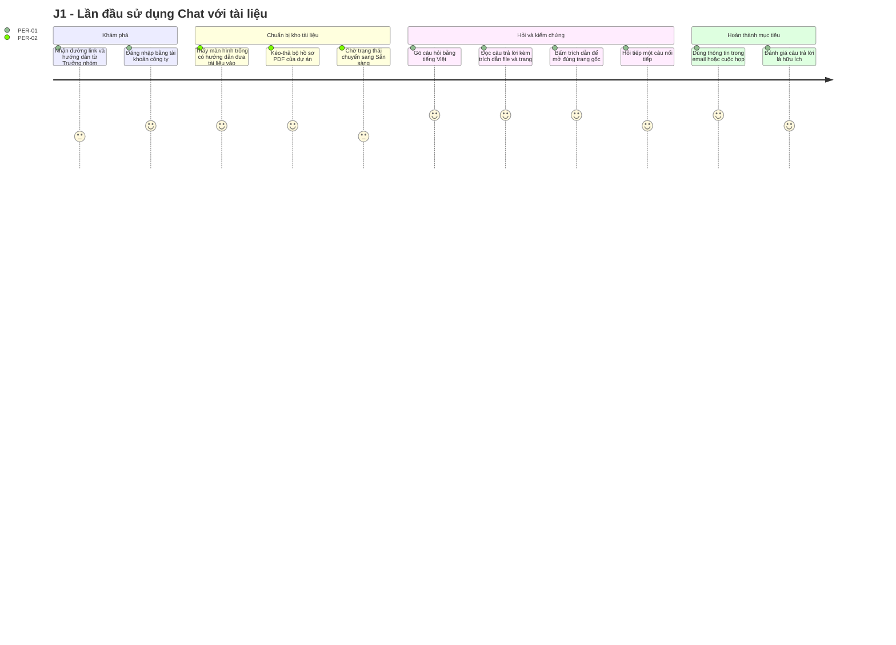
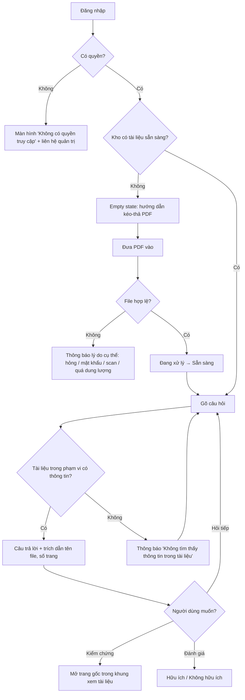

# Tài liệu Yêu cầu Sản phẩm (PRD) — "Chat với tài liệu" (MVP)

> **Chuẩn áp dụng:** IEEE 29148-2018 (tầng yêu cầu sản phẩm / stakeholder-to-system)
> **Đầu vào:** [BRD.md](BRD.md) v0.2 (BRD-CWD-001), [PRD_Prompt_IEEE_standard.md](PRD_Prompt_IEEE_standard.md)
> **Đầu ra kế tiếp:** SRS / SAD (thiết kế kỹ thuật), test plan

---

## 0. Kiểm tra các trụ cột sản phẩm (Product pillar validation)

### 0.1 Product foundation

| Mục | Nội dung | Nguồn |
|---|---|---|
| **Tên sản phẩm** | "Chat với tài liệu" (tên làm việc; tên chính thức chưa có — OQ-021) | SRC-001 |
| **Người dùng mục tiêu** | Nhân viên đội Phát triển kinh doanh (BD) phải tra cứu thông tin trong nhiều tài liệu PDF của dự án | BRD §6, STK-002 |
| **Vấn đề** | Thông tin nằm rải rác trong nhiều PDF; mỗi lần cần là phải mở, đọc và tổng hợp thủ công, tốn thời gian và dễ bỏ sót | BRD §3.4–3.6 |
| **Giải pháp cốt lõi** | Một ứng dụng web nơi người dùng đưa PDF vào kho tài liệu chung và hỏi bằng ngôn ngữ tự nhiên; AI trả lời **chỉ từ nội dung tài liệu**, **luôn kèm trích dẫn tên file + số trang**, và **nói rõ "không tìm thấy"** khi tài liệu không có thông tin | BRD BR-006..BR-010 |
| **Trụ cột UX** | Xem 0.2 | Đề xuất PM |

### 0.2 Đánh giá trụ cột UX

BRD không quy định trụ cột UX. PM đề xuất bốn trụ cột dưới đây, dựa trên các nhu cầu đã có trong BRD. Mỗi trụ cột cần đội BD xác nhận khi phỏng vấn người dùng (OQ-017).

| # | Trụ cột | Lý do (truy vết) | Đánh giá |
|---|---|---|---|
| P1 | **Tin cậy hiển thị (trust-first):** mọi câu trả lời hiển thị trích dẫn ngay trong câu trả lời, mở được trang gốc bằng một thao tác | SN-003, SN-004, RSK-001, RSK-003 | **Giữ.** Đây là yếu tố khác biệt chính. Người dùng hoài nghi AI (STK-007) chỉ chấp nhận khi kiểm chứng được |
| P2 | **Tối thiểu thao tác:** một ô hỏi, kéo-thả để đưa tài liệu vào, không cần cấu hình | SN-002, SN-005, BO-001 | **Giữ.** Nếu thao tác chậm hơn tìm thủ công thì BO-001 thất bại |
| P3 | **Desktop-first web:** tối ưu cho màn hình laptop/desktop ≥ 1280px; màn hình nhỏ hơn chỉ cần dùng được | CON-001; giả định nhân viên BD tra cứu khi chuẩn bị tài liệu tại bàn làm việc `[Unverified]` | **Giữ có điều kiện.** Cần xác nhận tỷ lệ dùng trên điện thoại (OQ-022) |
| P4 | **Tiếng Việt trước:** giao diện và câu trả lời mặc định bằng tiếng Việt; tiếng Anh là P1 | BR-006, BR-013, OQ-006 | **Giữ** |
| — | *Offline-capable* | — | **Loại.** Câu trả lời cần dịch vụ AI trực tuyến; không có nhu cầu trong BRD |
| — | *Mobile-first* | — | **Loại** cho MVP. Xem P3 |

### 0.3 Rủi ro đối với PRD

1. **Các ngưỡng định lượng trong BRD còn `[TBD]`** (OQ-009, OQ-010, OQ-014). PRD đưa ra **giá trị đề xuất**, đánh dấu `(đề xuất)`, để đội kỹ thuật và QA có mục tiêu làm việc. Các giá trị này **không có hiệu lực nghiệm thu** cho tới khi sponsor chốt.
2. **OQ-005 (chính sách AI/bảo mật) chưa có quyết định.** Nếu không được dùng AI bên ngoài, NFR-001 và NFR-005 có thể phải đánh giá lại.
3. **Persona chưa được xác nhận qua phỏng vấn** (OQ-017).

---

## 1. Kiểm soát tài liệu

| Thuộc tính | Giá trị |
|---|---|
| Mã tài liệu | PRD-CWD-001 |
| Phiên bản | 0.1 |
| Trạng thái | **Draft** |
| Tác giả | Product Manager |
| Review | Trưởng nhóm BD, Trưởng nhóm Dev, Design, QA, Bảo mật thông tin |
| Phê duyệt | Executive sponsor, Product owner |
| BRD baseline | BRD-CWD-001 v0.2 (Draft) |

| Phiên bản | Ngày | Tác giả | Thay đổi |
|---|---|---|---|
| 0.1 | 2026-10-20 | Product Manager | Bản nháp đầu tiên từ BRD v0.2 |

**Quy ước ID:** `US-xxx` user story · `NFR-xxx` yêu cầu phi chức năng · `EV-xxx` sự kiện analytics · `LG-xxx` tiêu chí launch gate · `OQ-0xx` tiếp nối đánh số câu hỏi mở của BRD (OQ-021 trở đi là câu hỏi mới của PRD).

**Ưu tiên:** P0 = bắt buộc để launch (tương ứng Must trong BRD) · P1 = nên có (Should) · P2 = có thì tốt (Could).

---

## 2. Tóm tắt điều hành & chiến lược (Executive Summary & Strategy)

### 2.1 Tầm nhìn sản phẩm (Product Vision)

> Trở thành "bộ nhớ chung" của đội Phát triển kinh doanh: mọi thông tin trong tài liệu dự án đều tra được bằng một câu hỏi, có nguồn kiểm chứng, trong thời gian ngắn hơn việc mở một file PDF.

MVP chứng minh ba điều: (1) người dùng tìm được thông tin nhanh hơn; (2) câu trả lời đủ đúng để tin dùng; (3) có thể vận hành an toàn với tài liệu kinh doanh. Nếu đạt, các giai đoạn sau mở rộng sang định dạng khác, OCR, phân quyền theo dự án và đồng bộ từ kho tài liệu hiện có (BRD §5.3).

### 2.2 Objectives & Key Results (OKRs) — giai đoạn pilot MVP

> Mọi target dưới đây là **(đề xuất)** của PM. Sponsor chốt qua OQ-002, OQ-009, OQ-010. Mẫu đo là **bộ câu hỏi chuẩn** (golden set) trong Thuật ngữ của BRD.

**O1 — Đội BD tìm được thông tin nhanh hơn rõ rệt** (BO-001)

| KR | Kết quả then chốt | Chỉ số | Target (đề xuất) |
|---|---|---|---|
| KR1.1 | Thời gian trung bình để có câu trả lời cho một câu hỏi trong golden set giảm so với cách làm thủ công | MET-001 | Giảm ≥ 50% so với baseline (OQ-001) |
| KR1.2 | Thời gian từ khi gửi câu hỏi đến khi câu trả lời hoàn chỉnh | NFR-001 | p90 ≤ 15 giây; ký tự đầu tiên hiển thị p90 ≤ 3 giây |
| KR1.3 | Thời gian từ khi đưa tài liệu vào đến khi sẵn sàng truy vấn (PDF ≤ 50 trang) | NFR-005 | p90 ≤ 3 phút |

**O2 — Câu trả lời đáng tin cậy để dùng trong công việc** (BO-002)

| KR | Kết quả then chốt | Chỉ số | Target (đề xuất) |
|---|---|---|---|
| KR2.1 | Tỷ lệ câu trả lời được SME chấm "đúng và trích dẫn đúng" trên golden set | MET-002 / NFR-002 | ≥ 85% |
| KR2.2 | Tỷ lệ câu hỏi "không có đáp án" được trả về "không tìm thấy" | NFR-002 | ≥ 90% |
| KR2.3 | Tỷ lệ câu trả lời có nội dung kèm ít nhất một trích dẫn | US-010 | 100% |

**O3 — Được sử dụng thường xuyên và vận hành an toàn** (BO-003, BO-004)

| KR | Kết quả then chốt | Chỉ số | Target (đề xuất) |
|---|---|---|---|
| KR3.1 | Tỷ lệ người dùng hoạt động hàng tuần trên tổng người được cấp quyền, trung bình 4 tuần pilot | MET-003 | ≥ 60% |
| KR3.2 | Tỷ lệ câu trả lời được đánh giá "hữu ích" trên số câu trả lời được đánh giá | MET-004 | ≥ 70% |
| KR3.3 | Số sự cố truy cập trái phép / rò rỉ được xác nhận | MET-005 | 0 |

### 2.3 Phạm vi sản phẩm

- **Trong MVP:** các epic E1–E5 tại §4 (truy vết đầy đủ tới BR-001..BR-025 của BRD).
- **Ngoài MVP:** định dạng khác PDF, OCR cho PDF scan, phân quyền theo tài liệu, đồng bộ từ DMS/shared drive, quản lý phiên bản tài liệu, xuất hội thoại, ứng dụng mobile native, người dùng bên ngoài tổ chức (BRD §5.2–5.3).
- **Ghi chú cho SAD (không phải yêu cầu):** cách tiếp cận truy xuất tăng cường (RAG), lựa chọn mô hình AI, cách lưu trữ dữ liệu và chỉ mục là quyết định thiết kế, phải tuân thủ NFR-003 và CON-005/CON-006.

---

## 3. Persona & hành trình người dùng (User Personas & User Journeys)

### 3.1 Persona mục tiêu

> Persona được xây dựng từ BRD §6; các chi tiết hành vi là `[Unverified]` cho tới khi phỏng vấn (OQ-017).

**Persona chính — PER-01: Chuyên viên Phát triển kinh doanh** (STK-002)

| Thuộc tính | Mô tả |
|---|---|
| Công việc | Chuẩn bị đề xuất, trả lời câu hỏi của khách hàng/đối tác, chuẩn bị cho các buổi họp và đàm phán |
| Bối cảnh dùng | Trên laptop tại văn phòng, thường ngay trước hoặc trong lúc chuẩn bị cuộc họp, khi có ít thời gian `[Unverified]` |
| Tài liệu | Hồ sơ dự án, hợp đồng, đề xuất, báo cáo; nhiều file PDF, tiếng Việt và tiếng Anh `[Unverified]` |
| Mục tiêu | Có câu trả lời đúng trong vài giây và dẫn được nguồn khi khách hàng hỏi lại |
| Khó khăn | Mở nhiều file, dùng Ctrl+F theo từ khoá nhưng không tìm được khi cách diễn đạt khác; phải tự tổng hợp |
| Mức độ quen thuộc với AI | Đa dạng; một phần nhóm hoài nghi (STK-007) |
| Điều khiến họ bỏ dùng | Câu trả lời sai mà không kiểm chứng được; chậm hơn tự tìm |

**Persona phụ — PER-02: Trưởng nhóm BD / người phụ trách tài liệu dự án** (STK-002, Business owner)

| Thuộc tính | Mô tả |
|---|---|
| Công việc | Đưa bộ hồ sơ dự án mới vào kho, gỡ tài liệu lỗi thời, hướng dẫn nhóm |
| Mục tiêu | Kho tài liệu luôn đúng và đủ; biết ai đã đưa vào/gỡ tài liệu gì |
| Khó khăn | Nhiều phiên bản cùng tài liệu gây câu trả lời mâu thuẫn (RSK-007) |

**Persona phụ — PER-03: Quản lý / Executive sponsor** (STK-001)

| Thuộc tính | Mô tả |
|---|---|
| Mục tiêu | Có số liệu sử dụng và mức hài lòng để quyết định đầu tư tiếp (SN-007) |
| Tần suất | Xem thống kê hàng tuần trong pilot |

**Bên liên quan không phải người dùng trực tiếp:** Bảo mật thông tin (STK-005) và Pháp chế (STK-006). Họ không dùng sản phẩm hằng ngày nhưng phải phê duyệt trước khi launch (LG-04).

### 3.2 Hành trình người dùng chính

**Hành trình J1 — Từ lần đầu sử dụng đến câu trả lời đáng tin cậy đầu tiên (PER-01 / PER-02)**



**Luồng chi tiết J1 (end-to-end)**



**Hành trình J2 — Hỏi trong phạm vi một dự án (PER-01):** chọn nhóm tài liệu của dự án X → hỏi → mọi trích dẫn chỉ thuộc dự án X (US-013).

**Hành trình J3 — Dọn kho tài liệu (PER-02):** mở danh sách → thấy hai phiên bản của cùng hợp đồng → gỡ bản cũ → xem nhật ký thao tác (US-005, US-007).

**Hành trình J4 — Đánh giá pilot (PER-03):** mở trang thống kê → xem người dùng hoạt động, số câu hỏi, tỷ lệ hữu ích theo tuần (US-019..US-021).

---

## 4. Yêu cầu chức năng & User Stories

### 4.1 Ma trận Epic / Feature

| Epic | Tên | Mục tiêu | Stories | BR liên quan | P0 / P1 / P2 |
|---|---|---|---|---|---|
| E1 | Truy cập & phân quyền | Chỉ người được cấp quyền dùng được sản phẩm | US-001 | BR-018 | 1 / 0 / 0 |
| E2 | Kho tài liệu | Đưa tài liệu vào, theo dõi và quản lý | US-002..US-007 | BR-001..BR-005, BR-019 | 3 / 2 / 1 |
| E3 | Hỏi đáp trên tài liệu | Trả lời đúng, có nguồn, từ nhiều tài liệu | US-008..US-015 | BR-006..BR-013 | 5 / 3 / 0 |
| E4 | Kiểm chứng & lịch sử | Kiểm chứng nhanh; xem lại hội thoại an toàn | US-016..US-018 | BR-016, BR-017, BR-024 | 0 / 2 / 1 |
| E5 | Đo lường & phản hồi | Số liệu cho quyết định đầu tư | US-019..US-021 | BR-021, BR-022, BR-025 | 0 / 2 / 1 |
| — | Phi chức năng | Hiệu năng, chất lượng, bảo mật, sẵn sàng | NFR-001..NFR-008 | BR-014, BR-015, BR-020, BR-023 | — |

**Tổng:** 21 user stories (9 P0, 9 P1, 3 P2) và 8 NFR.

**Giới hạn đầu vào dùng chung (đề xuất, chờ OQ-004):** PDF có lớp văn bản, ≤ 50 MB và ≤ 500 trang mỗi file; câu hỏi ≤ 2.000 ký tự.

### 4.2 E1 — Truy cập & phân quyền

| ID | User story | Ưu tiên | BR |
|---|---|---|---|
| US-001 | Là **chuyên viên BD**, tôi muốn đăng nhập bằng tài khoản công ty, để chỉ người trong đội mới xem được tài liệu và hội thoại. | **P0** | BR-018, BRU-003 |

**AC — US-001**

- **AC-US001-1:** **Given** người dùng có trong danh sách được cấp quyền, **When** đăng nhập thành công, **Then** họ vào màn hình chính và thấy kho tài liệu chung.
- **AC-US001-2:** **Given** người dùng xác thực được nhưng không có trong danh sách được cấp quyền, **When** truy cập ứng dụng, **Then** hệ thống hiển thị "Bạn chưa được cấp quyền sử dụng" kèm hướng dẫn liên hệ, và không hiển thị tên hay nội dung tài liệu nào.
- **AC-US001-3:** **Given** người chưa đăng nhập, **When** truy cập trực tiếp đường dẫn của một tài liệu, một trang trích dẫn hoặc một hội thoại, **Then** hệ thống chuyển tới trang đăng nhập và không trả về nội dung.
- **AC-US001-4:** **Given** phiên đăng nhập đã hết hạn, **When** người dùng gửi câu hỏi, **Then** hệ thống yêu cầu đăng nhập lại và giữ nguyên câu hỏi đang soạn để gửi lại sau khi đăng nhập.

> Nguồn định danh (SSO công ty hay danh sách riêng) chờ OQ-016 / DEP-004.

### 4.3 E2 — Kho tài liệu

| ID | User story | Ưu tiên | BR |
|---|---|---|---|
| US-002 | Là **trưởng nhóm BD**, tôi muốn đưa một file PDF vào kho chung, để cả đội hỏi được về nội dung file đó. | **P0** | BR-001 |
| US-003 | Là **chuyên viên BD**, tôi muốn xem danh sách tài liệu với người đưa vào, ngày và trạng thái, để biết câu trả lời dựa trên những tài liệu nào. | **P0** | BR-002 |
| US-004 | Là **trưởng nhóm BD**, tôi muốn được báo rõ khi một file không dùng được và lý do, để xử lý file đó thay vì tưởng nó đã được dùng. | **P0** | BR-004 |
| US-005 | Là **trưởng nhóm BD**, tôi muốn gỡ một tài liệu khỏi kho, để tài liệu sai hoặc lỗi thời không còn ảnh hưởng tới câu trả lời. | P1 | BR-003, BRU-002 |
| US-006 | Là **trưởng nhóm BD**, tôi muốn đưa nhiều PDF vào trong một thao tác, để nạp cả bộ hồ sơ dự án nhanh chóng. | P2 | BR-005 |
| US-007 | Là **trưởng nhóm BD**, tôi muốn xem ai đã đưa vào hoặc gỡ tài liệu nào và khi nào, để truy vết khi có sai sót. | P1 | BR-019 |

**AC — US-002 (P0)**

- **AC-US002-1:** **Given** người dùng đã đăng nhập, **When** kéo-thả hoặc chọn một PDF hợp lệ (có lớp văn bản, trong giới hạn dung lượng), **Then** file xuất hiện ngay trong danh sách với trạng thái "Đang xử lý" và một thanh tiến trình tải lên.
- **AC-US002-2:** **Given** một PDF hợp lệ ≤ 50 trang đang "Đang xử lý", **When** quá trình xử lý hoàn tất, **Then** trạng thái chuyển sang "Sẵn sàng" trong vòng 3 phút (p90, đề xuất — NFR-005) mà người dùng không cần tải lại trang.
- **AC-US002-3:** **Given** tài liệu đã "Sẵn sàng", **When** người dùng hỏi một câu chỉ có đáp án trong tài liệu đó, **Then** câu trả lời trích dẫn đúng tài liệu đó.
- **AC-US002-4:** **Given** kho đã có một file cùng tên và cùng nội dung, **When** người dùng đưa file đó vào lần nữa, **Then** hệ thống cảnh báo "Tài liệu này đã có trong kho" và chỉ thêm khi người dùng xác nhận.

**AC — US-003 (P0)**

- **AC-US003-1:** **Given** kho có N tài liệu, **When** người dùng mở danh sách, **Then** hiển thị đủ N dòng, mỗi dòng có tên tài liệu, người đưa vào, ngày đưa vào, trạng thái (Đang xử lý / Sẵn sàng / Lỗi), sắp xếp mặc định theo ngày mới nhất.
- **AC-US003-2:** **Given** danh sách có > 20 tài liệu, **When** người dùng gõ một phần tên tài liệu vào ô lọc, **Then** danh sách chỉ hiển thị các tài liệu có tên chứa chuỗi đó (không phân biệt hoa thường, không phân biệt dấu).
- **AC-US003-3:** **Given** một tài liệu đổi trạng thái, **When** người dùng đang mở danh sách, **Then** trạng thái mới hiển thị trong vòng 10 giây mà không cần tải lại trang.

**AC — US-004 (P0)**

- **AC-US004-1:** **Given** file không phải PDF, **When** người dùng đưa vào, **Then** hệ thống từ chối ngay trước khi tải lên với thông báo "Chỉ hỗ trợ file PDF".
- **AC-US004-2:** **Given** file vượt giới hạn dung lượng hoặc số trang, **When** người dùng đưa vào, **Then** hệ thống từ chối với thông báo nêu giới hạn cụ thể (ví dụ "File vượt quá 50 MB").
- **AC-US004-3:** **Given** PDF có mật khẩu, bị hỏng, hoặc không có lớp văn bản (ảnh scan), **When** xử lý thất bại, **Then** trạng thái là "Lỗi" kèm lý do tương ứng ("Có mật khẩu" / "File bị hỏng" / "PDF dạng ảnh scan — chưa hỗ trợ"), và tài liệu không được dùng để trả lời.
- **AC-US004-4:** **Given** một tài liệu ở trạng thái "Lỗi", **When** người dùng chọn "Xoá khỏi danh sách", **Then** tài liệu biến mất khỏi danh sách.

**AC — US-005 (P1):** **Given** tài liệu "Sẵn sàng", **When** người dùng chọn "Gỡ" và xác nhận trong hộp thoại, **Then** tài liệu không còn trong danh sách, và câu hỏi chỉ có đáp án trong tài liệu đó nhận "Không tìm thấy thông tin". Hội thoại cũ có trích dẫn tài liệu này hiển thị nhãn "Tài liệu đã bị gỡ".

**AC — US-006 (P2):** **Given** người dùng chọn 10 PDF, **When** thả vào vùng tải lên, **Then** cả 10 file vào danh sách với trạng thái riêng; một file lỗi không làm dừng các file còn lại.

**AC — US-007 (P1):** **Given** đã có các thao tác đưa vào/gỡ, **When** trưởng nhóm mở "Nhật ký tài liệu", **Then** mỗi thao tác hiển thị người thực hiện, loại thao tác, tên tài liệu, thời điểm; nhật ký không chỉnh sửa được từ giao diện.

### 4.4 E3 — Hỏi đáp trên tài liệu

| ID | User story | Ưu tiên | BR |
|---|---|---|---|
| US-008 | Là **chuyên viên BD**, tôi muốn đặt câu hỏi bằng tiếng Việt tự nhiên, để không phải đoán đúng từ khoá như khi dùng Ctrl+F. | **P0** | BR-006 |
| US-009 | Là **chuyên viên BD**, tôi muốn câu trả lời chỉ dựa trên tài liệu trong kho, để không dùng nhầm thông tin chung chung hoặc bịa đặt. | **P0** | BR-007, BRU-001 |
| US-010 | Là **chuyên viên BD**, tôi muốn mỗi ý trong câu trả lời có trích dẫn tên file và số trang, để dẫn được nguồn khi khách hàng hỏi lại. | **P0** | BR-008 |
| US-011 | Là **chuyên viên BD**, tôi muốn được báo rõ khi tài liệu không có thông tin, để không dựa vào một câu trả lời đoán mò. | **P0** | BR-009 |
| US-012 | Là **chuyên viên BD**, tôi muốn nhận một câu trả lời tổng hợp khi thông tin nằm ở nhiều tài liệu, để không phải tự ghép từ từng file. | **P0** | BR-010 |
| US-013 | Là **chuyên viên BD**, tôi muốn chỉ hỏi trong các tài liệu tôi chọn, để câu trả lời không lẫn thông tin của dự án khác. | P1 | BR-011 |
| US-014 | Là **chuyên viên BD**, tôi muốn hỏi tiếp mà không phải lặp lại ngữ cảnh, để hội thoại tự nhiên như hỏi một đồng nghiệp. | P1 | BR-012 |
| US-015 | Là **chuyên viên BD**, tôi muốn hỏi bằng tiếng Anh và nhận câu trả lời tiếng Anh, để làm việc với tài liệu và đối tác nước ngoài. | P1 | BR-013 |

**AC — US-008 (P0)**

- **AC-US008-1:** **Given** kho có ít nhất một tài liệu "Sẵn sàng", **When** người dùng gõ câu hỏi tiếng Việt (có hoặc không dấu) và nhấn Enter hoặc nút Gửi, **Then** câu hỏi hiển thị trong khung hội thoại và câu trả lời bắt đầu hiển thị dần (streaming).
- **AC-US008-2:** **Given** câu hỏi diễn đạt khác với văn bản gốc (ví dụ hỏi "hạn chót nộp hồ sơ" khi tài liệu ghi "thời hạn đệ trình"), **When** gửi câu hỏi, **Then** câu trả lời vẫn tìm ra đúng nội dung (được kiểm qua nhóm câu "diễn đạt khác" trong golden set).
- **AC-US008-3:** **Given** ô câu hỏi trống hoặc chỉ có khoảng trắng, **When** người dùng nhấn Gửi, **Then** nút Gửi bị vô hiệu và không có yêu cầu nào được gửi đi.
- **AC-US008-4:** **Given** một câu trả lời đang được tạo, **When** người dùng nhấn "Dừng", **Then** việc tạo câu trả lời dừng lại, phần đã hiển thị được giữ, kèm nhãn "Đã dừng".

**AC — US-009 (P0)**

- **AC-US009-1:** **Given** câu hỏi về kiến thức chung không có trong kho (ví dụ "Thủ đô của Pháp là gì?"), **When** gửi câu hỏi, **Then** hệ thống trả về thông báo không tìm thấy (US-011), không trả lời từ kiến thức chung.
- **AC-US009-2:** **Given** một câu trả lời có nội dung, **When** SME đối chiếu từng ý với các trang được trích dẫn, **Then** không có ý nào chứa thông tin không có trong tài liệu (được kiểm trên toàn golden set, tính vào NFR-002).
- **AC-US009-3:** **Given** người dùng yêu cầu ý kiến hoặc khuyến nghị (ví dụ "Có nên ký hợp đồng này không?"), **When** gửi câu hỏi, **Then** hệ thống chỉ cung cấp các thông tin liên quan có trong tài liệu kèm trích dẫn và nêu rằng công cụ không đưa ra khuyến nghị kinh doanh (BRU-001).

**AC — US-010 (P0)**

- **AC-US010-1:** **Given** câu trả lời có nội dung, **When** hiển thị, **Then** mỗi đoạn/ý dùng thông tin từ tài liệu có ít nhất một chip trích dẫn dạng `[n]`, và cuối câu trả lời có danh sách nguồn "[n] Tên tài liệu — trang X".
- **AC-US010-2:** **Given** một trích dẫn, **When** SME mở đúng tài liệu và trang được nêu, **Then** nội dung được dùng có mặt ở trang đó (tỷ lệ đạt tính vào NFR-002).
- **AC-US010-3:** **Given** nội dung trải trên hai trang liên tiếp, **When** hiển thị trích dẫn, **Then** trích dẫn ghi khoảng trang (ví dụ "trang 12–13").

**AC — US-011 (P0)**

- **AC-US011-1:** **Given** không tài liệu nào trong phạm vi chứa thông tin được hỏi, **When** gửi câu hỏi, **Then** hệ thống hiển thị "Không tìm thấy thông tin này trong các tài liệu hiện có" kèm phạm vi đã tìm (ví dụ "đã tìm trong 12 tài liệu") và gợi ý diễn đạt lại hoặc đưa thêm tài liệu.
- **AC-US011-2:** **Given** tài liệu chỉ có một phần thông tin, **When** gửi câu hỏi, **Then** câu trả lời nêu phần tìm được kèm trích dẫn và nói rõ phần nào không tìm thấy.
- **AC-US011-3:** **Given** thông báo không tìm thấy, **When** hiển thị, **Then** không có chip trích dẫn nào được hiển thị.

**AC — US-012 (P0)**

- **AC-US012-1:** **Given** đáp án nằm ở ≥ 2 tài liệu (ví dụ giá trong báo giá, thời hạn thanh toán trong hợp đồng), **When** gửi câu hỏi cần cả hai, **Then** câu trả lời kết hợp thông tin của cả hai và có trích dẫn tới từng tài liệu.
- **AC-US012-2:** **Given** hai tài liệu chứa thông tin mâu thuẫn (ví dụ hai phiên bản hợp đồng ghi giá khác nhau), **When** gửi câu hỏi, **Then** câu trả lời nêu cả hai giá trị, trích dẫn từng nguồn và nói rõ có mâu thuẫn, không tự chọn một giá trị (RSK-007).

**AC — US-013 (P1):** **Given** người dùng đã chọn 3 tài liệu trong danh sách, **When** gửi câu hỏi, **Then** thanh phạm vi hiển thị "Đang hỏi trong 3 tài liệu", mọi trích dẫn chỉ thuộc 3 tài liệu này, và câu hỏi có đáp án nằm ngoài 3 tài liệu nhận "Không tìm thấy". Bỏ chọn tất cả thì phạm vi quay về toàn bộ kho.

**AC — US-014 (P1):** **Given** câu trước là "Điều khoản thanh toán của dự án X là gì?", **When** người dùng hỏi "Còn thời hạn bảo hành thì sao?", **Then** câu trả lời hiểu là thời hạn bảo hành của dự án X. Nút "Hội thoại mới" xoá ngữ cảnh.

**AC — US-015 (P1):** **Given** câu hỏi viết bằng tiếng Anh, **When** gửi câu hỏi, **Then** câu trả lời bằng tiếng Anh với cùng quy tắc trích dẫn và "không tìm thấy". **Given** câu hỏi tiếng Việt về tài liệu tiếng Anh, **Then** câu trả lời bằng tiếng Việt và trích dẫn tài liệu tiếng Anh.

### 4.5 E4 — Kiểm chứng & lịch sử

| ID | User story | Ưu tiên | BR |
|---|---|---|---|
| US-016 | Là **chuyên viên BD**, tôi muốn bấm vào trích dẫn để mở đúng trang tài liệu gốc, để kiểm chứng trong vài giây. | P1 | BR-017 |
| US-017 | Là **chuyên viên BD**, tôi muốn xem lại các hội thoại trước của mình, để không phải hỏi lại câu đã hỏi. | P2 | BR-016 |
| US-018 | Là **chuyên viên BD**, tôi muốn chỉ mình tôi xem được hội thoại của tôi, để yên tâm hỏi về các vấn đề nhạy cảm của khách hàng. | P1 | BR-024 |

> US-016 là P1 theo BRD (BR-017 Should). PM **khuyến nghị nâng lên P0** vì đây là cơ chế chính của trụ cột P1 và giảm RSK-001, RSK-003. Cần sponsor quyết định (OQ-023).

**AC — US-016 (P1):** **Given** câu trả lời có trích dẫn `[n]`, **When** người dùng bấm vào trích dẫn, **Then** khung xem tài liệu mở ở bên phải, tại đúng trang được trích dẫn, trong ≤ 2 giây (đề xuất); nếu vị trí xác định được, đoạn văn liên quan được tô sáng. Người dùng đóng khung xem mà không mất hội thoại.

**AC — US-017 (P2):** **Given** người dùng đã có hội thoại từ hôm trước, **When** mở danh sách "Hội thoại", **Then** thấy các hội thoại được đặt tiêu đề theo câu hỏi đầu tiên, sắp xếp mới nhất trước; mở ra thấy đầy đủ câu hỏi, câu trả lời, trích dẫn. Thời hạn lưu chờ OQ-013.

**AC — US-018 (P1):** **Given** người dùng B có đường dẫn tới hội thoại của người dùng A, **When** B mở đường dẫn, **Then** hệ thống hiển thị "Không tìm thấy hội thoại" và không lộ nội dung; A vẫn mở được bình thường.

### 4.6 E5 — Đo lường & phản hồi

| ID | User story | Ưu tiên | BR |
|---|---|---|---|
| US-019 | Là **quản lý**, tôi muốn xem số người dùng hoạt động theo tuần, để đánh giá mức chấp nhận của đội. | P1 | BR-021 |
| US-020 | Là **quản lý**, tôi muốn xem số câu hỏi theo tuần, để đánh giá khối lượng sử dụng và chi phí. | P1 | BR-025 |
| US-021 | Là **chuyên viên BD**, tôi muốn đánh giá câu trả lời là hữu ích hay không, để đội sản phẩm cải thiện chất lượng. | P2 | BR-022 |

**AC — US-019 / US-020 (P1):** **Given** người dùng có vai trò quản lý, **When** mở trang "Thống kê", **Then** thấy theo từng tuần: số người dùng hoạt động / tổng người được cấp quyền (MET-003), số câu hỏi, tỷ lệ câu trả lời "Không tìm thấy", tỷ lệ "hữu ích" (MET-004). Số liệu khớp với kiểm đếm mẫu từ EV-xxx (§6.2). Người dùng không có vai trò quản lý không thấy trang này.

**AC — US-021 (P2):** **Given** câu trả lời đã hiển thị xong, **When** người dùng bấm 👍 hoặc 👎, **Then** đánh giá được ghi nhận, biểu tượng đổi trạng thái; khi bấm 👎 có thể chọn lý do (Sai thông tin / Trích dẫn sai / Thiếu thông tin / Khác) và ghi chú tuỳ chọn. Người dùng đổi được đánh giá của mình.

### 4.7 Yêu cầu phi chức năng (NFR)

| ID | Yêu cầu | Chỉ số / ngưỡng (đề xuất) | Ưu tiên | BR | Kiểm chứng |
|---|---|---|---|---|---|
| NFR-001 | Thời gian phản hồi câu hỏi | Ký tự đầu tiên p90 ≤ 3 giây; câu trả lời hoàn chỉnh p90 ≤ 15 giây, đo trên golden set với kho ≥ 200 tài liệu | P0 | BR-014 (OQ-009) | Test hiệu năng |
| NFR-002 | Chất lượng câu trả lời | ≥ 85% đúng và trích dẫn đúng; ≥ 90% câu "không có đáp án" trả về "không tìm thấy"; 0 câu trả lời chứa thông tin ngoài tài liệu trong nhóm câu kiến thức chung | P0 | BR-015 (OQ-010) | SME chấm golden set |
| NFR-003 | Xử lý dữ liệu theo chính sách được phê duyệt | 100% điều kiện trong chính sách của Bảo mật thông tin được đáp ứng (ví dụ: không dùng dữ liệu để huấn luyện mô hình, vị trí lưu trữ, mã hoá khi truyền và lưu) | P0 | BR-020, CON-005, CON-006 (OQ-005, OQ-019) | Review bảo mật |
| NFR-004 | Mức sẵn sàng | ≥ 99% trong giờ làm việc 08:00–20:00 các ngày làm việc trong pilot; khôi phục dịch vụ ≤ 4 giờ | P1 | BR-023 (OQ-014) | Giám sát |
| NFR-005 | Thời gian xử lý tài liệu | PDF ≤ 50 trang sẵn sàng p90 ≤ 3 phút; ≤ 500 trang p90 ≤ 15 phút | P0 | BR-001 (AC-001, OQ-004) | Test hiệu năng |
| NFR-006 | Quy mô pilot | Phục vụ đồng thời ≥ 20 người dùng và kho ≥ 500 tài liệu mà vẫn đạt NFR-001 | P1 | ASM-004 (OQ-003, OQ-004) | Test tải |
| NFR-007 | Trình duyệt hỗ trợ | Chrome và Edge (2 phiên bản mới nhất) trên desktop ≥ 1280px; dùng được (không vỡ bố cục) ở chiều rộng ≥ 768px | P0 | CON-001 (OQ-022) | Test thủ công |
| NFR-008 | Khả năng tiếp cận | Giao diện chính đạt WCAG 2.1 AA về tương phản và thao tác bằng bàn phím | P1 | — (đề xuất PM) | Kiểm tra tự động + thủ công |

> NFR-008 không có BR nguồn. PM đề xuất vì đây là chuẩn tối thiểu cho ứng dụng nội bộ; cần sponsor chấp thuận hoặc loại bỏ (OQ-024).

---

## 5. Yêu cầu UX & UI

### 5.1 Bố cục và logic luồng chính

**Màn hình chính (desktop ≥ 1280px) — ba vùng:**

```text
┌───────────────────────┬─────────────────────────────────────────┬───────────────────────────┐
│ KHO TÀI LIỆU          │ HỘI THOẠI                    [+ Mới]    │ XEM TÀI LIỆU (khi mở)     │
│ [⬆ Kéo-thả PDF vào]   │                                         │ HopDong_X.pdf — trang 12  │
│ 🔍 Lọc theo tên...     │ Bạn: Điều khoản thanh toán dự án X?     │ ┌───────────────────────┐ │
│ ☐ HopDong_X.pdf  ✅    │                                         │ │ ... đoạn văn liên quan│ │
│ ☐ BaoGia_X.pdf   ✅    │ AI: Thanh toán 30% khi ký hợp đồng [1], │ │ được tô sáng ...      │ │
│ ☐ HoSo_Y.pdf     ⏳    │ 70% sau nghiệm thu trong 15 ngày [2].   │ └───────────────────────┘ │
│ ☐ Scan_Z.pdf     ⚠️    │ Nguồn: [1] HopDong_X.pdf — tr.12        │  ◀ trang 12/40 ▶   [✕]   │
│                       │        [2] HopDong_X.pdf — tr.13        │                           │
│ ─────────────         │                         👍 👎  ⧉ Sao chép │                           │
│ 🕘 Hội thoại gần đây   │ ─────────────────────────────────────── │                           │
│ 📊 Thống kê (quản lý)  │ Đang hỏi trong: Tất cả 3 tài liệu sẵn sàng│                           │
│                       │ [ Nhập câu hỏi...                 ][➤] │                           │
└───────────────────────┴─────────────────────────────────────────┴───────────────────────────┘
```

**Quy tắc bố cục và tương tác:**

| # | Quy tắc | Story / Trụ cột |
|---|---|---|
| UX-01 | Ô câu hỏi luôn nằm cố định ở cuối vùng hội thoại và được focus sẵn khi mở màn hình chính | US-008, P2 |
| UX-02 | Enter = gửi; Shift+Enter = xuống dòng; trong lúc tạo câu trả lời, nút Gửi chuyển thành "Dừng" | US-008 |
| UX-03 | Câu trả lời hiển thị dần (streaming); chip trích dẫn `[n]` hiện ngay cạnh ý tương ứng và danh sách nguồn ở cuối | US-010, P1 |
| UX-04 | Bấm chip trích dẫn mở vùng "Xem tài liệu" bên phải tại đúng trang; vùng hội thoại thu hẹp lại, không chuyển trang | US-016, P1 |
| UX-05 | Thanh phạm vi ngay trên ô hỏi luôn cho biết đang hỏi trong bao nhiêu tài liệu; tick chọn tài liệu ở cột trái để giới hạn phạm vi | US-013 |
| UX-06 | Kéo-thả file vào bất kỳ vị trí nào trên màn hình đều kích hoạt tải lên (lớp phủ "Thả để thêm vào kho") | US-002, US-006, P2 |
| UX-07 | Trạng thái tài liệu dùng cả biểu tượng và chữ (Sẵn sàng / Đang xử lý / Lỗi), không chỉ dựa vào màu | US-003, NFR-008 |
| UX-08 | Câu trả lời "Không tìm thấy" có kiểu hiển thị khác câu trả lời thường (biểu tượng ℹ️, không có chip trích dẫn) để người dùng không nhầm | US-011, P1 |
| UX-09 | Nút "Sao chép" sao chép câu trả lời kèm danh sách nguồn để dán vào email/tài liệu | P2, J1 |
| UX-10 | Gỡ tài liệu luôn có hộp thoại xác nhận nêu tên tài liệu | US-005 |
| UX-11 | Ở chiều rộng 768–1279px: cột kho tài liệu thu gọn thành nút; vùng xem tài liệu mở dạng lớp phủ toàn màn | NFR-007 |
| UX-12 | Giao diện tiếng Việt; mọi thông báo lỗi nói rõ điều gì xảy ra và người dùng cần làm gì | P4 |

### 5.2 Trường hợp biên & trạng thái lỗi

| # | Tình huống | Hành vi bắt buộc | Story |
|---|---|---|---|
| EC-01 | **Kho trống** (lần đầu sử dụng) | Vùng hội thoại hiển thị empty state: "Chưa có tài liệu nào. Kéo-thả file PDF vào đây để bắt đầu", kèm nút "Chọn file"; ô câu hỏi bị vô hiệu với gợi ý "Thêm tài liệu để bắt đầu hỏi" | US-002, US-008 |
| EC-02 | **Có tài liệu nhưng chưa tài liệu nào "Sẵn sàng"** | Ô hỏi bị vô hiệu với thông báo "Tài liệu đang được xử lý, vui lòng chờ"; hiển thị tiến trình | US-002 |
| EC-03 | **Một số tài liệu đang xử lý** khi người dùng hỏi | Cho phép hỏi; câu trả lời ghi chú "2 tài liệu đang xử lý chưa được dùng để trả lời" | US-008 |
| EC-04 | **Mất mạng khi đang tải file lên** | Trạng thái file chuyển "Tải lên bị gián đoạn" kèm nút "Thử lại"; các file khác không bị ảnh hưởng; khi có mạng lại, hiển thị thông báo để người dùng thử lại | US-002, US-006 |
| EC-05 | **Mất mạng khi đang tạo câu trả lời** | Giữ phần câu trả lời đã nhận, gắn nhãn "Câu trả lời chưa hoàn chỉnh do mất kết nối" và nút "Thử lại"; câu hỏi không bị mất | US-008 |
| EC-06 | **Mất mạng khi đang soạn câu hỏi** | Banner "Mất kết nối" ở đầu trang; nút Gửi bị vô hiệu; nội dung đang soạn được giữ trong trình duyệt | US-008 |
| EC-07 | **Dịch vụ AI không phản hồi / quá tải** | Sau 30 giây không có phản hồi, hiển thị "Hệ thống đang bận, vui lòng thử lại sau ít phút" + nút "Thử lại"; không hiển thị lỗi kỹ thuật thô | NFR-001, NFR-004 |
| EC-08 | **File không phải PDF / vượt giới hạn** | Từ chối trước khi tải lên, nêu lý do và giới hạn cụ thể | US-004 |
| EC-09 | **PDF có mật khẩu / hỏng / dạng scan** | Trạng thái "Lỗi" kèm lý do cụ thể; không dùng để trả lời; có thể xoá khỏi danh sách | US-004 |
| EC-10 | **PDF có một phần là ảnh scan** | Xử lý phần có văn bản; hiển thị cảnh báo "X trang không đọc được văn bản" trong chi tiết tài liệu | US-004 |
| EC-11 | **Tải lên trùng** (cùng tên, cùng nội dung) | Cảnh báo "Tài liệu này đã có trong kho", chỉ thêm khi người dùng xác nhận | US-002 |
| EC-12 | **Câu hỏi trống / chỉ khoảng trắng** | Nút Gửi bị vô hiệu | US-008 |
| EC-13 | **Câu hỏi quá dài** (> 2.000 ký tự) | Bộ đếm ký tự hiển thị khi gần giới hạn; không cho gửi khi vượt, kèm thông báo | US-008 |
| EC-14 | **Câu hỏi ngoài phạm vi tài liệu** (kiến thức chung, tán gẫu) | Trả lời "Không tìm thấy thông tin này trong các tài liệu hiện có"; với lời chào, trả lời ngắn và hướng dẫn cách hỏi | US-009, US-011 |
| EC-15 | **Câu hỏi đòi khuyến nghị / quyết định** | Chỉ cung cấp thông tin liên quan có trích dẫn; nêu rõ công cụ không đưa khuyến nghị | US-009 |
| EC-16 | **Tài liệu bị gỡ trong lúc đang trả lời** | Câu trả lời hiện tại hoàn tất; trích dẫn tới tài liệu đó gắn nhãn "Tài liệu đã bị gỡ" và không mở được | US-005, US-016 |
| EC-17 | **Hội thoại cũ trích dẫn tài liệu đã gỡ** | Chip trích dẫn hiển thị gạch ngang và nhãn "Tài liệu đã bị gỡ"; nội dung câu trả lời cũ vẫn hiển thị | US-005, US-017 |
| EC-18 | **Phạm vi chọn chỉ gồm tài liệu lỗi / đang xử lý** | Ô hỏi bị vô hiệu với thông báo "Các tài liệu đã chọn chưa sẵn sàng" | US-013 |
| EC-19 | **Phiên đăng nhập hết hạn** | Yêu cầu đăng nhập lại; giữ câu hỏi đang soạn và gửi lại sau khi đăng nhập | US-001 |
| EC-20 | **Không có quyền** | Màn hình "Bạn chưa được cấp quyền sử dụng" + hướng dẫn liên hệ; không lộ tên tài liệu | US-001 |
| EC-21 | **Truy cập hội thoại của người khác** | "Không tìm thấy hội thoại" (không xác nhận hội thoại có tồn tại) | US-018 |
| EC-22 | **Hai người cùng gỡ một tài liệu** | Thao tác thứ hai nhận thông báo "Tài liệu đã được gỡ trước đó"; nhật ký ghi một thao tác gỡ | US-005, US-007 |
| EC-23 | **Không mở được trang trích dẫn** (lỗi tải tài liệu) | Vùng xem hiển thị "Không tải được tài liệu" + "Thử lại"; hội thoại không bị ảnh hưởng | US-016 |

---

## 6. Tiêu chí phát hành & chỉ số sau launch (Release Criteria & Post-Launch Metrics)

### 6.1 Tiêu chí launch gate

Sản phẩm chỉ được đưa vào pilot khi **mọi** tiêu chí dưới đây đạt. Ngưỡng `(đề xuất)` cần sponsor chốt trước Gate review.

| ID | Nhóm | Tiêu chí | Bằng chứng | Người ký |
|---|---|---|---|---|
| LG-01 | Chức năng | 100% AC của 9 story P0 (US-001, US-002, US-003, US-004, US-008..US-012) đạt; ≥ 90% AC của story P1 đạt hoặc đã được sponsor chấp thuận hoãn | Báo cáo kiểm thử | QA lead |
| LG-02 | Chất lượng AI | NFR-002 đạt trên golden set ≥ 100 câu, gồm ít nhất: 40% câu một tài liệu, 20% câu đa tài liệu, 15% câu không có đáp án, 10% câu diễn đạt khác, 10% câu tiếng Anh, 5% câu yêu cầu khuyến nghị (đề xuất) | Phiếu chấm SME (DEP-003) | Trưởng nhóm BD |
| LG-03 | Hiệu năng | NFR-001, NFR-005 đạt; NFR-006 đạt trong test tải | Báo cáo test hiệu năng | Trưởng nhóm Dev |
| LG-04 | Bảo mật & tuân thủ | Bảo mật thông tin ký xác nhận NFR-003 (OQ-005); Pháp chế xác nhận về dữ liệu cá nhân (OQ-019); kiểm thử phân quyền: 100% truy cập trái phép trong US-001, US-018 bị chặn; không còn lỗ hổng mức Critical/High chưa xử lý | Biên bản review bảo mật, báo cáo pentest/quét lỗ hổng | Bảo mật thông tin, Pháp chế |
| LG-05 | Độ phủ QA | Kiểm thử tự động end-to-end cho hành trình J1 và mọi story P0; độ phủ unit test ≥ 70% cho phần xử lý nghiệp vụ (đề xuất); toàn bộ EC-01..EC-23 có test case và đã chạy | Báo cáo test coverage | QA lead |
| LG-06 | Lỗi tồn đọng | 0 lỗi Sev-1/Sev-2 đang mở; lỗi Sev-3 có kế hoạch xử lý được Product owner chấp thuận | Bug tracker | Product owner |
| LG-07 | UAT | ≥ 5 người dùng BD thực hiện J1 với tài liệu thật; ≥ 4/5 hoàn thành không cần trợ giúp | Biên bản UAT | Trưởng nhóm BD |
| LG-08 | Analytics | 100% sự kiện P0 tại §6.2 được ghi nhận và kiểm tra trên môi trường staging; trang Thống kê (US-019, US-020) hiển thị đúng | Kiểm tra sự kiện | Product owner |
| LG-09 | Vận hành | Giám sát mức sẵn sàng và lỗi; cảnh báo khi dịch vụ AI lỗi; ngưỡng chi phí theo tháng được thiết lập (RSK-006); quy trình xử lý sự cố đã có | Runbook | Trưởng nhóm Dev |
| LG-10 | Sẵn sàng người dùng | Hướng dẫn sử dụng 1 trang và buổi giới thiệu cho đội BD; nêu rõ BRU-006 (kiểm chứng trước khi cam kết với khách hàng) | Tài liệu hướng dẫn | Product owner |

### 6.2 Analytics & tracking

**Nguyên tắc đo lường**

- **Không ghi nội dung câu hỏi, câu trả lời hay nội dung tài liệu vào hệ thống analytics.** Chỉ ghi ID, độ dài, số lượng, thời gian và phân loại. Việc lưu nội dung để cải thiện chất lượng cần Bảo mật thông tin phê duyệt riêng (OQ-025).
- Mỗi sự kiện có các thuộc tính chung: `event_id`, `timestamp`, `user_id` (ID ẩn danh nội bộ), `session_id`, `app_version`, `viewport_width`.

**Danh mục sự kiện**

| ID | Sự kiện | Kích hoạt khi | Thuộc tính riêng | Ưu tiên | Phục vụ |
|---|---|---|---|---|---|
| EV-01 | `session_started` | Người dùng vào màn hình chính sau đăng nhập | `is_first_session` | P0 | MET-003, phễu |
| EV-02 | `access_denied` | Người dùng bị từ chối quyền truy cập | `reason` (not_authorized / session_expired) | P0 | MET-005, LG-04 |
| EV-03 | `document_upload_started` | Bắt đầu tải một file lên | `document_id`, `file_size_mb`, `batch_size` | P0 | Phễu |
| EV-04 | `document_upload_rejected` | File bị từ chối trước khi tải lên | `reason` (not_pdf / too_large / too_many_pages / duplicate_cancelled) | P0 | US-004 |
| EV-05 | `document_processing_completed` | Tài liệu chuyển sang "Sẵn sàng" | `document_id`, `page_count`, `processing_seconds`, `unreadable_pages` | P0 | NFR-005 |
| EV-06 | `document_processing_failed` | Tài liệu chuyển sang "Lỗi" | `document_id`, `reason` (password / corrupted / scanned / other) | P0 | RSK-004, ASM-001 |
| EV-07 | `document_removed` | Tài liệu bị gỡ | `document_id`, `age_days` | P1 | RSK-007 |
| EV-08 | `question_submitted` | Gửi câu hỏi | `conversation_id`, `turn_index`, `question_length`, `language` (vi / en / other), `scope_type` (all / selected), `docs_in_scope` | P0 | MET-003, BR-025 |
| EV-09 | `answer_completed` | Câu trả lời hiển thị xong | `conversation_id`, `turn_index`, `answer_type` (answered / partial / not_found), `first_token_ms`, `total_ms`, `citation_count`, `distinct_docs_cited` | P0 | NFR-001, KR2.3 |
| EV-10 | `answer_failed` | Không tạo được câu trả lời | `error_type` (network / timeout / service_unavailable / other), `elapsed_ms` | P0 | NFR-004, EC-05, EC-07 |
| EV-11 | `answer_stopped` | Người dùng nhấn "Dừng" | `elapsed_ms` | P1 | Chất lượng/độ dài câu trả lời |
| EV-12 | `citation_clicked` | Bấm chip trích dẫn | `conversation_id`, `turn_index`, `citation_index`, `document_id`, `page` | P0 | Trụ cột P1, RSK-003 |
| EV-13 | `source_viewer_loaded` | Trang trích dẫn hiển thị xong | `document_id`, `load_ms`, `highlight_found` | P1 | US-016 |
| EV-14 | `scope_changed` | Thay đổi phạm vi tài liệu | `docs_selected` | P1 | US-013 |
| EV-15 | `conversation_started` | Bấm "Hội thoại mới" hoặc câu hỏi đầu tiên | `conversation_id` | P1 | US-014 |
| EV-16 | `conversation_reopened` | Mở lại hội thoại cũ | `conversation_id`, `age_days` | P2 | US-017 |
| EV-17 | `answer_rated` | Đánh giá 👍/👎 | `conversation_id`, `turn_index`, `rating`, `reason` | P0 | MET-004 |
| EV-18 | `answer_copied` | Bấm "Sao chép" | `conversation_id`, `turn_index` | P1 | Giá trị thực tế của câu trả lời |
| EV-19 | `stats_viewed` | Quản lý mở trang Thống kê | `period` | P2 | J4 |

> EV-17 là P0 dù US-021 là P2: không có nó thì không đo được MET-004 (KR3.2). Nếu US-021 bị cắt, phải thay bằng khảo sát cuối pilot.

**Phễu và chỉ số phái sinh**

| Phễu / chỉ số | Định nghĩa | Sự kiện | Dùng để |
|---|---|---|---|
| **Phễu kích hoạt** | Đăng nhập lần đầu → tài liệu đầu tiên "Sẵn sàng" (trong kho mà người dùng thấy) → câu hỏi đầu tiên → câu trả lời `answered` đầu tiên → bấm trích dẫn hoặc đánh giá 👍 đầu tiên | EV-01 → EV-05 → EV-08 → EV-09 → EV-12/EV-17 | Tìm điểm rơi rụng trong J1 |
| **Phễu tải lên** | Bắt đầu tải → Sẵn sàng; tách theo lý do thất bại | EV-03 → EV-05 / EV-04, EV-06 | RSK-004, ASM-001 |
| **WAU / tỷ lệ hoạt động** | Người dùng có ≥ 1 EV-08 trong tuần ÷ người được cấp quyền | EV-08 | MET-003, KR3.1 |
| **Tỷ lệ "không tìm thấy"** | EV-09 có `answer_type = not_found` ÷ tổng EV-09 | EV-09 | Phát hiện thiếu tài liệu hoặc truy xuất kém |
| **Tỷ lệ kiểm chứng** | Câu trả lời có ≥ 1 EV-12 ÷ câu trả lời `answered` | EV-09, EV-12 | Mức tin cậy; quá cao có thể nghĩa là người dùng chưa tin câu trả lời |
| **Tỷ lệ hữu ích** | EV-17 `rating = up` ÷ tổng EV-17 | EV-17 | MET-004, KR3.2 |
| **Độ trễ** | p50 / p90 của `first_token_ms`, `total_ms` | EV-09 | NFR-001, KR1.2 |
| **Tỷ lệ lỗi trả lời** | EV-10 ÷ (EV-09 + EV-10) | EV-09, EV-10 | NFR-004 |
| **Mức giữ chân** | Người dùng có câu hỏi ở tuần 1 và có lại ở tuần 3–4 | EV-08 | BO-003 |
| **Độ sâu hội thoại** | Trung bình `turn_index` lớn nhất mỗi hội thoại | EV-08 | US-014 |

**Đo MET-001 (thời gian tìm thông tin):** không đo được chỉ bằng telemetry. Đo bằng time study trước pilot (cách làm thủ công) và cuối pilot (dùng công cụ) với cùng golden set (BRD MET-001, OQ-001).

**Nhịp xem số liệu:** Product owner xem hàng tuần trong pilot; báo cáo tổng kết cho sponsor sau 4 tuần để quyết định đầu tư tiếp (J4).

---

## 7. Truy vết BRD → PRD

| BR | Ưu tiên BRD | PRD | Ưu tiên PRD |
|---|---|---|---|
| BR-001 | Must | US-002, NFR-005 | P0 |
| BR-002 | Must | US-003 | P0 |
| BR-003 | Should | US-005 | P1 |
| BR-004 | Must | US-004 | P0 |
| BR-005 | Could | US-006 | P2 |
| BR-006 | Must | US-008 | P0 |
| BR-007 | Must | US-009 | P0 |
| BR-008 | Must | US-010 | P0 |
| BR-009 | Must | US-011 | P0 |
| BR-010 | Must | US-012 | P0 |
| BR-011 | Should | US-013 | P1 |
| BR-012 | Should | US-014 | P1 |
| BR-013 | Should | US-015 | P1 |
| BR-014 | Must | NFR-001 | P0 |
| BR-015 | Must | NFR-002, LG-02 | P0 |
| BR-016 | Could | US-017 | P2 |
| BR-017 | Should | US-016 | P1 (đề xuất P0 — OQ-023) |
| BR-018 | Must | US-001 | P0 |
| BR-019 | Should | US-007 | P1 |
| BR-020 | Must | NFR-003, LG-04 | P0 |
| BR-021 | Should | US-019 | P1 |
| BR-022 | Could | US-021, EV-17 | P2 (sự kiện EV-17: P0) |
| BR-023 | Should | NFR-004 | P1 |
| BR-024 | Should | US-018 | P1 |
| BR-025 | Should | US-020 | P1 |

**Độ phủ:** 25/25 BR có ít nhất một story hoặc NFR. Ưu tiên trong PRD bám theo BRD (Must → P0, Should → P1, Could → P2), trừ hai đề xuất cần quyết định: US-016 (OQ-023) và EV-17. Các mục không có BR nguồn: NFR-006 (từ ASM-004), NFR-007 (từ CON-001), NFR-008 (đề xuất PM — OQ-024), và các yêu cầu UX tại §5 (cụ thể hoá trụ cột sản phẩm). Cột "Downstream PRD/SRS ID" trong ma trận BRD §11.1 có thể điền từ bảng này.

---

## 8. Phụ thuộc, giả định và câu hỏi mở

**Kế thừa từ BRD:** mọi ASM, DEP, RSK và OQ-001..OQ-020 vẫn có hiệu lực. Các mục chặn launch gate: OQ-005, OQ-009, OQ-010, OQ-019 (LG-02, LG-03, LG-04), DEP-002, DEP-003 (golden set), DEP-004 (US-001).

**Câu hỏi mở mới của PRD**

| ID | Câu hỏi | Ảnh hưởng | Owner | Cần trước | Trạng thái |
|---|---|---|---|---|---|
| OQ-021 | Tên chính thức của sản phẩm? | Giao diện, truyền thông nội bộ | Executive sponsor | 2026-11-06 | Open |
| OQ-022 | Đội BD có cần dùng trên điện thoại khi gặp khách hàng không? | Trụ cột P3, NFR-007 | Trưởng nhóm BD | 2026-10-30 | Open |
| OQ-023 | Nâng US-016 (mở trang trích dẫn) lên P0? | Phạm vi P0, LG-01 | Executive sponsor | 2026-10-27 | Open |
| OQ-024 | Chấp thuận NFR-008 (WCAG 2.1 AA) cho MVP? | Effort Design/QA | Product owner | 2026-10-30 | Open |
| OQ-025 | Có được lưu nội dung câu hỏi/câu trả lời (ngoài lịch sử hội thoại) để phân tích chất lượng không? | §6.2, NFR-003 | Bảo mật thông tin | 2026-10-27 | Open |
| OQ-026 | Vai trò "quản lý" (xem Thống kê) được gán cho ai và gán bằng cách nào? | US-019, US-020 | Business owner | 2026-10-30 | Open |
| OQ-027 | Sponsor chốt các target "(đề xuất)" tại §2.2, §4.7, §6.1? | Hiệu lực nghiệm thu của OKR, NFR, LG | Executive sponsor | 2026-11-06 | Open |

---

## 9. Tuyên bố sẵn sàng

**Ready with conditions.** PRD đủ để Engineering, Design và QA bắt đầu ước lượng, thiết kế và viết test case. PRD **chưa đủ để chốt phạm vi và nghiệm thu** cho tới khi:

- Sponsor chốt các target đề xuất (OQ-027, kế thừa OQ-002, OQ-009, OQ-010).
- Bảo mật thông tin và Pháp chế trả lời OQ-005, OQ-019, OQ-025.
- Sponsor quyết định OQ-018 (tính năng BA đề xuất) và OQ-023 (ưu tiên US-016).
- Có golden set và SME chấm điểm (DEP-002, DEP-003).
